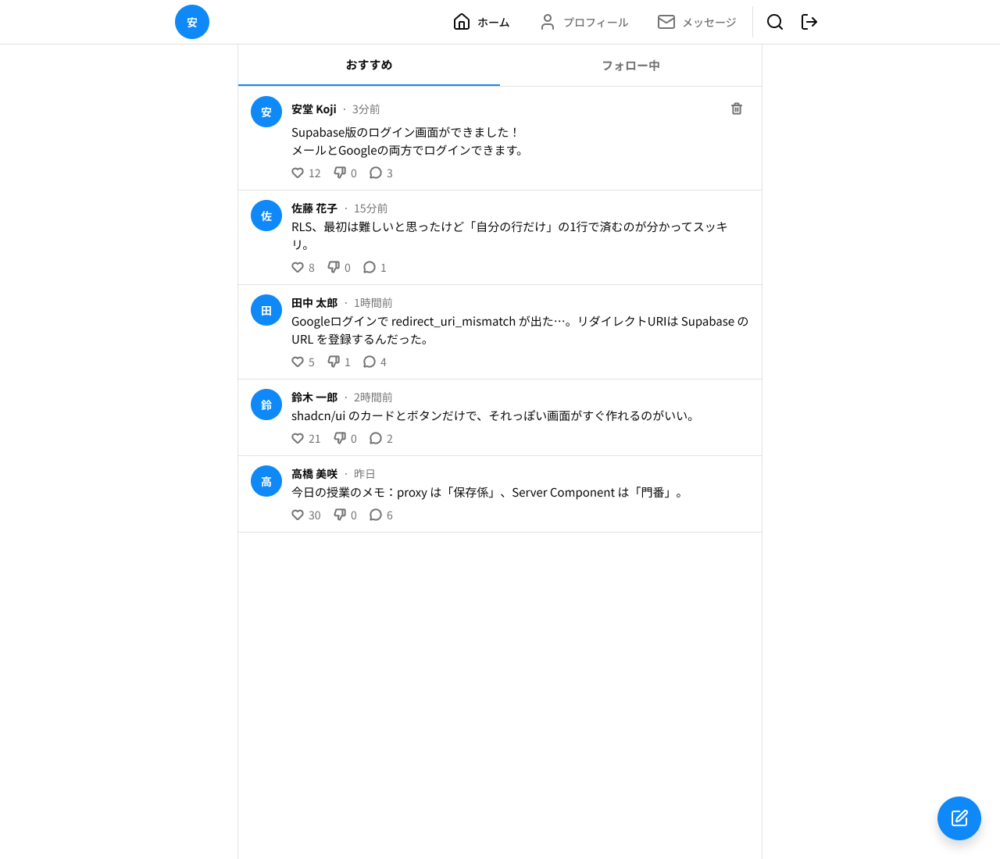
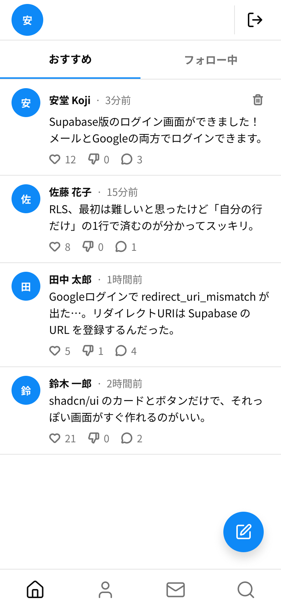
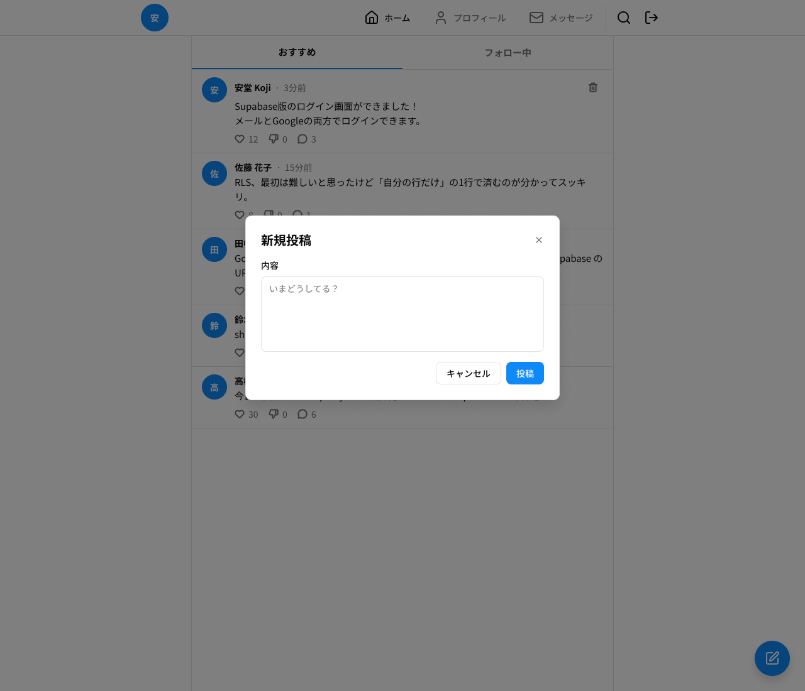

# 第1回 タイムライン画面を作る（ダミーデータ）

> 開始タグ：`lesson00-step2` → 到達タグ：`lesson01-step3`

## この回のゴール

- デザインカンプ D2（タイムライン）と M2（スマホ）を、**ダミーデータ** で再現する
- 画面を「部品（コンポーネント）」に分けて作る考え方を身につける
- `'use client'` が必要な部品と、要らない部品の違いがわかる

| パソコン（D2） | スマホ（M2） |
|---|---|
|  |  |

## 講義：画面を部品に分ける

カンプを見ながら、「繰り返し出てくるもの」「別のページでも使うもの」に線を引きます。

```text
TopPageClient（ページ全体）
├─ Header（左のナビ。スマホでは隠す）
├─ TimelineTabs（おすすめ／フォロー中）
├─ PostRow × 投稿の数
│   ├─ UserAvatar（丸いアイコン。画像がなければ頭文字）
│   └─ ReactionButtons（コメント・いいね・Bad）
├─ FloatingPostButton（右下の＋ボタン → 投稿ダイアログ）
└─ MobileNav（スマホ用の下部ナビ）
```

### ダミーデータの「形」を先に決める

`lib/dummyData.js` の投稿は、次の形をしています。**第6回で Supabase から取ってくるデータも、まったく同じ形にそろえます。** だから後でデータの取得元を差し替えても、画面のコードは変えずに済みます。

```js
{
  id: 'p1', userId: 'u2', userName: '佐藤 花子', userPhotoURL: '',
  content: '…', createdAt: '2026-…',
  likeCount: 3, badCount: 0, commentCount: 1, likedByMe: false, badByMe: false,
}
```

### `'use client'` の目安

| 書く | 書かない |
|---|---|
| `useState`・`onClick`・`usePathname` などブラウザで動く機能を使う部品 | 受け取ったデータを表示するだけの部品（`UserAvatar` など） |

---

## Step 1：ダミーデータで投稿一覧（PostRow）を表示する

- `lib/dummyData.js`：ユーザー3人と投稿・コメントのダミーデータ
- `lib/utils.js`：「3分前」のような相対時刻と、アイコン用の頭文字を作る関数を追加
- `components/UserAvatar.jsx`・`ReactionButtons.jsx`・`PostRow.jsx`：投稿1件分の部品
- `app/page.js`：ダミーの投稿を `PostRow` で並べる

#### ✏️ `app/page.js`（全体を書き換え）

```js
import { PostRow } from '@/components/PostRow';
import { dummyPosts } from '@/lib/dummyData';

// トップページ（タイムライン）。
// 第1回 Step1 では、ダミーデータを並べて表示するだけ。
export default function TopPage() {
  return (
    <main className="mx-auto min-h-screen max-w-2xl border-x">
      {dummyPosts.map((post) => (
        <PostRow key={post.id} post={post} />
      ))}
    </main>
  );
}
```

#### 📄 `components/PostRow.jsx`（新規）

```jsx
'use client';

import { useRouter } from 'next/navigation';
import { MessageCircle, Trash2 } from 'lucide-react';
import { Button } from '@/components/ui/button';
import { ReactionButtons } from '@/components/ReactionButtons';
import { UserAvatar } from '@/components/UserAvatar';
import { cn, formatRelativeTime } from '@/lib/utils';
import { DUMMY_CURRENT_USER_ID } from '@/lib/dummyData';

/**
 * 投稿1件分の表示（components/PostRow.jsx）
 *
 * props
 *   post     … 表示する投稿
 *   onClick  … 行全体を押したときの処理（渡さなければクリックできない）
 *   onDelete … 削除ボタンの処理。「渡されたときだけゴミ箱を出す」約束にしてある。
 *              誰が消せるかを判断するのは呼び出し側。
 *   onToggleLike / onToggleBad … いいね・Bad を押したときの処理
 */
export const PostRow = ({ post, onClick, onDelete, onToggleLike, onToggleBad }) => {
  const router = useRouter();
  // 第1回は「ログイン中ユーザー」をダミーの固定値にしておく（第3回でストアに置き換える）
  const isOwnPost = post.userId === DUMMY_CURRENT_USER_ID;

  const goToProfile = (e) => {
    e.stopPropagation();
    router.push(`/profile/${post.userId}`);
  };

  const handleDelete = (e) => {
    e.stopPropagation();
    onDelete?.(post.id);
  };

  return (
    <article
      onClick={onClick}
      className={cn(
        'flex gap-3 border-b px-4 py-3 transition-colors hover:bg-muted/40 md:px-6',
        onClick && 'cursor-pointer',
      )}
    >
      <button type="button" onClick={goToProfile} aria-label={`${post.userName}のプロフィール`}>
        <UserAvatar name={post.userName} photoURL={post.userPhotoURL} />
      </button>

      <div className="min-w-0 flex-1">
        <div className="flex items-center gap-1.5 text-sm">
          <span className="truncate font-bold">{post.userName}</span>
          <span className="text-muted-foreground">·</span>
          {/* 相対時間はサーバーとブラウザで数秒ずれることがあるので、差分の警告を抑える */}
          <span className="shrink-0 text-muted-foreground" suppressHydrationWarning>
            {formatRelativeTime(post.createdAt)}
          </span>
          {isOwnPost && (
            <span className="rounded-full bg-primary px-2 py-0.5 text-xs text-primary-foreground">
              あなた
            </span>
          )}
          {onDelete && (
            <Button
              variant="ghost"
              size="icon-sm"
              className="ml-auto text-muted-foreground hover:bg-destructive/10 hover:text-destructive"
              onClick={handleDelete}
              aria-label="削除"
            >
              <Trash2 className="size-4" />
            </Button>
          )}
        </div>

        <p className="mt-0.5 whitespace-pre-wrap break-words text-[15px]">{post.content}</p>

        <div className="mt-2 -ml-1.5 flex items-center gap-4">
          <ReactionButtons
            likeCount={post.likeCount}
            badCount={post.badCount}
            likedByMe={post.likedByMe}
            badByMe={post.badByMe}
            onToggleLike={onToggleLike ? () => onToggleLike(post) : undefined}
            onToggleBad={onToggleBad ? () => onToggleBad(post) : undefined}
          />
          <div className="flex items-center gap-1.5 px-1.5 py-1 text-sm text-muted-foreground">
            <MessageCircle className="size-4" />
            {post.commentCount > 0 && <span>{post.commentCount}</span>}
          </div>
        </div>
      </div>
    </article>
  );
};
```

#### 📄 `components/ReactionButtons.jsx`（新規）

```jsx
'use client';

import { Heart, ThumbsDown } from 'lucide-react';
import { cn } from '@/lib/utils';

/**
 * いいね・Bad ボタン（components/ReactionButtons.jsx）
 *
 * 表示に必要なものは props で受け取るだけにしてある。
 * 「押されたらどうするか」（onToggleLike / onToggleBad）も外から渡す。
 * → この部品はデータの置き場所（ダミー／Supabase）を知らなくてよい。
 */
export const ReactionButtons = ({
  likeCount = 0,
  badCount = 0,
  likedByMe = false,
  badByMe = false,
  onToggleLike,
  onToggleBad,
}) => {
  // 投稿行全体のクリック（詳細ページへの移動）が発火しないように止める
  const handle = (fn) => (e) => {
    e.stopPropagation();
    fn?.();
  };

  return (
    <div className="flex items-center gap-4">
      <button
        type="button"
        onClick={handle(onToggleLike)}
        aria-pressed={likedByMe}
        aria-label="いいね"
        className={cn(
          'flex items-center gap-1.5 rounded-full px-1.5 py-1 text-sm text-muted-foreground transition-colors hover:bg-pink-500/10 hover:text-pink-600',
          likedByMe && 'text-pink-600',
        )}
      >
        <Heart className={cn('size-4', likedByMe && 'fill-current')} />
        {likeCount > 0 && <span>{likeCount}</span>}
      </button>
      <button
        type="button"
        onClick={handle(onToggleBad)}
        aria-pressed={badByMe}
        aria-label="Bad"
        className={cn(
          'flex items-center gap-1.5 rounded-full px-1.5 py-1 text-sm text-muted-foreground transition-colors hover:bg-primary/10 hover:text-primary',
          badByMe && 'text-primary',
        )}
      >
        <ThumbsDown className={cn('size-4', badByMe && 'fill-current')} />
        {badCount > 0 && <span>{badCount}</span>}
      </button>
    </div>
  );
};
```

#### 📄 `components/UserAvatar.jsx`（新規）

```jsx
import { Avatar, AvatarFallback, AvatarImage } from '@/components/ui/avatar';
import { cn, getInitial } from '@/lib/utils';

/**
 * ユーザーのアイコン（components/UserAvatar.jsx）
 * 画像があれば画像を、無ければ名前の頭文字を表示する。
 * 投稿・コメント・ヘッダー・プロフィールなど、あちこちで使うので部品にしておく。
 */
export const UserAvatar = ({ name, photoURL, className, fallbackClassName }) => (
  <Avatar className={cn('size-10 shrink-0', className)}>
    {photoURL ? <AvatarImage src={photoURL} alt={name} /> : null}
    <AvatarFallback
      className={cn('bg-primary text-sm font-bold text-primary-foreground', fallbackClassName)}
    >
      {getInitial(name)}
    </AvatarFallback>
  </Avatar>
);
```

#### 📄 `lib/dummyData.js`（新規）

```js
/**
 * ダミーデータ（lib/dummyData.js）
 *
 * 第1〜3回では、データベースの代わりにこのファイルのデータで画面を作る。
 * ★データの「形」は、第6回以降に Supabase から取ってくるデータとそろえてある。
 *   だから、後で「取ってくる場所」を差し替えるだけで画面はそのまま動く。
 */

// 時刻は「今から何分前か」で作る（いつ開いても「3分前」などと表示されるように）
const minutesAgo = (min) => new Date(Date.now() - min * 60 * 1000).toISOString();

// ログイン中ユーザーの代わり（第3回でユーザーを切り替えられるようにする）
export const DUMMY_CURRENT_USER_ID = 'u1';

// ユーザー（第4回以降は Supabase の profiles テーブルになる）
export const dummyUsers = [
  {
    uid: 'u1',
    displayName: '安堂 Koji',
    email: 'koji@example.com',
    photoURL: '',
    bio: 'フロントエンドエンジニア／講師。Next.js と Supabase で授業用のSNSを作っています。',
    location: '東京',
    bannerURL: '',
  },
  {
    uid: 'u2',
    displayName: '佐藤 花子',
    email: 'hanako@example.com',
    photoURL: '',
    bio: 'Webデザイン科2年。UIを作るのが好きです。',
    location: '大阪',
    bannerURL: '',
  },
  {
    uid: 'u3',
    displayName: '田中 太郎',
    email: 'taro@example.com',
    photoURL: '',
    bio: '',
    location: '',
    bannerURL: '',
  },
  {
    uid: 'u4',
    displayName: '鈴木 一郎',
    email: 'ichiro@example.com',
    photoURL: '',
    bio: 'カメラと散歩。',
    location: '福岡',
    bannerURL: '',
  },
];

// フォロー関係（follower がフォローしている人の一覧）
export const dummyFollows = [
  { followerId: 'u1', followeeId: 'u2' },
  { followerId: 'u2', followeeId: 'u1' },
  { followerId: 'u3', followeeId: 'u1' },
];

// 投稿（第6回以降は Supabase の posts テーブル＋集計ビューになる）
//   likeCount / badCount / commentCount … 件数
//   likedByMe / badByMe                  … ログイン中の人が押しているか
export const dummyPosts = [
  {
    id: 'p1',
    userId: 'u1',
    userName: '安堂 Koji',
    userPhotoURL: '',
    content: 'Supabase版のログイン画面ができました！\nメールとGoogleの両方でログインできます。',
    createdAt: minutesAgo(3),
    likeCount: 12,
    badCount: 0,
    commentCount: 2,
    likedByMe: false,
    badByMe: false,
  },
  {
    id: 'p2',
    userId: 'u2',
    userName: '佐藤 花子',
    userPhotoURL: '',
    content: 'RLS、最初は難しいと思ったけど「自分の行だけ」の1行で済むのが分かってスッキリ。',
    createdAt: minutesAgo(15),
    likeCount: 8,
    badCount: 0,
    commentCount: 1,
    likedByMe: true,
    badByMe: false,
  },
  {
    id: 'p3',
    userId: 'u3',
    userName: '田中 太郎',
    userPhotoURL: '',
    content: 'Googleログインで redirect_uri_mismatch が出た…。リダイレクトURIは Supabase の URL を登録するんだった。',
    createdAt: minutesAgo(60),
    likeCount: 5,
    badCount: 1,
    commentCount: 0,
    likedByMe: false,
    badByMe: false,
  },
  {
    id: 'p4',
    userId: 'u4',
    userName: '鈴木 一郎',
    userPhotoURL: '',
    content: 'shadcn/ui のカードとボタンだけで、それっぽい画面がすぐ作れるのがいい。',
    createdAt: minutesAgo(120),
    likeCount: 21,
    badCount: 0,
    commentCount: 0,
    likedByMe: false,
    badByMe: false,
  },
];

// コメント（第8回以降は Supabase の comments テーブルになる）
export const dummyComments = [
  {
    id: 'c1',
    postId: 'p1',
    userId: 'u2',
    userName: '佐藤 花子',
    userPhotoURL: '',
    content: 'おつかれさまです！Googleログイン、私も試してみます。',
    createdAt: minutesAgo(2),
  },
  {
    id: 'c2',
    postId: 'p1',
    userId: 'u3',
    userName: '田中 太郎',
    userPhotoURL: '',
    content: 'リダイレクトURIの設定でつまずきました…',
    createdAt: minutesAgo(1),
  },
  {
    id: 'c3',
    postId: 'p2',
    userId: 'u1',
    userName: '安堂 Koji',
    userPhotoURL: '',
    content: 'その感覚、大事です！',
    createdAt: minutesAgo(10),
  },
];
```

#### ✏️ `lib/utils.js`（全体を書き換え）

```js
import { clsx } from 'clsx';
import { twMerge } from 'tailwind-merge';

// shadcn/ui が使う、クラス名を結合するための関数。
// cn('px-2', isActive && 'bg-primary') のように、条件付きでクラスを足せる。
export function cn(...inputs) {
  return twMerge(clsx(inputs));
}

// 相対時間の表示（例："3分前"）
// 引数は Date でも文字列（"2026-11-25T10:00:00Z" など）でもよい。
// Supabase から届く時刻は文字列なので、最初に Date に変換している。
export function formatRelativeTime(value) {
  if (!value) return '';
  const date = value instanceof Date ? value : new Date(value);
  const diffSec = Math.floor((Date.now() - date.getTime()) / 1000);
  const diffMin = Math.floor(diffSec / 60);
  const diffHour = Math.floor(diffMin / 60);
  const diffDay = Math.floor(diffHour / 24);

  if (diffSec < 60) return 'たった今';
  if (diffMin < 60) return `${diffMin}分前`;
  if (diffHour < 24) return `${diffHour}時間前`;
  if (diffDay < 7) return `${diffDay}日前`;
  return date.toLocaleDateString('ja-JP', { year: 'numeric', month: 'short', day: 'numeric' });
}

// 名前の頭文字（アバター画像が無いときに丸の中へ表示する）
export function getInitial(name) {
  return name ? name.charAt(0).toUpperCase() : '?';
}
```


✅ **動作確認**（`npm run dev`）

- トップページに投稿が並び、名前・本文・「◯分前」が表示される
- アイコン画像のない人は、名前の頭文字（例：「安」）の丸が表示される
- いいね・Bad の数が表示される（押しても、まだ何も起きなくてよい）

💾 **コミット**

```bash
git add -A
git commit -m "[第1回 Step1] ダミーデータで投稿一覧（PostRow）を表示"
```

---

## Step 2：ヘッダーとスマホ用の下部ナビを追加する

- `components/Header.jsx`：パソコンでは左に縦のナビ（ホーム・プロフィール・メッセージ）
- `components/MobileNav.jsx`：スマホ（`md` 未満）では画面下にナビ
- `components/ClientLayout.jsx`：2つのナビとページの中身を並べる「枠」。`app/layout.js` から使う
- `app/messages/page.jsx`：メッセージは第11回で作るので、リンク先だけ仮に用意

#### ✏️ `app/layout.js`（変更）

`+` の行を追加し、`-` の行を削除します。

```diff
@@ -1,3 +1,4 @@
+import { ClientLayout } from '@/components/ClientLayout';
 import './globals.css';
 
 // ここに書いた内容を、Next.js が <head> の <title> などに変換してくれる
@@ -10,7 +11,9 @@ export default function RootLayout({ children }) {
   // lang="ja"：このページは日本語だと宣言する（読み上げや翻訳の判定に使われる）
   return (
     <html lang="ja">
-      <body className="min-h-screen antialiased">{children}</body>
+      <body className="min-h-screen antialiased">
+        <ClientLayout>{children}</ClientLayout>
+      </body>
     </html>
   );
 }
```

#### 📄 `app/messages/page.jsx`（新規）

```jsx
// メッセージ（DM）ページ。第11回で作る。それまではナビのリンク先として仮置きしておく。
export default function MessagesPage() {
  return (
    <main className="mx-auto min-h-screen max-w-2xl border-x px-4 py-16 text-center text-muted-foreground">
      メッセージ機能は第11回で作ります
    </main>
  );
}
```

#### 📄 `components/ClientLayout.jsx`（新規）

```jsx
'use client';

import Header from '@/components/Header';
import { MobileNav } from '@/components/MobileNav';

/**
 * 全ページ共通の枠（components/ClientLayout.jsx）
 *
 * app/layout.js から <body> の直下に置く。どのページへ移動しても
 * マウントされたまま残るので、「アプリ全体で1回だけ行う処理」
 * （第4回のログイン状態の監視など）もここに書くことになる。
 */
export const ClientLayout = ({ children }) => {
  return (
    <>
      <Header />
      {/* pb-16 … スマホでは下部ナビに最後の投稿が隠れないよう余白をとる */}
      <div className="pb-16 md:pb-0">{children}</div>
      <MobileNav />
    </>
  );
};
```

#### 📄 `components/Header.jsx`（新規）

```jsx
'use client';

import Link from 'next/link';
import { usePathname } from 'next/navigation';
import { Home, LogOut, Mail, User } from 'lucide-react';
import { Button } from '@/components/ui/button';
import { UserAvatar } from '@/components/UserAvatar';
import { cn } from '@/lib/utils';
import { DUMMY_CURRENT_USER_ID, dummyUsers } from '@/lib/dummyData';

/**
 * 画面上部のヘッダー（components/Header.jsx）
 *
 * PC（md以上）：アイコン＋文字のナビゲーションを表示
 * スマホ　　　：ナビゲーションは画面下の MobileNav に任せ、ここには出さない
 */
export default function Header() {
  const pathname = usePathname();
  // 第1回は固定のダミーユーザー（第3回でストアに置き換える）
  const user = dummyUsers.find((u) => u.uid === DUMMY_CURRENT_USER_ID);

  const navItems = [
    { href: '/', label: 'ホーム', Icon: Home },
    { href: `/profile/${user.uid}`, label: 'プロフィール', Icon: User },
    { href: '/messages', label: 'メッセージ', Icon: Mail },
  ];

  return (
    <header className="sticky top-0 z-50 w-full border-b bg-background/80 backdrop-blur-md">
      <div className="mx-auto flex h-14 max-w-4xl items-center justify-between px-4 md:px-8">
        <Link href={`/profile/${user.uid}`} aria-label="自分のプロフィール">
          <UserAvatar name={user.displayName} photoURL={user.photoURL} className="size-11" />
        </Link>

        <nav className="flex items-center gap-1">
          {/* hidden md:flex … スマホでは隠し、md（768px）以上で横並びにする */}
          <div className="hidden items-center gap-1 md:flex">
            {navItems.map(({ href, label, Icon }) => (
              <Button
                key={href}
                asChild
                variant="ghost"
                size="lg"
                className={cn(
                  'gap-2',
                  pathname === href ? 'text-foreground' : 'text-muted-foreground',
                )}
              >
                <Link href={href}>
                  <Icon className="size-6" />
                  <span>{label}</span>
                </Link>
              </Button>
            ))}
          </div>

          <div className="ml-2 flex items-center border-l pl-2">
            {/* 第1回は見た目だけ。第4回で本物のログアウト処理をつなぐ */}
            <Button asChild variant="ghost" size="icon-lg" aria-label="ログアウト">
              <Link href="/login">
                <LogOut className="size-6" />
              </Link>
            </Button>
          </div>
        </nav>
      </div>
    </header>
  );
}
```

#### 📄 `components/MobileNav.jsx`（新規）

```jsx
'use client';

import Link from 'next/link';
import { usePathname } from 'next/navigation';
import { Home, Mail, User } from 'lucide-react';
import { cn } from '@/lib/utils';
import { DUMMY_CURRENT_USER_ID } from '@/lib/dummyData';

/**
 * スマホ用の下部ナビゲーション（components/MobileNav.jsx）
 * md:hidden … PC幅では表示しない（PCはヘッダーにナビがある）
 */
export const MobileNav = () => {
  const pathname = usePathname();
  const uid = DUMMY_CURRENT_USER_ID; // 第3回でストアに置き換える

  const items = [
    { href: '/', label: 'ホーム', Icon: Home },
    { href: `/profile/${uid}`, label: 'プロフィール', Icon: User },
    { href: '/messages', label: 'メッセージ', Icon: Mail },
  ];

  return (
    <nav className="fixed inset-x-0 bottom-0 z-50 flex border-t bg-background/95 backdrop-blur-md md:hidden">
      {items.map(({ href, label, Icon }) => (
        <Link
          key={href}
          href={href}
          aria-label={label}
          className={cn(
            'flex flex-1 items-center justify-center py-3.5',
            pathname === href ? 'text-foreground' : 'text-muted-foreground',
          )}
        >
          <Icon className="size-7" />
        </Link>
      ))}
    </nav>
  );
};
```


✅ **動作確認**

- パソコンの幅で左にナビ、スマホの幅（開発者ツールのデバイス表示）で下にナビが出る
- 今いるページのナビが濃い色になる
- 「メッセージ」を押すと「メッセージ機能は第11回で作ります」が出る

💾 **コミット**

```bash
git add -A
git commit -m "[第1回 Step2] ヘッダーとスマホ用の下部ナビを追加"
```

---

## Step 3：タブ切り替えと新規投稿ダイアログ（見た目）を追加する

- `components/TimelineTabs.jsx`：「おすすめ」「フォロー中」のタブ（フォロー中はダミーのフォロー関係で絞り込む）
- `components/FloatingPostButton.jsx`：右下の＋ボタンを押すと、shadcn/ui の `Dialog` で投稿フォームが開く（カンプ D5）
- `components/TopPageClient.jsx`：タブの状態（`useState`）を持つので Client Component。`app/page.js` はこれを表示するだけにする



#### ✏️ `app/page.js`（全体を書き換え）

```js
import { TopPageClient } from '@/components/TopPageClient';

// トップページ（タイムライン）。中身は Client Component に任せる。
export default function TopPage() {
  return <TopPageClient />;
}
```

#### 📄 `components/FloatingPostButton.jsx`（新規）

```jsx
'use client';

import { useState } from 'react';
import { PenSquare } from 'lucide-react';
import { Button } from '@/components/ui/button';
import {
  Dialog,
  DialogContent,
  DialogDescription,
  DialogFooter,
  DialogHeader,
  DialogTitle,
  DialogTrigger,
} from '@/components/ui/dialog';
import { Label } from '@/components/ui/label';

/**
 * 右下の投稿ボタンと、新規投稿ダイアログ（components/FloatingPostButton.jsx）
 *
 * onSubmit … 投稿内容（文字列）を受け取って保存する処理。
 *            第1回は渡さない（＝見た目だけ）。第3回でストアの処理を渡す。
 */
export const FloatingPostButton = ({ onSubmit }) => {
  const [open, setOpen] = useState(false);
  const [content, setContent] = useState('');
  const [isSubmitting, setIsSubmitting] = useState(false);
  const MAX = 280; // 1投稿の最大文字数（第6回でDB側にも同じ制限をかける）

  const handleSubmit = async (e) => {
    e.preventDefault();
    const text = content.trim();
    if (!text) return;
    setIsSubmitting(true);
    try {
      await onSubmit?.(text);
      setContent('');
      setOpen(false);
    } finally {
      setIsSubmitting(false);
    }
  };

  return (
    <Dialog open={open} onOpenChange={setOpen}>
      <DialogTrigger asChild>
        <Button
          aria-label="投稿する"
          className="fixed right-6 bottom-20 z-40 size-14 rounded-full shadow-lg md:bottom-6"
        >
          <PenSquare className="size-6" />
        </Button>
      </DialogTrigger>
      <DialogContent className="sm:max-w-[500px]">
        <DialogHeader>
          <DialogTitle>新規投稿</DialogTitle>
          <DialogDescription className="sr-only">投稿する内容を入力してください</DialogDescription>
        </DialogHeader>
        <form onSubmit={handleSubmit} className="space-y-4">
          <div className="space-y-2">
            <Label htmlFor="post-content">内容</Label>
            <textarea
              id="post-content"
              value={content}
              onChange={(e) => setContent(e.target.value)}
              placeholder="いまどうしてる？"
              maxLength={MAX}
              className="min-h-[120px] w-full resize-none rounded-md border border-input bg-background px-3 py-2 text-sm outline-none focus:ring-2 focus:ring-ring"
            />
            <p className="text-right text-xs text-muted-foreground">
              {content.length} / {MAX}
            </p>
          </div>
          <DialogFooter>
            <Button type="button" variant="outline" onClick={() => setOpen(false)}>
              キャンセル
            </Button>
            <Button type="submit" disabled={isSubmitting || !content.trim()}>
              {isSubmitting ? '投稿中...' : '投稿'}
            </Button>
          </DialogFooter>
        </form>
      </DialogContent>
    </Dialog>
  );
};
```

#### 📄 `components/TimelineTabs.jsx`（新規）

```jsx
'use client';

import { cn } from '@/lib/utils';

/**
 * タイムラインの「おすすめ／フォロー中」タブ（components/TimelineTabs.jsx）
 * どちらが選ばれているか（value）と、切り替えたときの処理（onChange）を外から受け取る。
 */
export const TimelineTabs = ({ value, onChange }) => {
  const tabs = [
    { key: 'public', label: 'おすすめ' },
    { key: 'following', label: 'フォロー中' },
  ];
  return (
    <div className="flex border-b">
      {tabs.map((tab) => (
        <button
          key={tab.key}
          type="button"
          onClick={() => onChange(tab.key)}
          className={cn(
            // -mb-px … 下線を親の border-b にぴったり重ねるための調整
            '-mb-px flex-1 border-b-2 py-4 text-center text-[15px] font-bold transition-colors hover:bg-muted/40',
            value === tab.key
              ? 'border-primary text-foreground'
              : 'border-transparent text-muted-foreground',
          )}
        >
          {tab.label}
        </button>
      ))}
    </div>
  );
};
```

#### 📄 `components/TopPageClient.jsx`（新規）

```jsx
'use client';

import { useState } from 'react';
import { useRouter } from 'next/navigation';
import { FloatingPostButton } from '@/components/FloatingPostButton';
import { PostRow } from '@/components/PostRow';
import { TimelineTabs } from '@/components/TimelineTabs';
import { DUMMY_CURRENT_USER_ID, dummyFollows, dummyPosts } from '@/lib/dummyData';

/**
 * トップページの中身（components/TopPageClient.jsx）
 * タブの切り替えという「状態」を持つので、Client Component にする。
 */
export const TopPageClient = () => {
  const router = useRouter();
  const [activeTab, setActiveTab] = useState('public');

  // フォロー中の人＋自分の投稿だけに絞る
  const followingIds = dummyFollows
    .filter((f) => f.followerId === DUMMY_CURRENT_USER_ID)
    .map((f) => f.followeeId);
  const visibleIds = [...followingIds, DUMMY_CURRENT_USER_ID];

  const posts =
    activeTab === 'public'
      ? dummyPosts
      : dummyPosts.filter((p) => visibleIds.includes(p.userId));

  return (
    <main className="mx-auto min-h-screen max-w-2xl border-x">
      <TimelineTabs value={activeTab} onChange={setActiveTab} />
      {posts.map((post) => (
        <PostRow key={post.id} post={post} onClick={() => router.push(`/post/${post.id}`)} />
      ))}
      <FloatingPostButton />
    </main>
  );
};
```


✅ **動作確認**

- タブを押すと下線が移動し、「フォロー中」では自分とフォロー中の人（ダミーデータ）の投稿だけになる
- ＋ボタンでダイアログが開き、文字数カウンター（◯ / 280）が動く。280文字より多くは入力できず、空のときは投稿ボタンが押せない
- 「投稿する」を押すとダイアログが閉じる（保存は第3回から）

💾 **コミット**

```bash
git add -A
git commit -m "[第1回 Step3] タイムラインのタブ切り替えと新規投稿ダイアログ（見た目）を追加"
```

---

## よくあるつまずき

| 症状 | 原因 | 対処 |
|---|---|---|
| `You're importing a component that needs useState…` | `'use client'` の書き忘れ | ファイルの1行目に `'use client';` |
| 「◯分前」がサーバーとブラウザでずれて警告が出る（Hydration） | 時刻の計算が表示のたびに変わる | 完成形と同じく Client Component の中で計算しているか確認 |
| スマホ幅で左のナビが消えない | `hidden md:flex` の書き漏れ | 差分のクラス名を確認 |

## 確認クイズ

1. ダミーデータの「形」を、後で使うデータベースの形とそろえるのはなぜ？ → 取得元を差し替えても画面のコードを変えずに済むから
2. `UserAvatar` に `'use client'` が要らないのはなぜ？ → 受け取った値を表示するだけで、状態やイベントを使わないから
