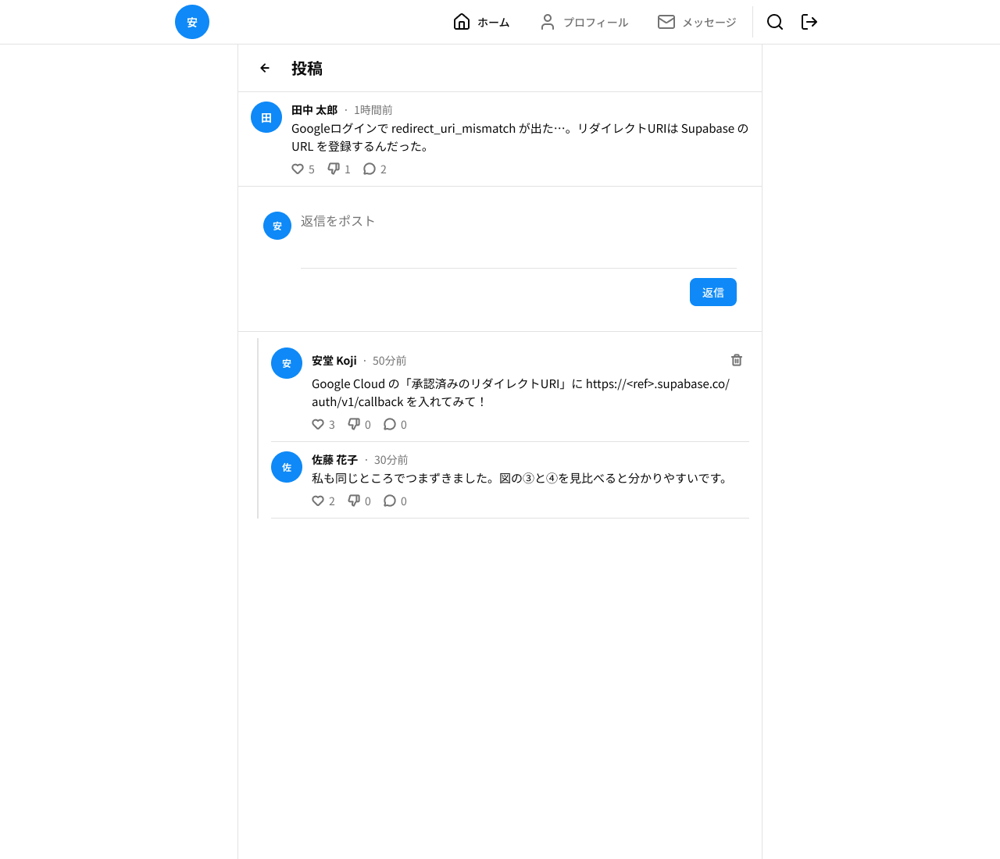
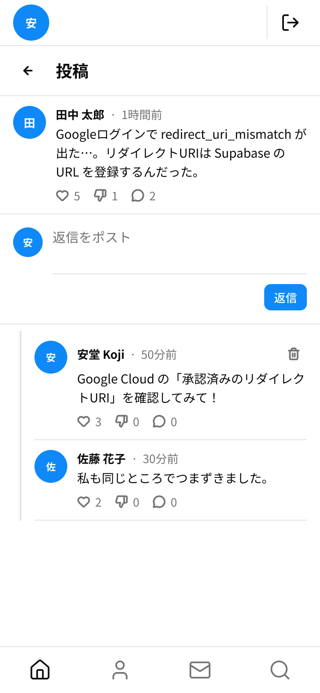
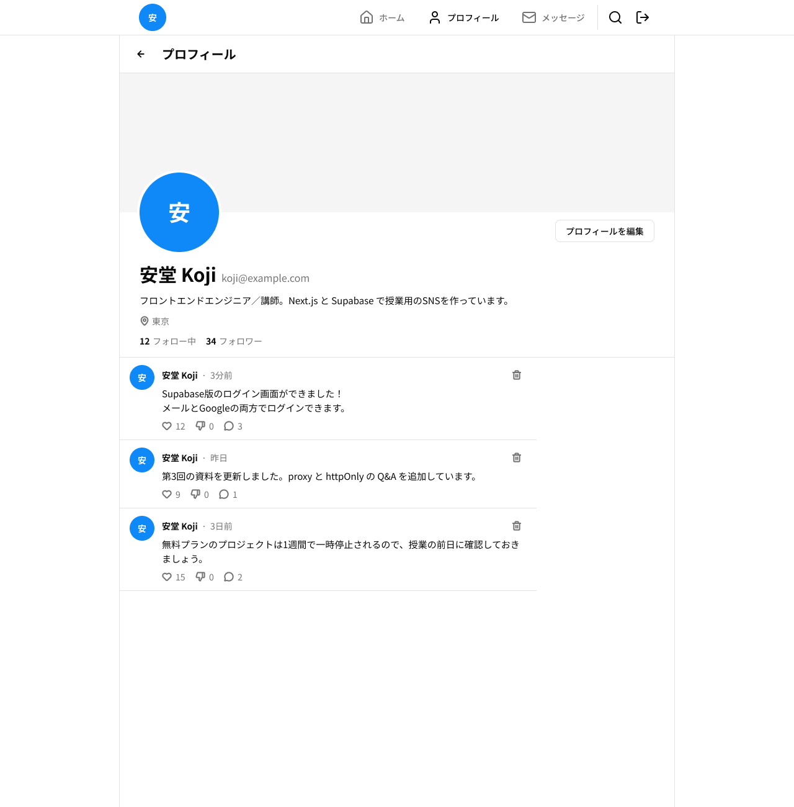
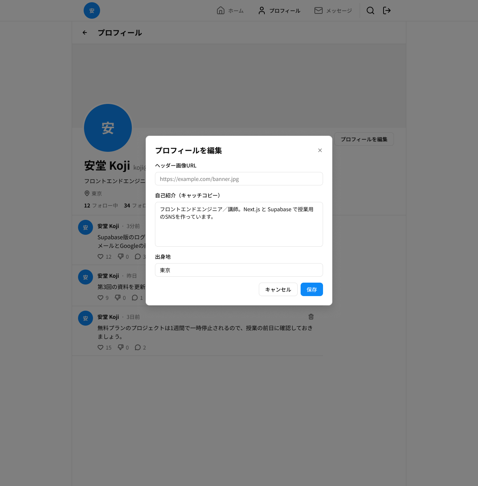
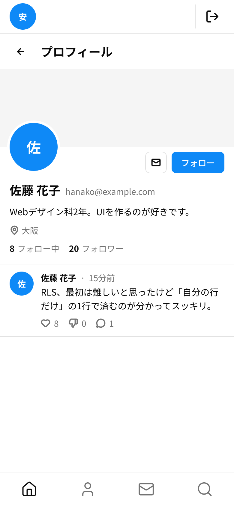
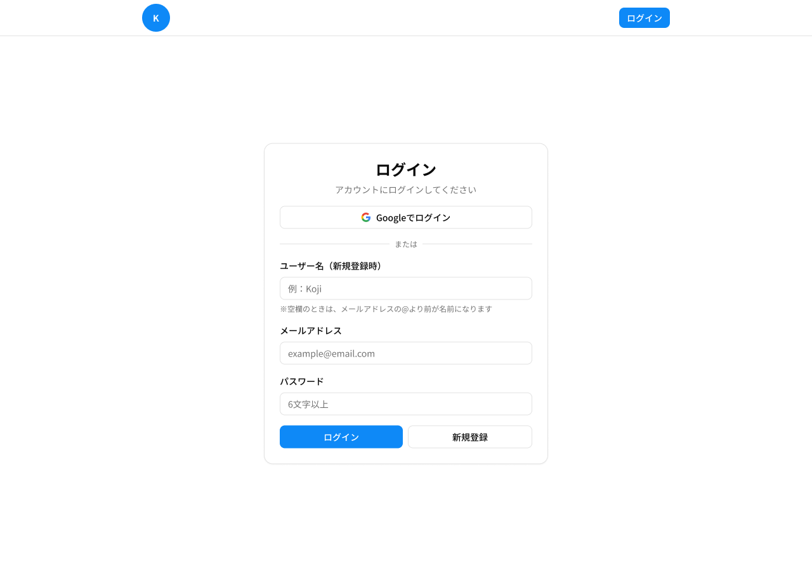
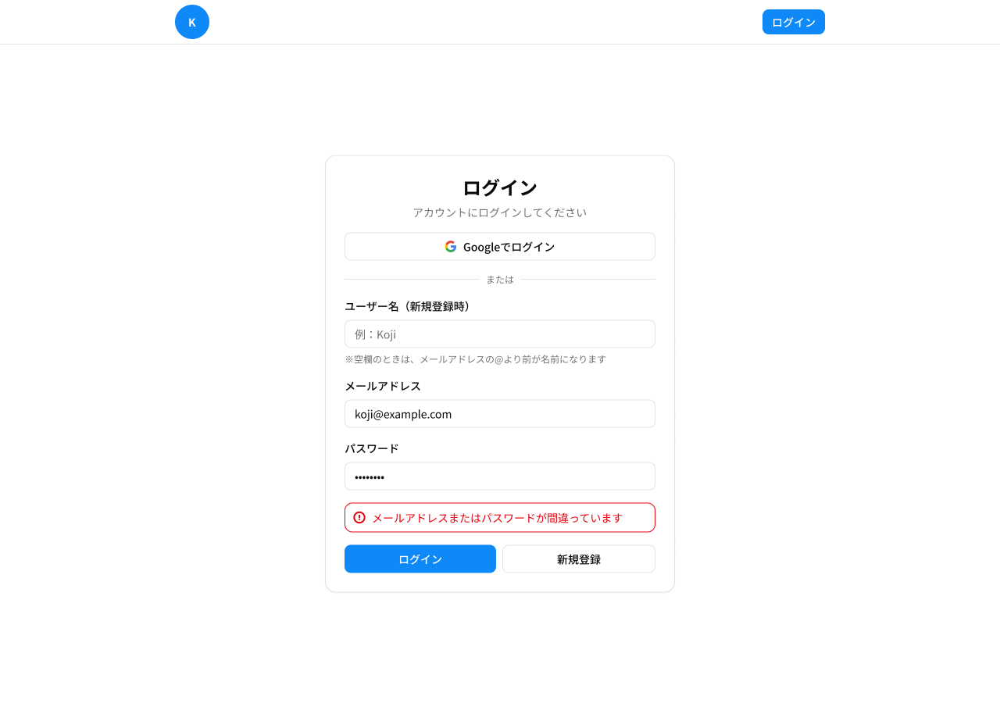
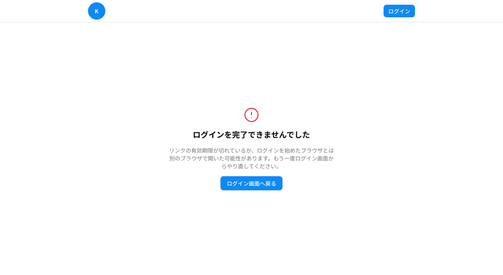
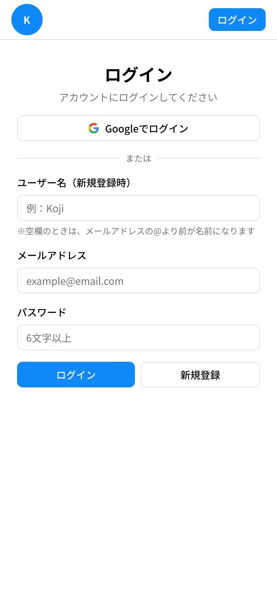

# 第2回 投稿詳細・プロフィール・ログイン画面

> 開始タグ：`lesson01-step3` → 到達タグ：`lesson02-step3`

## この回のゴール

- URL の一部を受け取る **動的ルート**（`/post/[postId]`、`/profile/[uid]`）を作れる
- Next.js 16 では `params` が **Promise** であることを理解し、`await` して使える
- 残りの画面（投稿詳細・プロフィール・ログイン・認証エラー）をカンプどおりに作り、**プロトタイプを完成** させる

## 講義：動的ルートと `params`

```text
app/post/[postId]/page.jsx   ← /post/p1 を開くと postId = 'p1'
app/profile/[uid]/page.jsx   ← /profile/u2 を開くと uid = 'u2'
```

```js
// Next.js 16 の書き方：params は Promise なので await する
export default async function PostPage({ params }) {
  const { postId } = await params;
  return <PostDetailClient postId={postId} />;
}
```

> 💡 ページ（`page.jsx`）は Server Component のまま、URL から値を取り出して Client Component に渡すだけにします。この形は最後の回まで変わりません。

---

## Step 1：投稿詳細ページ（返信フォームとコメント一覧）

| パソコン（D3） | スマホ（M3） |
|---|---|
|  |  |

- `components/PageHeader.jsx`：「← 戻る」付きの見出し（他のページでも使う）
- `components/CommentRow.jsx`・`CommentForm.jsx`：コメント1件と、返信の入力欄
- `components/PostDetailClient.jsx`：投稿本体＋返信フォーム＋コメント一覧。見つからない ID なら「投稿が見つかりません」
- `app/post/[postId]/page.jsx`：`params` から `postId` を取り出して渡す

#### 📄 `app/post/[postId]/page.jsx`（新規）

```jsx
import { PostDetailClient } from '@/components/PostDetailClient';

// /post/p1 のように開いたとき、params.postId に "p1" が入る（動的ルート）。
// Next.js 15 以降、params は Promise なので await してから使う。
export default async function PostPage({ params }) {
  const { postId } = await params;
  return <PostDetailClient postId={postId} />;
}
```

#### 📄 `components/CommentForm.jsx`（新規）

```jsx
'use client';

import { useState } from 'react';
import { Button } from '@/components/ui/button';
import { UserAvatar } from '@/components/UserAvatar';

/**
 * 返信（コメント）の入力欄（components/CommentForm.jsx）
 * onSubmit … 入力された文字列を受け取って保存する処理（第1〜2回は渡さない＝見た目だけ）
 */
export const CommentForm = ({ user, onSubmit }) => {
  const [content, setContent] = useState('');
  const [isSubmitting, setIsSubmitting] = useState(false);

  const handleSubmit = async (e) => {
    e.preventDefault();
    const text = content.trim();
    if (!text || !onSubmit) return;
    setIsSubmitting(true);
    try {
      await onSubmit(text);
      setContent('');
    } finally {
      setIsSubmitting(false);
    }
  };

  return (
    <form onSubmit={handleSubmit} className="flex gap-3 border-b p-4 md:p-6">
      <UserAvatar name={user?.displayName} photoURL={user?.photoURL} className="size-9" fallbackClassName="text-xs" />
      <div className="flex-1 space-y-2">
        <textarea
          value={content}
          onChange={(e) => setContent(e.target.value)}
          placeholder="返信をポスト"
          rows={2}
          maxLength={280}
          className="w-full resize-none border-none bg-transparent text-base outline-none placeholder:text-muted-foreground"
        />
        <div className="flex justify-end border-t pt-3">
          <Button type="submit" disabled={isSubmitting || !content.trim()}>
            {isSubmitting ? '返信中...' : '返信'}
          </Button>
        </div>
      </div>
    </form>
  );
};
```

#### 📄 `components/CommentRow.jsx`（新規）

```jsx
'use client';

import { Trash2 } from 'lucide-react';
import { Button } from '@/components/ui/button';
import { UserAvatar } from '@/components/UserAvatar';
import { formatRelativeTime } from '@/lib/utils';

/**
 * コメント1件分の表示（components/CommentRow.jsx）
 * onDelete を渡したときだけ削除ボタンを出す（PostRow と同じ約束）。
 */
export const CommentRow = ({ comment, onDelete }) => (
  <div className="flex gap-3 border-b py-3 last:border-b-0">
    <UserAvatar
      name={comment.userName}
      photoURL={comment.userPhotoURL}
      className="size-8"
      fallbackClassName="text-xs"
    />
    <div className="min-w-0 flex-1">
      <div className="flex items-center gap-1.5 text-sm">
        <span className="truncate font-bold">{comment.userName}</span>
        <span className="text-muted-foreground">·</span>
        <span className="shrink-0 text-muted-foreground" suppressHydrationWarning>
          {formatRelativeTime(comment.createdAt)}
        </span>
        {onDelete && (
          <Button
            variant="ghost"
            size="icon-sm"
            className="ml-auto text-muted-foreground hover:bg-destructive/10 hover:text-destructive"
            onClick={() => onDelete(comment.id)}
            aria-label="コメントを削除"
          >
            <Trash2 className="size-4" />
          </Button>
        )}
      </div>
      <p className="mt-0.5 whitespace-pre-wrap break-words text-[15px]">{comment.content}</p>
    </div>
  </div>
);
```

#### 📄 `components/PageHeader.jsx`（新規）

```jsx
'use client';

import { useRouter } from 'next/navigation';
import { ArrowLeft } from 'lucide-react';
import { Button } from '@/components/ui/button';

/**
 * 「← タイトル」の見出し（components/PageHeader.jsx）
 * 投稿詳細・プロフィールなど、トップ以外のページの一番上に置く。
 */
export const PageHeader = ({ title }) => {
  const router = useRouter();
  return (
    <div className="sticky top-14 z-40 flex items-center gap-4 border-b bg-background/80 px-4 py-3 backdrop-blur-md md:px-6">
      <Button variant="ghost" size="icon" onClick={() => router.back()} aria-label="戻る">
        <ArrowLeft className="size-5" />
      </Button>
      <h1 className="text-xl font-bold">{title}</h1>
    </div>
  );
};
```

#### 📄 `components/PostDetailClient.jsx`（新規）

```jsx
'use client';

import { CommentForm } from '@/components/CommentForm';
import { CommentRow } from '@/components/CommentRow';
import { PageHeader } from '@/components/PageHeader';
import { PostRow } from '@/components/PostRow';
import { DUMMY_CURRENT_USER_ID, dummyComments, dummyPosts, dummyUsers } from '@/lib/dummyData';

/**
 * 投稿詳細ページの中身（components/PostDetailClient.jsx）
 * 投稿1件＋返信フォーム＋コメント一覧
 */
export const PostDetailClient = ({ postId }) => {
  const post = dummyPosts.find((p) => p.id === postId);
  const comments = dummyComments.filter((c) => c.postId === postId);
  const me = dummyUsers.find((u) => u.uid === DUMMY_CURRENT_USER_ID);

  return (
    <main className="mx-auto min-h-screen max-w-2xl border-x">
      <PageHeader title="投稿" />
      {!post ? (
        <p className="px-4 py-16 text-center text-muted-foreground">投稿が見つかりません</p>
      ) : (
        <>
          <PostRow post={post} />
          <CommentForm user={me} />
          {comments.length === 0 ? (
            <p className="px-4 py-8 text-center text-muted-foreground">まだコメントはありません</p>
          ) : (
            // ml-6 border-l-2 … 左に縦線を引いて「この投稿への返信」だと分かるようにする
            <div className="mx-4 my-2 ml-6 border-l-2 pl-4 md:mr-6">
              {comments.map((c) => (
                <CommentRow key={c.id} comment={c} />
              ))}
            </div>
          )}
        </>
      )}
    </main>
  );
};
```


✅ **動作確認**

- タイムラインの投稿を押すと `/post/p1` などに移動し、その投稿とコメントが出る
- `/post/xxxx`（存在しない ID）を直接開くと「投稿が見つかりません」
- 「← 」で前の画面に戻れる

💾 **コミット**

```bash
git add -A
git commit -m "[第2回 Step1] 投稿詳細ページ（返信フォームとコメント一覧）を追加"
```

---

## Step 2：プロフィールページと編集ダイアログ（見た目）

| 自分のプロフィール（D4） | 編集ダイアログ（D6） |
|---|---|
|  |  |

他人のプロフィール（スマホ・M4）：



- `components/ProfileClient.jsx`：バナー・アイコン・自己紹介・場所・フォロー数・その人の投稿
  - **自分** のページなら「プロフィールを編集」、**他人** のページなら「フォロー」とメールのボタン（カンプ M4）
- `components/EditProfileDialog.jsx`：名前・バナー画像のURL・自己紹介・場所を編集するフォーム
- `app/profile/[uid]/page.jsx`

#### 📄 `app/profile/[uid]/page.jsx`（新規）

```jsx
import { ProfileClient } from '@/components/ProfileClient';

// /profile/u1 のように開いたとき、params.uid に "u1" が入る
export default async function ProfilePage({ params }) {
  const { uid } = await params;
  return <ProfileClient uid={uid} />;
}
```

#### 📄 `components/EditProfileDialog.jsx`（新規）

```jsx
'use client';

import { useState } from 'react';
import { Button } from '@/components/ui/button';
import {
  Dialog,
  DialogContent,
  DialogDescription,
  DialogFooter,
  DialogHeader,
  DialogTitle,
  DialogTrigger,
} from '@/components/ui/dialog';
import { Input } from '@/components/ui/input';
import { Label } from '@/components/ui/label';

/**
 * プロフィール編集ダイアログ（components/EditProfileDialog.jsx）
 *
 * profile  … 今のプロフィール（入力欄の初期値になる）
 * onSave   … 入力内容 { displayName, bio, location, bannerURL } を受け取って保存する処理
 *            第2回は渡さない（＝見た目だけ）
 */
export const EditProfileDialog = ({ profile, onSave }) => {
  const [open, setOpen] = useState(false);
  const [form, setForm] = useState(null);
  const [isSubmitting, setIsSubmitting] = useState(false);

  // ダイアログを開いた瞬間の値で入力欄を初期化する
  const handleOpenChange = (next) => {
    if (next) {
      setForm({
        displayName: profile.displayName ?? '',
        bio: profile.bio ?? '',
        location: profile.location ?? '',
        bannerURL: profile.bannerURL ?? '',
      });
    }
    setOpen(next);
  };

  const update = (key) => (e) => setForm({ ...form, [key]: e.target.value });

  const handleSubmit = async (e) => {
    e.preventDefault();
    setIsSubmitting(true);
    try {
      await onSave?.({ ...form, displayName: form.displayName.trim() });
      setOpen(false);
    } finally {
      setIsSubmitting(false);
    }
  };

  return (
    <Dialog open={open} onOpenChange={handleOpenChange}>
      <DialogTrigger asChild>
        <Button variant="outline" className="mt-2">
          プロフィールを編集
        </Button>
      </DialogTrigger>
      <DialogContent className="sm:max-w-[500px]">
        <DialogHeader>
          <DialogTitle>プロフィールを編集</DialogTitle>
          <DialogDescription className="sr-only">表示名や自己紹介を変更できます</DialogDescription>
        </DialogHeader>
        {form && (
          <form onSubmit={handleSubmit} className="space-y-4">
            <div className="space-y-2">
              <Label htmlFor="display-name">表示名（1〜50文字）</Label>
              <Input id="display-name" value={form.displayName} onChange={update('displayName')} maxLength={50} required />
            </div>
            <div className="space-y-2">
              <Label htmlFor="banner-url">ヘッダー画像URL</Label>
              <Input id="banner-url" type="url" value={form.bannerURL} onChange={update('bannerURL')} placeholder="https://example.com/banner.jpg" />
            </div>
            <div className="space-y-2">
              <Label htmlFor="bio">自己紹介</Label>
              <textarea
                id="bio"
                value={form.bio}
                onChange={update('bio')}
                maxLength={160}
                placeholder="自己紹介を書いてください"
                className="min-h-[90px] w-full resize-none rounded-md border border-input bg-background px-3 py-2 text-sm outline-none focus:ring-2 focus:ring-ring"
              />
            </div>
            <div className="space-y-2">
              <Label htmlFor="location">出身地</Label>
              <Input id="location" value={form.location} onChange={update('location')} placeholder="例：東京" maxLength={30} />
            </div>
            <DialogFooter>
              <Button type="button" variant="outline" onClick={() => setOpen(false)}>
                キャンセル
              </Button>
              <Button type="submit" disabled={isSubmitting}>
                {isSubmitting ? '保存中...' : '保存'}
              </Button>
            </DialogFooter>
          </form>
        )}
      </DialogContent>
    </Dialog>
  );
};
```

#### 📄 `components/ProfileClient.jsx`（新規）

```jsx
'use client';

import { useRouter } from 'next/navigation';
import { Mail, MapPin } from 'lucide-react';
import { Button } from '@/components/ui/button';
import { EditProfileDialog } from '@/components/EditProfileDialog';
import { PageHeader } from '@/components/PageHeader';
import { PostRow } from '@/components/PostRow';
import { UserAvatar } from '@/components/UserAvatar';
import { DUMMY_CURRENT_USER_ID, dummyFollows, dummyPosts, dummyUsers } from '@/lib/dummyData';

/**
 * プロフィールページの中身（components/ProfileClient.jsx）
 * ヘッダー画像・アイコン・名前・自己紹介・フォロー数と、その人の投稿一覧
 */
export const ProfileClient = ({ uid }) => {
  const router = useRouter();
  const profile = dummyUsers.find((u) => u.uid === uid);
  const posts = dummyPosts.filter((p) => p.userId === uid);
  const isMe = uid === DUMMY_CURRENT_USER_ID;
  const followingCount = dummyFollows.filter((f) => f.followerId === uid).length;
  const followerCount = dummyFollows.filter((f) => f.followeeId === uid).length;
  const isFollowing = dummyFollows.some(
    (f) => f.followerId === DUMMY_CURRENT_USER_ID && f.followeeId === uid,
  );

  if (!profile) {
    return (
      <main className="mx-auto min-h-screen max-w-4xl border-x">
        <PageHeader title="プロフィール" />
        <p className="px-4 py-16 text-center text-muted-foreground">ユーザーが見つかりません</p>
      </main>
    );
  }

  return (
    <main className="mx-auto min-h-screen max-w-4xl border-x">
      <PageHeader title="プロフィール" />

      <div className="border-b pb-4">
        {/* ヘッダー画像。URLが無ければグレーの帯にする */}
        <div
          className="h-32 bg-muted bg-cover bg-center md:h-56"
          style={profile.bannerURL ? { backgroundImage: `url(${profile.bannerURL})` } : undefined}
        />
        <div className="px-4 md:px-8">
          <div className="flex items-end justify-between gap-3">
            {/* -mt-10 … アイコンを上に持ち上げてヘッダー画像に重ねる */}
            <UserAvatar
              name={profile.displayName}
              photoURL={profile.photoURL}
              className="-mt-10 size-20 border-4 border-background bg-background md:-mt-16 md:size-32"
              fallbackClassName="text-2xl md:text-4xl"
            />
            {isMe ? (
              <EditProfileDialog profile={profile} />
            ) : (
              <div className="mt-2 flex gap-2">
                <Button variant="outline" size="icon-lg" aria-label="メッセージを送る" onClick={() => router.push('/messages')}>
                  <Mail className="size-4" />
                </Button>
                <Button variant={isFollowing ? 'outline' : 'default'} size="lg">
                  {isFollowing ? 'フォロー中' : 'フォロー'}
                </Button>
              </div>
            )}
          </div>

          <div className="mt-3 min-w-0">
            <h2 className="truncate text-xl font-bold md:text-3xl">{profile.displayName}</h2>
            {profile.bio && <p className="mt-3 whitespace-pre-wrap text-[15px]">{profile.bio}</p>}
            {profile.location && (
              <div className="mt-2 flex items-center gap-1 text-sm text-muted-foreground">
                <MapPin className="size-4" />
                {profile.location}
              </div>
            )}
            <div className="mt-3 flex gap-4 text-sm">
              <span>
                <strong>{followingCount}</strong> <span className="text-muted-foreground">フォロー中</span>
              </span>
              <span>
                <strong>{followerCount}</strong> <span className="text-muted-foreground">フォロワー</span>
              </span>
            </div>
          </div>
        </div>
      </div>

      <div className="mx-auto max-w-2xl">
        {posts.length === 0 ? (
          <p className="px-4 py-16 text-center text-muted-foreground">まだ投稿がありません</p>
        ) : (
          posts.map((post) => (
            <PostRow key={post.id} post={post} onClick={() => router.push(`/post/${post.id}`)} />
          ))
        )}
      </div>
    </main>
  );
};
```


✅ **動作確認**

- `/profile/u1`（自分）で「プロフィールを編集」が出て、ダイアログが開く
- `/profile/u2`（他人）では「フォロー」ボタンが出る
- ヘッダーのアイコンや投稿者名から、その人のプロフィールに移動できる

💾 **コミット**

```bash
git add -A
git commit -m "[第2回 Step2] プロフィールページとプロフィール編集ダイアログ（見た目）を追加"
```

---

## Step 3：ログイン画面と認証エラー画面（見た目）

| ログイン（D1） | エラー表示（D1b） | 認証エラー（D7） |
|---|---|---|
|  |  |  |

スマホ（M1）：



- `app/login/page.jsx`＋`LoginClient.jsx`：メール・パスワード・ユーザー名の入力欄と「ログイン」「新規登録」「Googleでログイン」ボタン。**まだ何もつながっていません**（第4・5回で中身を入れる）
- `components/GoogleIcon.jsx`：Google のロゴ（SVG）
- `app/auth/auth-code-error/page.jsx`：Google ログインに失敗したときに表示する画面（第5回で使う）

#### 📄 `app/auth/auth-code-error/page.jsx`（新規）

```jsx
import Link from 'next/link';
import { CircleAlert } from 'lucide-react';
import { Button } from '@/components/ui/button';

// Googleログインやメール確認に失敗したときに表示する画面（第5回で使う）
export default function AuthCodeErrorPage() {
  return (
    <main className="mx-auto flex min-h-[calc(100vh-56px)] max-w-md flex-col items-center justify-center gap-4 p-4 text-center">
      <CircleAlert className="size-10 text-destructive" />
      <h1 className="text-xl font-bold">ログインを完了できませんでした</h1>
      <p className="text-sm text-muted-foreground">
        リンクの有効期限が切れているか、ログインを始めたブラウザとは別のブラウザで開いた可能性があります。
        もう一度ログイン画面からやり直してください。
      </p>
      <Button asChild>
        <Link href="/login">ログイン画面へ戻る</Link>
      </Button>
    </main>
  );
}
```

#### 📄 `app/login/LoginClient.jsx`（新規）

```jsx
'use client';

import { useState } from 'react';
import { useRouter } from 'next/navigation';
import { Alert, AlertDescription } from '@/components/ui/alert';
import { Button } from '@/components/ui/button';
import { Card, CardContent, CardDescription, CardHeader, CardTitle } from '@/components/ui/card';
import { Input } from '@/components/ui/input';
import { Label } from '@/components/ui/label';
import { GoogleIcon } from '@/components/GoogleIcon';

/**
 * ログイン画面（app/login/LoginClient.jsx）
 *
 * 第2回は「見た目」だけ。ボタンを押すとトップへ移動するだけにしておく。
 * 第4回でメール＋パスワード、第5回で Google の本物の処理をつなぐ。
 */
export const LoginClient = () => {
  const router = useRouter();
  const [email, setEmail] = useState('');
  const [password, setPassword] = useState('');
  const [displayName, setDisplayName] = useState('');
  const [error] = useState(null);

  const handleSignIn = (e) => {
    e.preventDefault();
    router.push('/'); // 仮の動き
  };

  return (
    <div className="flex min-h-[calc(100vh-56px)] items-center justify-center p-4">
      <Card className="w-full max-w-md border-none shadow-none sm:border sm:shadow-sm">
        <CardHeader className="space-y-1">
          <CardTitle className="text-center text-2xl font-bold">ログイン</CardTitle>
          <CardDescription className="text-center">アカウントにログインしてください</CardDescription>
        </CardHeader>

        <CardContent className="space-y-4">
          <Button variant="outline" className="w-full" onClick={() => router.push('/')}>
            <GoogleIcon />
            Googleでログイン
          </Button>

          {/* 「または」の区切り線：横線の上に、背景色を敷いた文字を重ねる */}
          <div className="relative">
            <div className="absolute inset-0 flex items-center">
              <span className="w-full border-t" />
            </div>
            <div className="relative flex justify-center text-xs">
              <span className="bg-card px-2 text-muted-foreground">または</span>
            </div>
          </div>

          <form onSubmit={handleSignIn} className="space-y-4">
            <div className="space-y-2">
              <Label htmlFor="displayName">ユーザー名（新規登録時）</Label>
              <Input id="displayName" placeholder="例：Koji" value={displayName} onChange={(e) => setDisplayName(e.target.value)} />
              <p className="text-xs text-muted-foreground">※空欄のときは、メールアドレスの@より前が名前になります</p>
            </div>
            <div className="space-y-2">
              <Label htmlFor="email">メールアドレス</Label>
              <Input id="email" type="email" placeholder="example@email.com" value={email} onChange={(e) => setEmail(e.target.value)} required />
            </div>
            <div className="space-y-2">
              <Label htmlFor="password">パスワード</Label>
              <Input id="password" type="password" placeholder="6文字以上" value={password} onChange={(e) => setPassword(e.target.value)} required minLength={6} />
            </div>

            {error && (
              <Alert variant="destructive">
                <AlertDescription>{error}</AlertDescription>
              </Alert>
            )}

            <div className="flex gap-2">
              <Button type="submit" className="flex-1">
                ログイン
              </Button>
              {/* type="button" … フォーム送信（＝ログイン）を発火させない */}
              <Button type="button" variant="outline" className="flex-1" onClick={() => router.push('/')}>
                新規登録
              </Button>
            </div>
          </form>
        </CardContent>
      </Card>
    </div>
  );
};
```

#### 📄 `app/login/page.jsx`（新規）

```jsx
import { LoginClient } from './LoginClient';

export default function LoginPage() {
  return <LoginClient />;
}
```

#### 📄 `components/GoogleIcon.jsx`（新規）

```jsx
// Google のロゴ（ボタンの中に置く）
export const GoogleIcon = ({ className = 'size-4' }) => (
  <svg className={className} viewBox="0 0 24 24" aria-hidden="true">
    <path fill="#4285F4" d="M22.56 12.25c0-.78-.07-1.53-.2-2.25H12v4.26h5.92c-.26 1.37-1.04 2.53-2.21 3.31v2.77h3.57c2.08-1.92 3.28-4.74 3.28-8.09z" />
    <path fill="#34A853" d="M12 23c2.97 0 5.46-.98 7.28-2.66l-3.57-2.77c-.98.66-2.23 1.06-3.71 1.06-2.86 0-5.29-1.93-6.16-4.53H2.18v2.84C3.99 20.53 7.7 23 12 23z" />
    <path fill="#FBBC05" d="M5.84 14.09c-.22-.66-.35-1.36-.35-2.09s.13-1.43.35-2.09V7.07H2.18C1.43 8.55 1 10.22 1 12s.43 3.45 1.18 4.93l2.85-2.22.81-.62z" />
    <path fill="#EA4335" d="M12 5.38c1.62 0 3.06.56 4.21 1.64l3.15-3.15C17.45 2.09 14.97 1 12 1 7.7 1 3.99 3.47 2.18 7.07l3.66 2.84c.87-2.6 3.3-4.53 6.16-4.53z" />
  </svg>
);
```


✅ **動作確認**

- `/login` と `/auth/auth-code-error` がカンプどおりに表示される
- これで **すべての画面がそろった** ことを、カンプの一覧（README の Figma リンク）と見比べて確認する

💾 **コミット**

```bash
git add -A
git commit -m "[第2回 Step3] ログイン画面と認証エラー画面（見た目）を追加"
```

---

## よくあるつまずき

| 症状 | 原因 | 対処 |
|---|---|---|
| `params.postId` が `undefined` | Next.js 16 では `params` が Promise | `const { postId } = await params;` |
| `async` の Client Component でエラー | `'use client'` の部品は `async` にできない | `await params` はページ（Server Component）側でする |
| 編集ダイアログの入力欄が文字を受け付けない | `value` だけ指定して `onChange` が無い | 差分の `onChange` を確認 |

## 確認クイズ

1. `/profile/u2` を開いたとき、`uid` を取り出しているのはどのファイル？ → `app/profile/[uid]/page.jsx`
2. 「自分のページかどうか」は何で判断している？ → 表示中の `uid` と、ログイン中ユーザーの `uid` が同じかどうか（今はダミーの `u1`）
