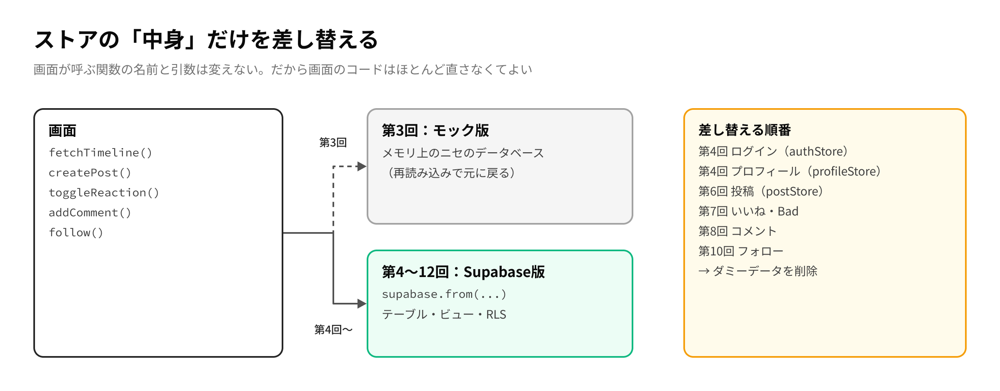

# 第3回 Zustand で「データの係」を作る（モック）

> 開始タグ：`lesson02-step3` → 到達タグ：`lesson03-step3`

## この回のゴール

- 画面（コンポーネント）と、データを読み書きする処理を **分ける** 理由がわかる
- Zustand のストアを作り、画面からは `usePostStore()` の関数を呼ぶだけにする
- ストアの中身はまだ **モック（メモリ上のニセのデータベース）**。投稿・いいね・コメント・プロフィール編集・フォローが「その場では」動くようにする

## 講義：なぜ「データの係」を分けるのか



- 画面が知っているのは **関数の名前と引数だけ**（`createPost({ content })` など）
- 第4回以降は、ストアの **中身だけ** を `supabase.from(...)` に書き換える。画面のコードはほとんど触らない
- 第3回の時点では、データはブラウザのメモリにあるだけなので **再読み込みすると元に戻ります**（それで正しい）

### Zustand の基本

```js
import { create } from 'zustand';

const useCounterStore = create((set, get) => ({
  count: 0,                                   // State（覚えておく値）
  increment: () => set({ count: get().count + 1 }), // Action（値を変える関数）
}));

// 画面側
const { count, increment } = useCounterStore();
```

- `set(...)` で値を変えると、その値を使っている画面だけが自動で描き直される
- `async` の関数も Action にできる（第4回以降、ここで Supabase を呼ぶ）

### 3つのストアと役割

| ストア | 持つもの | 第何回で本物にするか |
|---|---|---|
| `authStore` | ログイン中のユーザー | 第4回（メール）・第5回（Google） |
| `postStore` | タイムライン・投稿・いいね・コメント | 第6・7・8回 |
| `profileStore` | プロフィール・フォロー | 第4回（プロフィール）・第10回（フォロー） |
| `dmStore` | 会話・メッセージ | 第11回で新しく作る |

---

## Step 1：ログイン状態のストア（モック）と、ユーザー切り替え

```bash
npm install zustand
```

- `stores/authStore.js`：`user`（ログイン中のユーザー）と `switchUser(uid)`・`signOut()`。中身はダミーのユーザーを返すだけ
- `components/dev/DevUserSwitcher.jsx`：画面の左下に「開発用：ログイン中 ▼」を出し、別の人に切り替えられる道具。**第4回で削除します**
- これまで `DUMMY_CURRENT_USER_ID` を直接見ていた部品を、`useAuthStore()` の `user` を見るように変える

#### ✏️ `components/ClientLayout.jsx`（変更）

`+` の行を追加し、`-` の行を削除します。

```diff
@@ -2,6 +2,7 @@
 
 import Header from '@/components/Header';
 import { MobileNav } from '@/components/MobileNav';
+import { DevUserSwitcher } from '@/components/dev/DevUserSwitcher';
 
 /**
  * 全ページ共通の枠（components/ClientLayout.jsx）
@@ -17,6 +18,8 @@ export const ClientLayout = ({ children }) => {
       {/* pb-16 … スマホでは下部ナビに最後の投稿が隠れないよう余白をとる */}
       <div className="pb-16 md:pb-0">{children}</div>
       <MobileNav />
+      {/* 開発用（第4回で削除する） */}
+      <DevUserSwitcher />
     </>
   );
 };
```

#### ✏️ `components/Header.jsx`（変更）

`+` の行を追加し、`-` の行を削除します。

```diff
@@ -6,7 +6,7 @@ import { Home, LogOut, Mail, User } from 'lucide-react';
 import { Button } from '@/components/ui/button';
 import { UserAvatar } from '@/components/UserAvatar';
 import { cn } from '@/lib/utils';
-import { DUMMY_CURRENT_USER_ID, dummyUsers } from '@/lib/dummyData';
+import useAuthStore from '@/stores/authStore';
 
 /**
  * 画面上部のヘッダー（components/Header.jsx）
@@ -16,8 +16,26 @@ import { DUMMY_CURRENT_USER_ID, dummyUsers } from '@/lib/dummyData';
  */
 export default function Header() {
   const pathname = usePathname();
-  // 第1回は固定のダミーユーザー（第3回でストアに置き換える）
-  const user = dummyUsers.find((u) => u.uid === DUMMY_CURRENT_USER_ID);
+  // ログイン中のユーザーはストアから取り出す（第3回）
+  const { user, loading } = useAuthStore();
+
+  // 判定中・未ログインのときは、ロゴ代わりの丸と「ログイン」ボタンだけ出す
+  if (loading || !user) {
+    return (
+      <header className="sticky top-0 z-50 w-full border-b bg-background/80 backdrop-blur-md">
+        <div className="mx-auto flex h-14 max-w-4xl items-center justify-between px-4 md:px-8">
+          <Link href="/" className="flex size-11 items-center justify-center rounded-full bg-primary text-lg font-bold text-primary-foreground">
+            S
+          </Link>
+          {!loading && (
+            <Button asChild size="sm">
+              <Link href="/login">ログイン</Link>
+            </Button>
+          )}
+        </div>
+      </header>
+    );
+  }
 
   const navItems = [
     { href: '/', label: 'ホーム', Icon: Home },
```

#### ✏️ `components/MobileNav.jsx`（変更）

`+` の行を追加し、`-` の行を削除します。

```diff
@@ -4,7 +4,7 @@ import Link from 'next/link';
 import { usePathname } from 'next/navigation';
 import { Home, Mail, User } from 'lucide-react';
 import { cn } from '@/lib/utils';
-import { DUMMY_CURRENT_USER_ID } from '@/lib/dummyData';
+import useAuthStore from '@/stores/authStore';
 
 /**
  * スマホ用の下部ナビゲーション（components/MobileNav.jsx）
@@ -12,7 +12,9 @@ import { DUMMY_CURRENT_USER_ID } from '@/lib/dummyData';
  */
 export const MobileNav = () => {
   const pathname = usePathname();
-  const uid = DUMMY_CURRENT_USER_ID; // 第3回でストアに置き換える
+  const { user } = useAuthStore();
+  if (!user) return null; // 未ログインなら出さない
+  const uid = user.uid;
 
   const items = [
     { href: '/', label: 'ホーム', Icon: Home },
```

#### ✏️ `components/PostDetailClient.jsx`（変更）

`+` の行を追加し、`-` の行を削除します。

```diff
@@ -4,7 +4,8 @@ import { CommentForm } from '@/components/CommentForm';
 import { CommentRow } from '@/components/CommentRow';
 import { PageHeader } from '@/components/PageHeader';
 import { PostRow } from '@/components/PostRow';
-import { DUMMY_CURRENT_USER_ID, dummyComments, dummyPosts, dummyUsers } from '@/lib/dummyData';
+import { dummyComments, dummyPosts } from '@/lib/dummyData';
+import useAuthStore from '@/stores/authStore';
 
 /**
  * 投稿詳細ページの中身（components/PostDetailClient.jsx）
@@ -13,7 +14,7 @@ import { DUMMY_CURRENT_USER_ID, dummyComments, dummyPosts, dummyUsers } from '@/
 export const PostDetailClient = ({ postId }) => {
   const post = dummyPosts.find((p) => p.id === postId);
   const comments = dummyComments.filter((c) => c.postId === postId);
-  const me = dummyUsers.find((u) => u.uid === DUMMY_CURRENT_USER_ID);
+  const { user: me } = useAuthStore();
 
   return (
     <main className="mx-auto min-h-screen max-w-2xl border-x">
```

#### ✏️ `components/PostRow.jsx`（変更）

`+` の行を追加し、`-` の行を削除します。

```diff
@@ -6,7 +6,7 @@ import { Button } from '@/components/ui/button';
 import { ReactionButtons } from '@/components/ReactionButtons';
 import { UserAvatar } from '@/components/UserAvatar';
 import { cn, formatRelativeTime } from '@/lib/utils';
-import { DUMMY_CURRENT_USER_ID } from '@/lib/dummyData';
+import useAuthStore from '@/stores/authStore';
 
 /**
  * 投稿1件分の表示（components/PostRow.jsx）
@@ -20,8 +20,8 @@ import { DUMMY_CURRENT_USER_ID } from '@/lib/dummyData';
  */
 export const PostRow = ({ post, onClick, onDelete, onToggleLike, onToggleBad }) => {
   const router = useRouter();
-  // 第1回は「ログイン中ユーザー」をダミーの固定値にしておく（第3回でストアに置き換える）
-  const isOwnPost = post.userId === DUMMY_CURRENT_USER_ID;
+  const { user } = useAuthStore();
+  const isOwnPost = post.userId === user?.uid;
 
   const goToProfile = (e) => {
     e.stopPropagation();
```

#### ✏️ `components/ProfileClient.jsx`（変更）

`+` の行を追加し、`-` の行を削除します。

```diff
@@ -7,7 +7,8 @@ import { EditProfileDialog } from '@/components/EditProfileDialog';
 import { PageHeader } from '@/components/PageHeader';
 import { PostRow } from '@/components/PostRow';
 import { UserAvatar } from '@/components/UserAvatar';
-import { DUMMY_CURRENT_USER_ID, dummyFollows, dummyPosts, dummyUsers } from '@/lib/dummyData';
+import { dummyFollows, dummyPosts, dummyUsers } from '@/lib/dummyData';
+import useAuthStore from '@/stores/authStore';
 
 /**
  * プロフィールページの中身（components/ProfileClient.jsx）
@@ -15,13 +16,14 @@ import { DUMMY_CURRENT_USER_ID, dummyFollows, dummyPosts, dummyUsers } from '@/l
  */
 export const ProfileClient = ({ uid }) => {
   const router = useRouter();
+  const { user } = useAuthStore();
   const profile = dummyUsers.find((u) => u.uid === uid);
   const posts = dummyPosts.filter((p) => p.userId === uid);
-  const isMe = uid === DUMMY_CURRENT_USER_ID;
+  const isMe = uid === user?.uid;
   const followingCount = dummyFollows.filter((f) => f.followerId === uid).length;
   const followerCount = dummyFollows.filter((f) => f.followeeId === uid).length;
   const isFollowing = dummyFollows.some(
-    (f) => f.followerId === DUMMY_CURRENT_USER_ID && f.followeeId === uid,
+    (f) => f.followerId === user?.uid && f.followeeId === uid,
   );
 
   if (!profile) {
```

#### ✏️ `components/TopPageClient.jsx`（変更）

`+` の行を追加し、`-` の行を削除します。

```diff
@@ -5,7 +5,8 @@ import { useRouter } from 'next/navigation';
 import { FloatingPostButton } from '@/components/FloatingPostButton';
 import { PostRow } from '@/components/PostRow';
 import { TimelineTabs } from '@/components/TimelineTabs';
-import { DUMMY_CURRENT_USER_ID, dummyFollows, dummyPosts } from '@/lib/dummyData';
+import { dummyFollows, dummyPosts } from '@/lib/dummyData';
+import useAuthStore from '@/stores/authStore';
 
 /**
  * トップページの中身（components/TopPageClient.jsx）
@@ -14,12 +15,13 @@ import { DUMMY_CURRENT_USER_ID, dummyFollows, dummyPosts } from '@/lib/dummyData
 export const TopPageClient = () => {
   const router = useRouter();
   const [activeTab, setActiveTab] = useState('public');
+  const { user } = useAuthStore();
 
   // フォロー中の人＋自分の投稿だけに絞る
   const followingIds = dummyFollows
-    .filter((f) => f.followerId === DUMMY_CURRENT_USER_ID)
+    .filter((f) => f.followerId === user?.uid)
     .map((f) => f.followeeId);
-  const visibleIds = [...followingIds, DUMMY_CURRENT_USER_ID];
+  const visibleIds = [...followingIds, user?.uid];
 
   const posts =
     activeTab === 'public'
```

#### 📄 `components/dev/DevUserSwitcher.jsx`（新規）

```jsx
'use client';

import useAuthStore from '@/stores/authStore';
import { dummyUsers } from '@/lib/dummyData';

/**
 * 開発用：ログイン中ユーザーの切り替え（components/dev/DevUserSwitcher.jsx）
 *
 * 本物のログインを作る前に「他の人として見たらどうなるか」を確認するための道具。
 * 第4回で本物の認証に置き換えたら、このファイルは削除する。
 */
export const DevUserSwitcher = () => {
  const { user, switchUser } = useAuthStore();
  return (
    <div className="fixed bottom-20 left-4 z-50 rounded-lg border bg-background/95 p-2 text-xs shadow md:bottom-4">
      <label className="flex items-center gap-2">
        <span className="font-bold text-muted-foreground">開発用：ログイン中</span>
        <select
          value={user?.uid ?? ''}
          onChange={(e) => switchUser(e.target.value)}
          className="rounded border bg-background px-1 py-0.5"
        >
          {dummyUsers.map((u) => (
            <option key={u.uid} value={u.uid}>
              {u.displayName}
            </option>
          ))}
        </select>
      </label>
    </div>
  );
};
```

#### ✏️ `package.json`（変更）

`+` の行を追加し、`-` の行を削除します。

```diff
@@ -17,7 +17,8 @@
     "react": "19.3.0",
     "react-dom": "19.3.0",
     "tailwind-merge": "^3.7.1",
-    "tw-animate-css": "^1.4.0"
+    "tw-animate-css": "^1.4.0",
+    "zustand": "^5.1.0"
   },
   "devDependencies": {
     "@tailwindcss/turbopack": "4.3.3",
```

#### 📄 `stores/authStore.js`（新規）

```js
/**
 * ログイン状態のストア（stores/authStore.js）— 第3回：モック版
 *
 * ★このストアの「形」（user / loading / signOut など）は、第4回で Supabase の
 *   本物の認証に差し替えても変わらない。画面側は useAuthStore() を使うだけなので、
 *   中身を入れ替えても画面のコードはほとんど直さなくてよい。
 *
 * user の形：{ uid, email, displayName, photoURL }
 */
import { create } from 'zustand';
import { dummyUsers } from '@/lib/dummyData';

const toUser = (u) => (u ? { uid: u.uid, email: u.email, displayName: u.displayName, photoURL: u.photoURL } : null);

const useAuthStore = create((set) => ({
  // --- State ---
  user: toUser(dummyUsers[0]), // 最初は u1 でログインしている“ことにする”
  loading: false, // 本物の認証では「判定中」がある（第4回）。モックでは常に false

  // --- Actions ---
  // 開発用：ログイン中のユーザーを切り替える（モックにしかない機能）
  switchUser: (uid) => set({ user: toUser(dummyUsers.find((u) => u.uid === uid)) }),
  signOut: async () => {
    set({ user: null });
    return { success: true };
  },
}));

export default useAuthStore;
```


✅ **動作確認**

- 左下のセレクトで「佐藤 花子」に切り替えると、ヘッダーのアイコンや「自分のプロフィール」が花子になる
- `/profile/u2` が、花子のときは「プロフィールを編集」、安堂のときは「フォロー」になる

💾 **コミット**

```bash
git add -A
git commit -m "[第3回 Step1] Zustandでログイン状態のストア（モック）を作り、ユーザーを切り替えられるようにする"
```

---

## Step 2：投稿・いいね・コメントを postStore で読み書きする

- `stores/postStore.js`：ダミーデータをコピーした `mockDb` を持ち、次の関数を用意する
  - 読む：`fetchTimeline`・`fetchPost`・`fetchUserPosts`・`fetchComments`
  - 書く：`createPost`・`deletePost`・`toggleReaction`・`addComment`・`deleteComment`
- 画面側は `dummyPosts` を直接読むのをやめ、ストアの State（`timeline`・`currentPost`・`comments` など）を表示する

> 💡 関数がすべて `async` になっているのは、第6回で Supabase に差し替えたときに **呼び出し側を変えなくて済むように** するためです。

#### ✏️ `components/PostDetailClient.jsx`（全体を書き換え）

```jsx
'use client';

import { useEffect } from 'react';
import { useRouter } from 'next/navigation';
import { CommentForm } from '@/components/CommentForm';
import { CommentRow } from '@/components/CommentRow';
import { PageHeader } from '@/components/PageHeader';
import { PostRow } from '@/components/PostRow';
import useAuthStore from '@/stores/authStore';
import usePostStore from '@/stores/postStore';

/**
 * 投稿詳細ページの中身（components/PostDetailClient.jsx）
 * 投稿1件＋返信フォーム＋コメント一覧
 */
export const PostDetailClient = ({ postId }) => {
  const router = useRouter();
  const { user } = useAuthStore();
  const {
    currentPost: post,
    comments,
    fetchPost,
    fetchComments,
    deletePost,
    toggleReaction,
    addComment,
    deleteComment,
  } = usePostStore();

  useEffect(() => {
    fetchPost(postId, user?.uid);
    fetchComments(postId);
  }, [postId, user?.uid, fetchPost, fetchComments]);

  const handleDeletePost = async (id) => {
    await deletePost(id);
    router.replace('/'); // 消した投稿のページには居られないのでトップへ
  };

  return (
    <main className="mx-auto min-h-screen max-w-2xl border-x">
      <PageHeader title="投稿" />
      {!post || post.id !== postId ? (
        <p className="px-4 py-16 text-center text-muted-foreground">投稿が見つかりません</p>
      ) : (
        <>
          <PostRow
            post={post}
            onDelete={post.userId === user?.uid ? handleDeletePost : undefined}
            onToggleLike={user ? (p) => toggleReaction(p, 'like', user.uid) : undefined}
            onToggleBad={user ? (p) => toggleReaction(p, 'bad', user.uid) : undefined}
          />
          {user && <CommentForm user={user} onSubmit={(content) => addComment({ postId, content, user })} />}
          {comments.length === 0 ? (
            <p className="px-4 py-8 text-center text-muted-foreground">まだコメントはありません</p>
          ) : (
            <div className="mx-4 my-2 ml-6 border-l-2 pl-4 md:mr-6">
              {comments.map((c) => (
                <CommentRow
                  key={c.id}
                  comment={c}
                  onDelete={c.userId === user?.uid ? () => deleteComment(c, user.uid) : undefined}
                />
              ))}
            </div>
          )}
        </>
      )}
    </main>
  );
};
```

#### ✏️ `components/ProfileClient.jsx`（変更）

`+` の行を追加し、`-` の行を削除します。

```diff
@@ -1,5 +1,6 @@
 'use client';
 
+import { useEffect } from 'react';
 import { useRouter } from 'next/navigation';
 import { Mail, MapPin } from 'lucide-react';
 import { Button } from '@/components/ui/button';
@@ -7,8 +8,9 @@ import { EditProfileDialog } from '@/components/EditProfileDialog';
 import { PageHeader } from '@/components/PageHeader';
 import { PostRow } from '@/components/PostRow';
 import { UserAvatar } from '@/components/UserAvatar';
-import { dummyFollows, dummyPosts, dummyUsers } from '@/lib/dummyData';
+import { dummyFollows, dummyUsers } from '@/lib/dummyData';
 import useAuthStore from '@/stores/authStore';
+import usePostStore from '@/stores/postStore';
 
 /**
  * プロフィールページの中身（components/ProfileClient.jsx）
@@ -17,8 +19,13 @@ import useAuthStore from '@/stores/authStore';
 export const ProfileClient = ({ uid }) => {
   const router = useRouter();
   const { user } = useAuthStore();
+  const { userPosts: posts, fetchUserPosts, deletePost, toggleReaction } = usePostStore();
+
+  useEffect(() => {
+    fetchUserPosts(uid, user?.uid);
+  }, [uid, user?.uid, fetchUserPosts]);
+
   const profile = dummyUsers.find((u) => u.uid === uid);
-  const posts = dummyPosts.filter((p) => p.userId === uid);
   const isMe = uid === user?.uid;
   const followingCount = dummyFollows.filter((f) => f.followerId === uid).length;
   const followerCount = dummyFollows.filter((f) => f.followeeId === uid).length;
@@ -94,7 +101,14 @@ export const ProfileClient = ({ uid }) => {
           <p className="px-4 py-16 text-center text-muted-foreground">まだ投稿がありません</p>
         ) : (
           posts.map((post) => (
-            <PostRow key={post.id} post={post} onClick={() => router.push(`/post/${post.id}`)} />
+            <PostRow
+              key={post.id}
+              post={post}
+              onClick={() => router.push(`/post/${post.id}`)}
+              onDelete={post.userId === user?.uid ? deletePost : undefined}
+              onToggleLike={user ? (p) => toggleReaction(p, 'like', user.uid) : undefined}
+              onToggleBad={user ? (p) => toggleReaction(p, 'bad', user.uid) : undefined}
+            />
           ))
         )}
       </div>
```

#### ✏️ `components/TopPageClient.jsx`（全体を書き換え）

```jsx
'use client';

import { useEffect, useState } from 'react';
import { useRouter } from 'next/navigation';
import { FloatingPostButton } from '@/components/FloatingPostButton';
import { PostRow } from '@/components/PostRow';
import { TimelineTabs } from '@/components/TimelineTabs';
import { dummyFollows } from '@/lib/dummyData';
import useAuthStore from '@/stores/authStore';
import usePostStore from '@/stores/postStore';

/**
 * トップページの中身（components/TopPageClient.jsx）
 * 投稿の読み書きは postStore に任せ、ここは「表示」と「ボタンが押されたら呼ぶ」だけ。
 */
export const TopPageClient = () => {
  const router = useRouter();
  const [activeTab, setActiveTab] = useState('public');
  const { user } = useAuthStore();
  const { timeline, fetchTimeline, createPost, deletePost, toggleReaction } = usePostStore();

  // フォロー中の人＋自分（第3回 Step3 でフォローもストアに移す）
  const followingIds = dummyFollows.filter((f) => f.followerId === user?.uid).map((f) => f.followeeId);
  const userIdsKey = [...followingIds, user?.uid].join(',');

  // タブやユーザーが変わったら読み込み直す
  useEffect(() => {
    if (!user) return;
    fetchTimeline({ mode: activeTab, myUid: user.uid, userIds: userIdsKey.split(',') });
  }, [activeTab, user, userIdsKey, fetchTimeline]);

  if (!user) {
    return (
      <main className="mx-auto min-h-screen max-w-2xl border-x px-4 py-16 text-center text-muted-foreground">
        ログインしてください
      </main>
    );
  }

  return (
    <main className="mx-auto min-h-screen max-w-2xl border-x">
      <TimelineTabs value={activeTab} onChange={setActiveTab} />
      {timeline.length === 0 && (
        <p className="px-4 py-16 text-center text-muted-foreground">まだ投稿がありません</p>
      )}
      {timeline.map((post) => (
        <PostRow
          key={post.id}
          post={post}
          onClick={() => router.push(`/post/${post.id}`)}
          // 自分の投稿のときだけ削除できるようにする
          onDelete={post.userId === user.uid ? deletePost : undefined}
          onToggleLike={(p) => toggleReaction(p, 'like', user.uid)}
          onToggleBad={(p) => toggleReaction(p, 'bad', user.uid)}
        />
      ))}
      <FloatingPostButton onSubmit={(content) => createPost({ content, user })} />
    </main>
  );
};
```

#### 📄 `stores/postStore.js`（新規）

```js
/**
 * 投稿・リアクション・コメントのストア（stores/postStore.js）— 第3回：モック版
 *
 * 画面はこのストアの関数（fetchTimeline / createPost / toggleReaction …）を呼ぶだけ。
 * 第3回は、ブラウザのメモリ上にある「ニセのデータベース（mockDb）」を読み書きする。
 * 第6〜8回で中身を Supabase に差し替えるが、関数の名前と引数は変えない。
 *
 * ★ページを再読み込みすると mockDb は最初の状態に戻る（保存先がメモリだから）。
 *   「データベースが必要な理由」を体感するポイント。
 */
import { create } from 'zustand';
import { dummyComments, dummyPosts } from '@/lib/dummyData';

// ---- ニセのデータベース ----------------------------------------------------
// dummyPosts の likedByMe / badByMe は「u1 が押している」という意味にしておく
const mockDb = {
  posts: dummyPosts.map(({ likedByMe, badByMe, ...p }) => ({
    ...p,
    likeCount: p.likeCount - (likedByMe ? 1 : 0), // u1 以外の人の分
    badCount: p.badCount - (badByMe ? 1 : 0),
  })),
  reactions: dummyPosts.flatMap((p) => [
    ...(p.likedByMe ? [{ postId: p.id, userId: 'u1', kind: 'like' }] : []),
    ...(p.badByMe ? [{ postId: p.id, userId: 'u1', kind: 'bad' }] : []),
  ]),
  comments: [...dummyComments],
};
let nextId = 1000;

// 投稿に「件数」と「自分が押しているか」を付け足す（第6回以降は DB のビューが計算する）
const withCounts = (post, myUid) => {
  const rs = mockDb.reactions.filter((r) => r.postId === post.id);
  const mine = (kind) => rs.some((r) => r.userId === myUid && r.kind === kind);
  return {
    ...post,
    likeCount: post.likeCount + rs.filter((r) => r.kind === 'like').length,
    badCount: post.badCount + rs.filter((r) => r.kind === 'bad').length,
    commentCount: mockDb.comments.filter((c) => c.postId === post.id).length,
    likedByMe: mine('like'),
    badByMe: mine('bad'),
  };
};
const byNewest = (a, b) => new Date(b.createdAt) - new Date(a.createdAt);

// ---- ストア ---------------------------------------------------------------
const usePostStore = create((set, get) => ({
  // --- State ---
  timeline: [],
  timelineLoading: false,
  currentPost: null, // 投稿詳細ページで表示中の投稿
  userPosts: [], // プロフィールページで表示中の人の投稿
  comments: [], // 投稿詳細ページで表示中のコメント
  myUid: null, // 「自分が押しているか」の判定に使う

  // --- 読み込み ---
  // mode: 'public'（全員）/ 'following'（userIds に含まれる人だけ）
  fetchTimeline: async ({ mode, myUid, userIds = [] }) => {
    const posts = mockDb.posts
      .filter((p) => mode === 'public' || userIds.includes(p.userId))
      .sort(byNewest)
      .map((p) => withCounts(p, myUid));
    set({ timeline: posts, timelineLoading: false, myUid });
  },
  fetchPost: async (postId, myUid) => {
    const post = mockDb.posts.find((p) => p.id === postId);
    set({ currentPost: post ? withCounts(post, myUid) : null, myUid });
  },
  fetchUserPosts: async (uid, myUid) => {
    const posts = mockDb.posts.filter((p) => p.userId === uid).sort(byNewest).map((p) => withCounts(p, myUid));
    set({ userPosts: posts, myUid });
  },
  fetchComments: async (postId) => {
    const comments = mockDb.comments
      .filter((c) => c.postId === postId)
      .sort((a, b) => new Date(a.createdAt) - new Date(b.createdAt));
    set({ comments });
  },

  // --- 書き込み ---
  createPost: async ({ content, user }) => {
    const post = {
      id: `p${nextId++}`,
      userId: user.uid,
      userName: user.displayName, // ★名前を「コピー」して保存している（第6回で問題になる）
      userPhotoURL: user.photoURL,
      content,
      createdAt: new Date().toISOString(),
      likeCount: 0,
      badCount: 0,
    };
    mockDb.posts.push(post);
    set({ timeline: [withCounts(post, user.uid), ...get().timeline] });
  },
  deletePost: async (postId) => {
    mockDb.posts = mockDb.posts.filter((p) => p.id !== postId);
    mockDb.comments = mockDb.comments.filter((c) => c.postId !== postId); // コメントも一緒に消す
    mockDb.reactions = mockDb.reactions.filter((r) => r.postId !== postId);
    set({
      timeline: get().timeline.filter((p) => p.id !== postId),
      userPosts: get().userPosts.filter((p) => p.id !== postId),
      currentPost: get().currentPost?.id === postId ? null : get().currentPost,
    });
  },
  // kind: 'like' | 'bad'。押していなければ追加、押していれば取り消す（トグル）
  toggleReaction: async (post, kind, myUid) => {
    const exists = mockDb.reactions.some((r) => r.postId === post.id && r.userId === myUid && r.kind === kind);
    mockDb.reactions = exists
      ? mockDb.reactions.filter((r) => !(r.postId === post.id && r.userId === myUid && r.kind === kind))
      : [...mockDb.reactions, { postId: post.id, userId: myUid, kind }];
    get()._refreshPost(post.id, myUid);
  },
  addComment: async ({ postId, content, user }) => {
    mockDb.comments.push({
      id: `c${nextId++}`,
      postId,
      userId: user.uid,
      userName: user.displayName,
      userPhotoURL: user.photoURL,
      content,
      createdAt: new Date().toISOString(),
    });
    await get().fetchComments(postId);
    get()._refreshPost(postId, user.uid);
  },
  deleteComment: async (comment, myUid) => {
    mockDb.comments = mockDb.comments.filter((c) => c.id !== comment.id);
    await get().fetchComments(comment.postId);
    get()._refreshPost(comment.postId, myUid);
  },

  // 1件の投稿の表示（件数など）を、表示中のすべての一覧で最新にする
  _refreshPost: (postId, myUid) => {
    const raw = mockDb.posts.find((p) => p.id === postId);
    if (!raw) return;
    const fresh = withCounts(raw, myUid);
    const replace = (list) => list.map((p) => (p.id === postId ? fresh : p));
    set({
      timeline: replace(get().timeline),
      userPosts: replace(get().userPosts),
      currentPost: get().currentPost?.id === postId ? fresh : get().currentPost,
    });
  },
}));

export default usePostStore;
```


✅ **動作確認**

- ＋ボタンから投稿すると、タイムラインの一番上に出る
- いいね・Bad を押すと数が増減し、もう一度押すと取り消せる（いいねと Bad は別々に数える）
- 投稿詳細で返信すると、コメント一覧とコメント数が増える
- 自分の投稿だけに削除ボタンが出る
- ブラウザを再読み込みすると元に戻る（モックなので正しい動き）

💾 **コミット**

```bash
git add -A
git commit -m "[第3回 Step2] 投稿・いいね・コメントをストア（postStore）で読み書きする"
```

---

## Step 3：プロフィール編集とフォローを profileStore で扱う

- `stores/profileStore.js`：`profiles`（uid ごとのプロフィール）・`followingIds`・`followCounts` と、`fetchProfile`・`updateProfile`・`follow`・`unfollow` など
- `components/FollowButton.jsx`：フォロー／フォロー中を切り替えるボタン（マウスを乗せると「フォロー解除」）
- タイムラインの「フォロー中」タブも、`followingIds` を使って絞り込むようにする

#### 📄 `components/FollowButton.jsx`（新規）

```jsx
'use client';

import { useState } from 'react';
import { Button } from '@/components/ui/button';

/**
 * フォロー／フォロー中ボタン（components/FollowButton.jsx）
 * 「フォロー中」の上にマウスを乗せると「フォロー解除」と表示する（よくあるSNSの作法）
 */
export const FollowButton = ({ isFollowing, onFollow, onUnfollow }) => {
  const [hover, setHover] = useState(false);
  const [busy, setBusy] = useState(false);

  const handleClick = async () => {
    setBusy(true);
    try {
      await (isFollowing ? onUnfollow() : onFollow());
    } finally {
      setBusy(false);
    }
  };

  return (
    <Button
      size="lg"
      variant={isFollowing ? 'outline' : 'default'}
      disabled={busy}
      onClick={handleClick}
      onMouseEnter={() => setHover(true)}
      onMouseLeave={() => setHover(false)}
      className={isFollowing && hover ? 'border-destructive/50 text-destructive' : undefined}
    >
      {isFollowing ? (hover ? 'フォロー解除' : 'フォロー中') : 'フォロー'}
    </Button>
  );
};
```

#### ✏️ `components/ProfileClient.jsx`（変更）

`+` の行を追加し、`-` の行を削除します。

```diff
@@ -4,13 +4,14 @@ import { useEffect } from 'react';
 import { useRouter } from 'next/navigation';
 import { Mail, MapPin } from 'lucide-react';
 import { Button } from '@/components/ui/button';
+import { FollowButton } from '@/components/FollowButton';
 import { EditProfileDialog } from '@/components/EditProfileDialog';
 import { PageHeader } from '@/components/PageHeader';
 import { PostRow } from '@/components/PostRow';
 import { UserAvatar } from '@/components/UserAvatar';
-import { dummyFollows, dummyUsers } from '@/lib/dummyData';
 import useAuthStore from '@/stores/authStore';
 import usePostStore from '@/stores/postStore';
+import useProfileStore from '@/stores/profileStore';
 
 /**
  * プロフィールページの中身（components/ProfileClient.jsx）
@@ -21,18 +22,30 @@ export const ProfileClient = ({ uid }) => {
   const { user } = useAuthStore();
   const { userPosts: posts, fetchUserPosts, deletePost, toggleReaction } = usePostStore();
 
+  const { profiles, followingIds, followCounts, fetchProfile, fetchFollowCounts, fetchMyFollowing, updateProfile, follow, unfollow } =
+    useProfileStore();
+
   useEffect(() => {
     fetchUserPosts(uid, user?.uid);
-  }, [uid, user?.uid, fetchUserPosts]);
+    fetchProfile(uid);
+    fetchFollowCounts(uid);
+    if (user) fetchMyFollowing(user.uid);
+  }, [uid, user, fetchUserPosts, fetchProfile, fetchFollowCounts, fetchMyFollowing]);
 
-  const profile = dummyUsers.find((u) => u.uid === uid);
+  const profile = profiles[uid];
   const isMe = uid === user?.uid;
-  const followingCount = dummyFollows.filter((f) => f.followerId === uid).length;
-  const followerCount = dummyFollows.filter((f) => f.followeeId === uid).length;
-  const isFollowing = dummyFollows.some(
-    (f) => f.followerId === user?.uid && f.followeeId === uid,
-  );
+  const { following: followingCount = 0, followers: followerCount = 0 } = followCounts[uid] ?? {};
+  const isFollowing = followingIds.includes(uid);
 
+  // undefined … まだ読み込み中 ／ null … 見つからなかった
+  if (profile === undefined) {
+    return (
+      <main className="mx-auto min-h-screen max-w-4xl border-x">
+        <PageHeader title="プロフィール" />
+        <p className="px-4 py-16 text-center text-muted-foreground">読み込み中...</p>
+      </main>
+    );
+  }
   if (!profile) {
     return (
       <main className="mx-auto min-h-screen max-w-4xl border-x">
@@ -62,15 +75,17 @@ export const ProfileClient = ({ uid }) => {
               fallbackClassName="text-2xl md:text-4xl"
             />
             {isMe ? (
-              <EditProfileDialog profile={profile} />
+              <EditProfileDialog profile={profile} onSave={(data) => updateProfile(uid, data)} />
             ) : (
               <div className="mt-2 flex gap-2">
                 <Button variant="outline" size="icon-lg" aria-label="メッセージを送る" onClick={() => router.push('/messages')}>
                   <Mail className="size-4" />
                 </Button>
-                <Button variant={isFollowing ? 'outline' : 'default'} size="lg">
-                  {isFollowing ? 'フォロー中' : 'フォロー'}
-                </Button>
+                <FollowButton
+                  isFollowing={isFollowing}
+                  onFollow={() => follow(user.uid, uid)}
+                  onUnfollow={() => unfollow(user.uid, uid)}
+                />
               </div>
             )}
           </div>
```

#### ✏️ `components/TopPageClient.jsx`（変更）

`+` の行を追加し、`-` の行を削除します。

```diff
@@ -5,9 +5,9 @@ import { useRouter } from 'next/navigation';
 import { FloatingPostButton } from '@/components/FloatingPostButton';
 import { PostRow } from '@/components/PostRow';
 import { TimelineTabs } from '@/components/TimelineTabs';
-import { dummyFollows } from '@/lib/dummyData';
 import useAuthStore from '@/stores/authStore';
 import usePostStore from '@/stores/postStore';
+import useProfileStore from '@/stores/profileStore';
 
 /**
  * トップページの中身（components/TopPageClient.jsx）
@@ -19,8 +19,14 @@ export const TopPageClient = () => {
   const { user } = useAuthStore();
   const { timeline, fetchTimeline, createPost, deletePost, toggleReaction } = usePostStore();
 
-  // フォロー中の人＋自分（第3回 Step3 でフォローもストアに移す）
-  const followingIds = dummyFollows.filter((f) => f.followerId === user?.uid).map((f) => f.followeeId);
+  const { followingIds, fetchMyFollowing } = useProfileStore();
+
+  // ログイン中の人がフォローしている人の一覧を読む
+  useEffect(() => {
+    if (user) fetchMyFollowing(user.uid);
+  }, [user, fetchMyFollowing]);
+
+  // フォロー中の人＋自分
   const userIdsKey = [...followingIds, user?.uid].join(',');
 
   // タブやユーザーが変わったら読み込み直す
```

#### 📄 `stores/profileStore.js`（新規）

```js
/**
 * プロフィールとフォローのストア（stores/profileStore.js）— 第3回：モック版
 *
 * postStore と同じく、第3回はメモリ上のニセのデータベースを読み書きする。
 * 第10回で Supabase（profiles / follows テーブル）に差し替える。
 *
 * profile の形：{ uid, displayName, photoURL, bio, location, bannerURL }
 */
import { create } from 'zustand';
import { dummyFollows, dummyUsers } from '@/lib/dummyData';

const mockDb = {
  profiles: dummyUsers.map(({ email, ...p }) => ({ ...p })), // email は公開しないので外す
  follows: [...dummyFollows],
};

const useProfileStore = create((set, get) => ({
  // --- State ---
  profiles: {}, // { [uid]: profile } 一度読んだプロフィールを覚えておく
  followingIds: [], // 自分がフォローしている人の uid 一覧
  followCounts: {}, // { [uid]: { following, followers } }

  // --- 読み込み ---
  fetchProfile: async (uid) => {
    const profile = mockDb.profiles.find((p) => p.uid === uid) ?? null;
    set({ profiles: { ...get().profiles, [uid]: profile } });
    return profile;
  },
  fetchMyFollowing: async (myUid) => {
    set({ followingIds: mockDb.follows.filter((f) => f.followerId === myUid).map((f) => f.followeeId) });
  },
  fetchFollowCounts: async (uid) => {
    const counts = {
      following: mockDb.follows.filter((f) => f.followerId === uid).length,
      followers: mockDb.follows.filter((f) => f.followeeId === uid).length,
    };
    set({ followCounts: { ...get().followCounts, [uid]: counts } });
  },

  // --- 書き込み ---
  updateProfile: async (uid, data) => {
    mockDb.profiles = mockDb.profiles.map((p) => (p.uid === uid ? { ...p, ...data } : p));
    await get().fetchProfile(uid);
  },
  follow: async (myUid, targetUid) => {
    if (myUid === targetUid) return; // 自分はフォローできない
    mockDb.follows.push({ followerId: myUid, followeeId: targetUid });
    await Promise.all([get().fetchMyFollowing(myUid), get().fetchFollowCounts(targetUid)]);
  },
  unfollow: async (myUid, targetUid) => {
    mockDb.follows = mockDb.follows.filter((f) => !(f.followerId === myUid && f.followeeId === targetUid));
    await Promise.all([get().fetchMyFollowing(myUid), get().fetchFollowCounts(targetUid)]);
  },
}));

export default useProfileStore;
```


✅ **動作確認**

- プロフィール編集で名前を変えると、プロフィールに反映される
- 他人のページで「フォロー」を押すとフォロワー数が増え、「フォロー中」タブにその人の投稿が出る
- ユーザーを切り替えて、別の人の立場からも確認する

💾 **コミット**

```bash
git add -A
git commit -m "[第3回 Step3] プロフィール編集とフォローをストア（profileStore）で扱う"
```

---

## ここまでで「プロトタイプ」が完成

第0〜3回で、**データベース無しでアプリ全体の動きを確認できる** 状態になりました。
デザインや画面遷移の修正は、この段階で済ませておくのがコツです（データベースを作った後の修正は手間が増えるため）。

## よくあるつまずき

| 症状 | 原因 | 対処 |
|---|---|---|
| `Module not found: Can't resolve 'zustand'` | インストール忘れ | `npm install zustand` |
| ストアの値を変えたのに画面が変わらない | `set` を使わずにオブジェクトを直接書き換えた | 新しい配列・オブジェクトを作って `set` する（差分の `map`・`filter` の書き方を参照） |
| 無限ループ（`Maximum update depth exceeded`） | `useEffect` の依存配列に、毎回作り直される値を入れた | 依存配列は完成形と同じにする |

## 確認クイズ

1. 第6回で投稿をデータベースに保存するとき、`FloatingPostButton.jsx` は書き換える必要がある？ → ほぼ不要。`createPost()` の中身（ストア）だけを変える
2. モックの関数をわざわざ `async` にしたのはなぜ？ → 後で Supabase（通信が必要＝非同期）に差し替えても、呼び出し側を変えずに済むから
