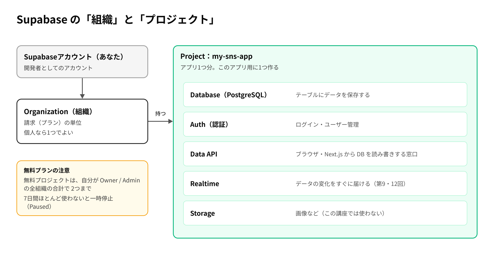
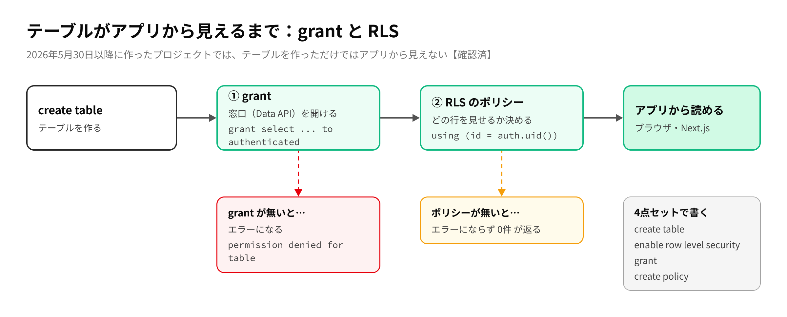

# 事前課題：Supabase と Google Cloud の準備

> 第4回（認証①）までに済ませてください。第0〜3回はデータベースを使わないので、それまでに少しずつ進めておけば大丈夫です。所要時間の目安：Supabase 20〜30分＋Google Cloud 20〜30分
> ※ 画面の項目名やボタンの位置は、サービス側の更新で変わることがあります。見つからないときは無理に進めず、スクリーンショットを撮って授業で質問してください。

凡例：【確認済】=公式ドキュメントで確認した事実／【推測】=見立て（画面の表記など）／【未確認】=要検証

---

## 0. はじめに：これから何を作るのか

### Supabase の「組織」と「プロジェクト」



- 組織が「請求の単位」、プロジェクトが「アプリ1つ分」です【確認済】
- **このアプリ用にプロジェクトを1つ**作ります

### 無料プランで必ず知っておくこと【確認済】

| ルール | 内容 | 授業への影響 |
|---|---|---|
| 無料プロジェクトは **2つまで** | 自分が Owner / Admin になっている**すべての組織の合計**で2つ。一時停止中のプロジェクトは数えない | 過去に2つ作っている人は、新しく作れない → 「2-1. 作れないとき」へ |
| **1週間使わないと一時停止** | DBへのアクセスが少ない状態が7日続くと、自動で一時停止（Paused）される | **週1回の授業だと、次の授業までに止まっている可能性が高い** |
| 止まったら | ダッシュボードで「Resume project」を押せば再開できる | **授業の前日までに再開しておく**（再開には数分かかる）【推測】 |

### この事前課題で集める値（メモ帳を1つ開いておく）

| # | 値 | 例 | 秘密？ |
|---|---|---|---|
| A | Project URL | `https://abcdefghijkl.supabase.co` | 公開してよい |
| B | Publishable key | `sb_publishable_xxxx…` | 公開してよい（ブラウザに配られる前提の鍵） |
| P | Database Password | ランダムな長い文字列 | **秘密**（この講座では使わないが、なくすと再設定が必要） |
| C | Google用 Callback URL | `https://abcdefghijkl.supabase.co/auth/v1/callback` | 公開してよい |
| D | Google クライアントID | `1234…apps.googleusercontent.com` | 公開してよい |
| E | Google クライアントシークレット | `GOCSPX-…` | **秘密** |

> ⚠ **秘密の値（P・E、それと後で出てくる `sb_secret_…`）は、Slack・LINE・GitHub・スクリーンショットに載せないこと。**

---

## Part 1：Supabase アカウントを作る（5分）

- [ ] 1-1. https://supabase.com を開き、右上の **Start your project**（または Sign up）を押す【推測：ボタン名】
- [ ] 1-2. サインアップ方法を選ぶ
  - **おすすめ：Continue with GitHub**
    - 後の回で Vercel に公開するときも GitHub を使うので、アカウントがまとまる
    - パスワードを新しく覚えなくてよい
  - メールアドレスで登録する場合：確認メールが届くので、**メール内のリンクを押すまで登録は終わらない**
    - 届かないときは迷惑メールフォルダを確認
- [ ] 1-3. ログイン後、ダッシュボード（https://supabase.com/dashboard）が開けばOK

> 💡 **Supabase アカウントと、これから作るアプリの「ユーザー」は別物です。**
> 今作ったのは「開発者としてのアカウント」。アプリにログインする人（受講者がテスト登録する人）は、第4回以降、プロジェクトの中の **Authentication → Users** に溜まっていきます。

---

## Part 2：Organization（組織）を作る（3分）

初めてログインすると、組織の作成画面が出ます（既に組織がある人は 2-1 の確認だけでOK）。

- [ ] 2-1. 次のように入力して作成する【推測：項目名】

| 項目 | 入力する値 | 補足 |
|---|---|---|
| Name | `自分の名前` または `my-school` など | 後から変更できる |
| Type | Personal（個人）／Educational（教育）など | どれを選んでも機能は同じ【推測】 |
| Plan | **Free（$0/month）** | ⚠ Pro を選ぶとクレジットカードの登録と課金が発生する |

### 2-1. 「プロジェクトを作れない」と言われたとき

無料プロジェクトの上限（**全組織の合計で2つ**）に達しています【確認済】。どちらかで対応します。

1. 使っていない古いプロジェクトを **Pause（一時停止）** する → 上限の数から外れる
2. 使っていない古いプロジェクトを **削除** する（⚠ データは戻らない）

---

## Part 3：Project（プロジェクト）を作る（5分＋待ち時間）

- [ ] 3-1. ダッシュボードで **New project** を押す
- [ ] 3-2. 次のように入力する

| 項目 | 入力する値 | 補足 |
|---|---|---|
| Organization | Part 2 で作った組織 | |
| Project name | `my-sns-app` | 後から変更できる。URLには使われない |
| Database Password | **Generate a password** を押して自動生成 → **Copy** してメモ帳の **P** に保存 | この講座では使わないが、後から表示できない（再設定は可能）【推測】 |
| Region | **Northeast Asia (Tokyo)** | ⚠ **後から変更できない**【推測】。日本から使うので東京を選ぶ。遠い地域だと動作が遅くなる |
| Compute size | 無料プランの既定のまま | 変更しない |

- [ ] 3-3. **Security（セキュリティ）の設定** を確認する ← ★ここが一番大事

画面に次のようなチェック項目が並んでいます【推測：表記・並び順】。**この講座では下の表のとおりにしてください。**

| 項目 | 設定 | 理由 |
|---|---|---|
| **Enable Data API** | ✅ **ON** | OFFにすると、Next.js から `supabase.from('profiles')` でDBを読み書きできなくなる |
| **Automatically expose new tables**（新しいテーブルを自動で公開） | ⬜ **OFF のまま（既定）** | 2026年5月30日以降、新しいプロジェクトではOFFが既定【確認済】。この講座では、テーブルごとに `grant` 文で「公開する」と明示する方法で進める（下の解説） |
| **Enable automatic RLS**（自動RLS） | 表示されていれば ✅ ON | テーブルを作った瞬間にRLSを有効にする仕組み。表示されない場合もある【未確認】 |

- [ ] 3-4. **Create new project** を押す
- [ ] 3-5. 「Setting up project…」の表示が消えるまで待つ（数分）【確認済：数分かかる】
  - この間に Part 6（Google Cloud）を進めてもよい

### 解説：「Automatically expose new tables」が OFF だと何が起きるのか

Supabase では、**テーブルを作っただけでは、ブラウザや Next.js から見えません**（新しいプロジェクトの既定）【確認済】。



- ①が無いと：`permission denied for table profiles` というエラーになる
- ②が無いと（RLSは有効、ポリシーなし）：エラーにはならず **0件** が返る

第4回以降に実行するSQL（`supabase/migrations/`）には、①と②の両方が入っています。**エラーと0件の違いで「どちらが足りないか」が分かる**ので、覚えておきましょう。

---

## Part 4：URL と API キーを控える（5分）

プロジェクトの準備が終わったら、アプリから接続するための値を2つ控えます。

- [ ] 4-1. プロジェクトの画面上部にある **Connect** ボタンを押す【確認済：Connect ダイアログから取得できる】
  - または左下の歯車 **Project Settings → API Keys** を開く
- [ ] 4-2. **Project URL** をコピーして、メモ帳の **A** に保存
  - 形式：`https://<20文字ほどの英小文字>.supabase.co`
  - この英小文字の部分を **Project Ref（プロジェクトID）** と呼ぶ。Google の設定でも出てくる
- [ ] 4-3. **Publishable key** をコピーして、メモ帳の **B** に保存
  - 形式：`sb_publishable_` で始まる

### API キーの見分け方【確認済】

| キー | 形式 | 使う場所 | 権限 |
|---|---|---|---|
| **Publishable key** ✅ | `sb_publishable_…` | ブラウザ・Next.js（**この講座で使うのはこれだけ**） | 低い。RLS のルールどおりにしか読み書きできない |
| Secret key ⚠ | `sb_secret_…` | サーバーの管理処理だけ | **RLS を素通りする**。漏れたら全データを読み書きされる |
| anon key（旧） | `eyJ…` で始まる長い文字列 | 古い教材・記事 | Publishable key と同等。2026年末までに廃止予定 |
| service_role key（旧） | `eyJ…` で始まる長い文字列 | 古い教材・記事 | Secret key と同等。2026年末までに廃止予定 |

> 💡 ネットの記事で `NEXT_PUBLIC_SUPABASE_ANON_KEY` と書かれていたら、それは古い書き方です。この講座では `NEXT_PUBLIC_SUPABASE_PUBLISHABLE_KEY` に Publishable key を入れます。
> 「Legacy API keys」のタブに anon / service_role が表示されていても使いません。

---

## Part 5：ダッシュボードの見取り図と、認証の初期設定（10分）

### 5-1. 左メニューのうち、この講座で使うもの【推測：表記】

| メニュー | 何をする場所か | 使う回 |
|---|---|---|
| **Table Editor** | テーブルの中身を表で見る・編集する | 第4回〜 |
| **SQL Editor** | SQLを書いて実行する | 第4回〜 |
| **Authentication** | ユーザー一覧・ログイン方法・URL設定 | 第4・5回 |
| **Database** | テーブル定義・ポリシー・トリガー・Publication（Realtime）の確認 | 第4回〜 |
| **Logs** | エラーの記録 | 困ったとき |
| **Advisors**（Security / Performance） | RLSの付け忘れなどを自動で指摘 | 毎回の最後 |
| **Project Settings** | API キー、プロジェクトの一時停止など | 最初だけ |

### 5-2. メール認証の設定

- [ ] 5-2-1. **Authentication → Sign In / Providers → Email** が有効（Enabled）になっていることを確認
- [ ] 5-2-2. 同じ画面の **Confirm email を OFF** にして保存

> **なぜ OFF にするのか**【確認済】
> Supabase 標準のメール送信は、**プロジェクトのメンバー（＝自分）以外のアドレスには届かず**、送信できる数もごくわずかです（エラー：`Email address not authorized`、`over_email_send_rate_limit`）。
> 授業ではテスト用のアカウントをいくつも作るので、確認メールなしで登録できるようにします。

### 5-3. URL の設定

- [ ] 5-3-1. **Authentication → URL Configuration** を開く
- [ ] 5-3-2. **Site URL** を `http://localhost:3000` にして保存
- [ ] 5-3-3. **Redirect URLs** の **Add URL** で `http://localhost:3000/**` を追加して保存
  - `/**` は「その下のすべてのページ」という意味。第5回で作る `/auth/callback` に戻ってこられるようにする

### 5-4. 動作確認（SQL Editor に慣れる）

- [ ] 5-4-1. **SQL Editor** を開き、次の1行を入力して **Run**（または `Ctrl/Cmd + Enter`）

```sql
select now() as 現在時刻, current_user as 実行ユーザー;
```

- [ ] 5-4-2. 下に結果の表が出ればOK（時刻は UTC＝日本時間の9時間前で表示される）

> 💡 SQL Editor は **管理者（postgres）として** 実行されるので、RLS を無視してすべての行が見えます。
> 「SQL Editor では見えるのに、アプリからは見えない」は RLS か grant が原因です（第4回で体験します）。

---

## Part 6：Google Cloud の設定（20〜30分）

- [ ] 6-1. https://console.cloud.google.com を開き、ログインに使う Google アカウントでサインイン
  - 初回は利用規約への同意が求められる。**クレジットカードの登録は不要**【推測】
- [ ] 6-2. 画面上部のプロジェクト選択 → **新しいプロジェクト** → 名前 `my-sns-app` で作成し、作ったプロジェクトに切り替える
- [ ] 6-3. メニュー（または検索欄）から **Google Auth Platform** を開く
- [ ] 6-4. **Branding（ブランディング）**
  - アプリ名：`my-sns-app（学習用）`
  - ユーザーサポートメール・デベロッパーの連絡先：自分の Gmail
- [ ] 6-5. **Audience（対象）**
  - ユーザーの種類：**外部（External）**
  - 公開ステータスは「テスト中」のままでよい
  - **テストユーザーに、ログインに使う Google アカウントを追加する**
    - 「テスト中」の間は、ここに登録したアカウントしかログインできない【推測・要確認】
    - 授業で一番多いつまずきです。必ず追加してください
- [ ] 6-6. **Data access（データアクセス）** → スコープを追加
  - `openid`（**手動での追加が必要**【確認済】）
  - `.../auth/userinfo.email`
  - `.../auth/userinfo.profile`
- [ ] 6-7. **Clients（クライアント）→ クライアントを作成**
  - アプリケーションの種類：**ウェブアプリケーション**
  - 承認済みのJavaScript生成元：`http://localhost:3000`（**末尾に `/` を付けない**）
  - 承認済みのリダイレクトURI：**この時点では空欄でOK**。Part 7 で Supabase から値をコピーして戻ってきます
- [ ] 6-8. 作成後に表示される **クライアントID（D）** と **クライアントシークレット（E）** をメモ帳に控える

## Part 7：Supabase に Google を登録する（5分）

- [ ] 7-1. Supabase の **Authentication → Sign In / Providers → Google** を開く
- [ ] 7-2. **Enable Sign in with Google** を ON
- [ ] 7-3. Client ID（**D**）と Client Secret（**E**）を貼り付けて **Save**
- [ ] 7-4. 同じ画面に表示されている **Callback URL（C）** をコピー
  - `https://<Project Ref>.supabase.co/auth/v1/callback` の形になっているはず
- [ ] 7-5. Google Cloud の 6-7 のクライアントに戻り、**承認済みのリダイレクトURI** に **C** を貼って保存

---

## よくあるつまずき（事前課題編）

| 症状 | 原因 | 対処 |
|---|---|---|
| New project を押しても作れない・上限のメッセージが出る | 無料プロジェクトが既に2つある（全組織の合計）【確認済】 | 古いプロジェクトを Pause または削除（Part 2-1） |
| プロジェクトを開くと「Paused」と表示される | 7日間ほとんど使わなかったので自動停止した【確認済】 | **Resume project** を押して数分待つ。授業の前日までに |
| 組織の作成で Pro を選んでしまった | 有料プラン | Billing から Free に戻す。不安なら講師に相談 |
| Region を間違えた（米国など） | 後から変えられない【推測】 | 授業では動くので、そのままでも可。気になる場合はプロジェクトを作り直す（作り直しは最初の授業の前に） |
| Database Password をなくした | 後から表示できない | Project Settings → Database で再設定できる【推測】。この講座では使わないので、慌てなくてよい |
| どの値が Publishable key か分からない | 旧形式の anon key と見分けにくい | `sb_publishable_` で始まるもの（Part 4 の表） |
| `sb_secret_…` をメモ帳に貼ってしまった | Secret key をコピーした | 使わないので消す。どこにも貼らない |
| 確認メールが届かない（Supabaseアカウント登録時） | 迷惑メールフォルダ、または入力ミス | GitHub でのサインアップに切り替える |
| Google Cloud の画面が英語 | 言語設定 | 右上のアカウント設定で日本語に変えられる。項目名は英語のままでも進められるよう両方書いてある |

---

## 提出物（第4回の冒頭で確認します）

> スクリーンショットでは、**クライアントシークレット・Secret key・Database Password が写っていないこと**を必ず確認してください。

- [ ] Supabase のプロジェクトのトップ画面（Region が Tokyo と分かるもの）
- [ ] Supabase の Authentication → Sign In / Providers → Email（Confirm email が OFF）
- [ ] Supabase の Authentication → URL Configuration（Site URL と Redirect URLs）
- [ ] Supabase の Google 設定画面（Client Secret は隠す）
- [ ] Google Cloud のクライアント設定画面（生成元とリダイレクトURIが見えるもの）
- [ ] Google Cloud のテストユーザー一覧

## 最終確認

| 確認項目 | OK |
|---|---|
| 組織のプランが **Free** | ☐ |
| プロジェクトの Region が **Tokyo** | ☐ |
| **Enable Data API** が ON | ☐ |
| A（Project URL）と B（`sb_publishable_` で始まるキー）をメモした | ☐ |
| SQL Editor で `select now();` が実行できた | ☐ |
| Confirm email が OFF | ☐ |
| Site URL が `http://localhost:3000` | ☐ |
| Redirect URLs に `http://localhost:3000/**` がある | ☐ |
| Google Cloud のJavaScript生成元が `http://localhost:3000`（末尾に `/` なし） | ☐ |
| Google Cloud のリダイレクトURIが `https://<Project Ref>.supabase.co/auth/v1/callback` | ☐ |
| テストユーザーに自分の Google アカウントを追加した | ☐ |
| Supabase の Google が Enabled | ☐ |
| **授業の前日に、プロジェクトが Paused になっていないか確認する** | ☐ |

---

## 参考（講師用）
- Supabase：Project Pausing — https://supabase.com/docs/guides/platform/free-project-pausing
- Supabase：About billing（無料プロジェクトの数え方）— https://supabase.com/docs/guides/platform/billing-on-supabase
- Supabase：Understanding API keys — https://supabase.com/docs/guides/getting-started/api-keys
- Supabase：Breaking Change: Tables not exposed to Data and GraphQL API automatically（2026-04-28）— https://supabase.com/changelog/45329-breaking-change-tables-not-exposed-to-data-and-graphql-api-automatically
- Supabase：Custom SMTP（標準メールの制限）— https://supabase.com/docs/guides/auth/auth-smtp
- Supabase：Login with Google — https://supabase.com/docs/guides/auth/social-sign-in/auth-google
