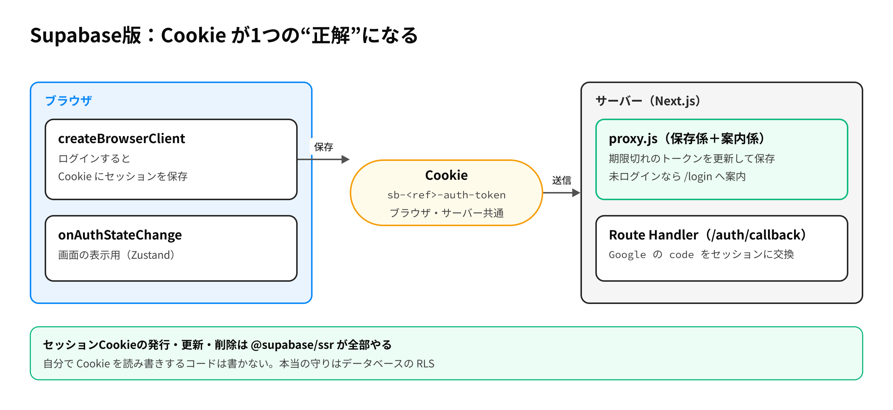
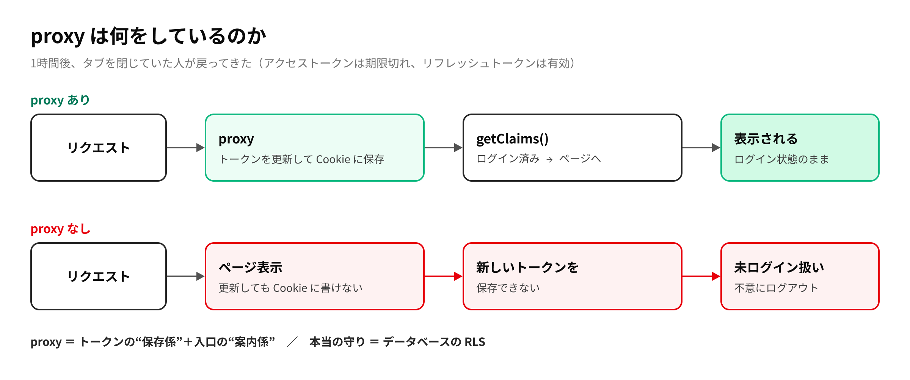
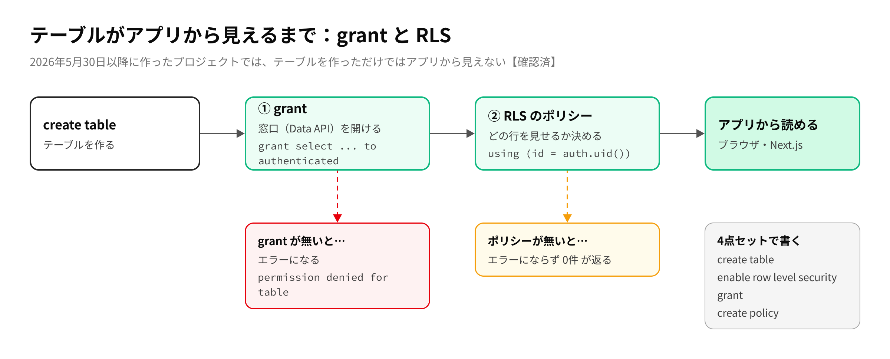
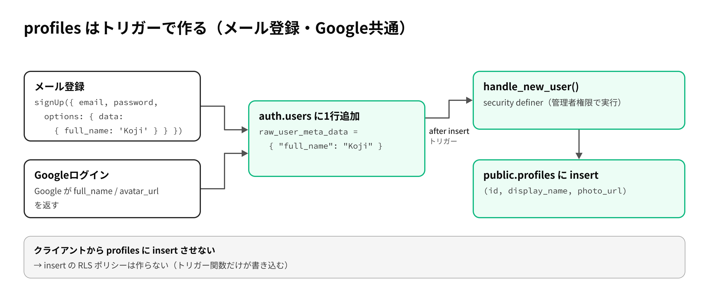

# 第4回 認証①：メール＋パスワードと profiles テーブル

> 開始タグ：`lesson03-step3` → 到達タグ：`lesson04-step4`
> 前提：[事前課題](04-0_事前課題_SupabaseとGoogleの準備.md) が終わっていること（Supabase プロジェクト・Confirm email OFF・URL 設定）

## この回のゴール

- `@supabase/ssr` で、ブラウザとサーバー（Next.js）が **同じ Cookie** でログイン状態を共有するしくみがわかる
- `profiles` テーブルを SQL で作り、**grant と RLS** の役割の違いを説明できる
- メール＋パスワードで新規登録・ログイン・ログアウトができる
- プロフィールの表示と編集が、本物のデータベースに保存される

## 講義

### 1. Cookie が1つの“正解”になる



- ログインすると、`@supabase/ssr` がセッション（アクセストークン＋リフレッシュトークン）を **Cookie** に保存する
- ブラウザの Zustand ストアも、サーバーの proxy も、この Cookie を見て「誰がログインしているか」を判断する
- Cookie の発行・更新・削除は、すべてライブラリがやってくれる。**自分で Cookie を読み書きするコードは書かない**

### 2. Supabase クライアントは3種類

| ファイル | 作り方 | 使う場所 |
|---|---|---|
| `lib/supabase/client.js` | `createBrowserClient` | `'use client'` の部品と Zustand ストア（**この講座のほとんど**） |
| `lib/supabase/server.js` | `createServerClient` ＋ `cookies()` | Route Handler（第5回の `/auth/callback`）など、サーバーで動くコード |
| `lib/supabase/proxy.js` | `createServerClient` ＋ `request.cookies` | ルートの `proxy.js`（ページ表示の前に毎回動く） |

### 3. proxy の2つの仕事



1. **保存係**：期限切れのアクセストークン（既定は1時間）を更新して、Cookie に書き戻す。Server Component は Cookie を書き換えられないので、proxy が先に済ませておく【確認済：公式ドキュメント】
2. **案内係**：ログインしていない人が `/` などを開いたら `/login` へ、ログイン済みの人が `/login` を開いたら `/` へ移動させる

> 💡 Next.js 16 で `middleware.js` は `proxy.js` に名前が変わりました。関数名も `middleware` → `proxy` です【確認済】。
> 💡 proxy の判定は「見た目の案内」です。**本当の守りはデータベースの RLS**。proxy をすり抜けても、RLS が許可しない行は読み書きできません。

### 4. サーバーでの本人確認は `getClaims()`

| メソッド | 何をするか | サーバーでの本人確認に使う？ |
|---|---|---|
| `getSession()` | Cookie の中身をそのまま返す。**改ざんを検出しない** | ❌ |
| `getClaims()` | トークンの署名を検証する | ✅ **これを使う**（proxy で使用） |
| `getUser()` | 認証サーバーに問い合わせる（通信が発生） | △ 最新情報が必要なときだけ |

### 5. grant と RLS



- **grant**：テーブルの「窓口」を開ける。無いと `permission denied for table profiles`
- **RLS**：どの「行」を見せるか・書かせるか。有効にしてポリシーが無いと **0件**（エラーにならない）

### 6. profiles はトリガーで作る



- `auth.users`（Supabase が管理するユーザー表）に1行増えた瞬間に、`profiles` に1行作る
- メール登録でも Google（第5回）でも、**同じトリガー** が動く
- アプリからは `profiles` に insert しないので、**insert のポリシーは作らない**

---

## Step 1：パッケージ・クライアント・proxy を用意する

```bash
npm install @supabase/supabase-js @supabase/ssr
```

1. `.env.local.example` をコピーして `.env.local` を作り、事前課題で控えた **A（Project URL）** と **B（Publishable key）** を書き込む
2. `.gitignore` に `!.env.local.example` を追加する（`.env*` で見本まで無視されないように）

```bash
cp .env.local.example .env.local
```

> ⚠ `.env.local` は Git に入りません（入れてはいけません）。`git status` に出てこないことを確認しましょう。
> ⚠ `sb_secret_…` で始まる Secret key は、この講座では使いません。`.env.local` にも書かないこと。

#### 📄 `.env.local.example`（新規）

```
# Supabase ダッシュボード → Connect（または Project Settings → API Keys）で確認できる値
# このファイルを .env.local という名前でコピーしてから値を書き換える
NEXT_PUBLIC_SUPABASE_URL=https://xxxxxxxxxxxxxxxxxxxx.supabase.co
NEXT_PUBLIC_SUPABASE_PUBLISHABLE_KEY=sb_publishable_xxxxxxxxxxxxxxxx
```

#### ✏️ `.gitignore`（変更）

`+` の行を追加し、`-` の行を削除します。

```diff
@@ -39,3 +39,6 @@ yarn-error.log*
 # typescript
 *.tsbuildinfo
 next-env.d.ts
+
+# .env.local.example は値の見本なのでコミットする
+!.env.local.example
```

#### 📄 `lib/supabase/client.js`（新規）

```js
/**
 * ブラウザ用のSupabaseクライアント（lib/supabase/client.js）
 *
 * 'use client' のコンポーネントや Zustand ストアから使う。
 * セッションは localStorage ではなく Cookie に保存される（@supabase/ssr の仕様）。
 * → だからサーバー側（Server Component / proxy）からも同じログイン状態が見える。
 */
import { createBrowserClient } from '@supabase/ssr';

export function createClient() {
  return createBrowserClient(
    process.env.NEXT_PUBLIC_SUPABASE_URL,
    process.env.NEXT_PUBLIC_SUPABASE_PUBLISHABLE_KEY,
  );
}
```

#### 📄 `lib/supabase/proxy.js`（新規）

```js
/**
 * セッション更新処理（lib/supabase/proxy.js）
 *
 * ルートの proxy.js から、ページを表示する前に毎回呼ばれる。
 *
 * ★なぜ必要か
 *   Supabase のアクセストークンは有効期限が短い（既定は1時間）。
 *   期限切れのトークンを「更新して Cookie に書き戻す」作業が必要だが、
 *   Server Component は Cookie を書き換えられない。そこで proxy が毎回先に済ませておく。
 *
 * 公式ドキュメントのコードをほぼそのまま使っている。
 * 「createServerClient と getClaims() の間に処理を書かない」
 * 「supabaseResponse をそのまま返す」の2点は崩さないこと。
 */
import { createServerClient } from '@supabase/ssr';
import { NextResponse } from 'next/server';

export async function updateSession(request) {
  let supabaseResponse = NextResponse.next({ request });

  const supabase = createServerClient(
    process.env.NEXT_PUBLIC_SUPABASE_URL,
    process.env.NEXT_PUBLIC_SUPABASE_PUBLISHABLE_KEY,
    {
      cookies: {
        getAll() {
          return request.cookies.getAll();
        },
        setAll(cookiesToSet, headers) {
          cookiesToSet.forEach(({ name, value }) => request.cookies.set(name, value));
          supabaseResponse = NextResponse.next({ request });
          cookiesToSet.forEach(({ name, value, options }) =>
            supabaseResponse.cookies.set(name, value, options),
          );
          Object.entries(headers ?? {}).forEach(([key, value]) =>
            supabaseResponse.headers.set(key, value),
          );
        },
      },
    },
  );

  // ここで「トークンの検証＋必要なら更新」が行われる。消さないこと。
  await supabase.auth.getClaims();

  return supabaseResponse;
}
```

#### 📄 `lib/supabase/server.js`（新規）

```js
/**
 * サーバー用のSupabaseクライアント（lib/supabase/server.js）
 *
 * Server Component / Server Action / Route Handler から使う。
 * リクエストに付いてきた Cookie を読み、「今アクセスしてきたのは誰か」を判定する。
 *
 * ★使うのは公開してよい publishable key だけ。
 *   「誰が何をできるか」は、キーではなくDB側のRLSで決まるため。
 */
import { createServerClient } from '@supabase/ssr';
import { cookies } from 'next/headers';

export async function createClient() {
  const cookieStore = await cookies();

  return createServerClient(
    process.env.NEXT_PUBLIC_SUPABASE_URL,
    process.env.NEXT_PUBLIC_SUPABASE_PUBLISHABLE_KEY,
    {
      cookies: {
        getAll() {
          return cookieStore.getAll();
        },
        setAll(cookiesToSet) {
          try {
            cookiesToSet.forEach(({ name, value, options }) =>
              cookieStore.set(name, value, options),
            );
          } catch {
            // Server Component からは Cookie を書き込めないため、ここに来ることがある。
            // トークンの更新は proxy.js が毎リクエスト行っているので、無視してよい。
          }
        },
      },
    },
  );
}
```

#### ✏️ `package.json`（変更）

`+` の行を追加し、`-` の行を削除します。

```diff
@@ -9,6 +9,8 @@
     "lint": "eslint"
   },
   "dependencies": {
+    "@supabase/ssr": "^0.12.7",
+    "@supabase/supabase-js": "^2.119.2",
     "class-variance-authority": "^0.7.1",
     "clsx": "^2.1.1",
     "lucide-react": "^1.80.0",
```

#### 📄 `proxy.js`（新規）

```js
/**
 * Next.js 16 の proxy（旧 middleware）。プロジェクト直下に置く。
 * すべてのページ表示の前に呼ばれる。
 *
 * Next.js 15 以前は middleware.js という名前で、関数名も middleware だった。
 */
import { updateSession } from '@/lib/supabase/proxy';

export async function proxy(request) {
  return await updateSession(request);
}

export const config = {
  matcher: [
    // 画像や静的ファイルには不要なので除外する
    '/((?!_next/static|_next/image|favicon.ico|.*\\.(?:svg|png|jpg|jpeg|gif|webp)$).*)',
  ],
};
```


✅ **動作確認**

- `npm run dev` で起動し直す（`.env.local` は起動時にしか読まれない）
- これまでどおり全ページが表示され、第3回のモックのまま動く（この Step の proxy はトークンの更新だけで、まだ案内はしない）
- `.env.local` の名前を一時的に変えて起動すると、エラー画面になる → proxy が毎回 Supabase のクライアントを作っていることが分かる（確認したら元に戻す）

💾 **コミット**

```bash
git add -A
git commit -m "[第4回 Step1] Supabaseのパッケージを入れ、クライアントとproxyを用意する"
```

---

## Step 2：profiles テーブル・RLS・トリガーの SQL

SQL は `supabase/migrations/0001_profiles.sql` というファイルに書いて Git で管理し、**中身を Supabase の SQL Editor に貼り付けて Run** します。

#### 📄 `supabase/migrations/0001_profiles.sql`（新規）

```sql
-- =====================================================================
-- 0001_profiles.sql（第4回）
-- Supabase ダッシュボード → SQL Editor に貼り付けて「Run」する
--
-- ① profiles テーブル …… ユーザーの公開プロフィール（表示名・アイコンなど）
-- ② RLS ……………………… 「誰がどの行を読める／書けるか」のルール
-- ③ grant …………………… アプリ（Data API）からこのテーブルを使えるようにする
-- ④ トリガー ………………… ユーザー登録の瞬間に profiles を自動で作る
-- =====================================================================

-- ---------------------------------------------------------------------
-- ① profiles テーブル
--   id は auth.users（Supabase が管理するユーザー表）の id と同じ値。
--   on delete cascade … ユーザーが削除されたら、プロフィールも一緒に消える。
-- ---------------------------------------------------------------------
create table public.profiles (
  id           uuid primary key references auth.users (id) on delete cascade,
  display_name text not null,
  photo_url    text,
  bio          text not null default '',
  location     text not null default '',
  banner_url   text not null default '',
  created_at   timestamptz not null default now(),
  updated_at   timestamptz not null default now(),
  -- check 制約：ルールに合わない値はデータベースが受け付けない
  constraint display_name_length check (char_length(display_name) between 1 and 50),
  constraint bio_length check (char_length(bio) <= 160),
  constraint location_length check (char_length(location) <= 30)
);

-- ---------------------------------------------------------------------
-- ② RLS（行レベルセキュリティ）
--   enable にした瞬間、「ポリシーで許可したこと」以外はすべて拒否になる。
-- ---------------------------------------------------------------------
alter table public.profiles enable row level security;

-- ログインしていれば、誰のプロフィールでも読める（SNSなので）
create policy "ログイン済みなら読める"
  on public.profiles for select
  to authenticated
  using (true);

-- 自分の行だけ更新できる
--   using      … 更新「前」の行が自分のものか
--   with check … 更新「後」の行も自分のものか（id を他人のものに書き換えるのを防ぐ）
create policy "自分の行だけ更新できる"
  on public.profiles for update
  to authenticated
  using (id = (select auth.uid()))
  with check (id = (select auth.uid()));

-- insert と delete のポリシーは「あえて作らない」
--   insert … ④のトリガーだけが行う
--   delete … ユーザーの削除に連動して cascade で消える

-- ---------------------------------------------------------------------
-- ③ grant（Data API への公開）
--   新しいプロジェクトでは、テーブルを作っただけではアプリから見えない。
--   grant が「窓口を開ける」、RLS が「どの行を見せるか」。両方そろって初めて使える。
-- ---------------------------------------------------------------------
grant select, update on public.profiles to authenticated;

-- ---------------------------------------------------------------------
-- ④ 新規登録トリガー
--   auth.users に1行増えたら（メール登録でも Google でも）、profiles に1行作る。
--   raw_user_meta_data に入っている値
--     メール登録 … signUp の options.data で渡した { full_name }
--     Google     … Google が返す full_name / name / avatar_url / picture など
--
--   security definer      … この関数は作成者（管理者）の権限で動く。
--                           RLS で insert を許可していなくても profiles に書き込める。
--   set search_path = ''  … 関数内のテーブルは public.xxx と完全な名前で書く（安全のための定石）
-- ---------------------------------------------------------------------
create function public.handle_new_user()
returns trigger
language plpgsql
security definer set search_path = ''
as $$
begin
  insert into public.profiles (id, display_name, photo_url)
  values (
    new.id,
    left(
      coalesce(
        nullif(trim(new.raw_user_meta_data ->> 'full_name'), ''),
        nullif(trim(new.raw_user_meta_data ->> 'name'), ''),
        split_part(new.email, '@', 1)        -- 名前が無ければメールの@より前
      ),
      50
    ),
    coalesce(
      new.raw_user_meta_data ->> 'avatar_url',
      new.raw_user_meta_data ->> 'picture'
    )
  );
  return new;
end;
$$;

create trigger on_auth_user_created
  after insert on auth.users
  for each row execute procedure public.handle_new_user();

-- ---------------------------------------------------------------------
-- （おまけ）updated_at を自動で更新する。以降のテーブルでも使い回す。
-- ---------------------------------------------------------------------
create function public.set_updated_at()
returns trigger
language plpgsql
set search_path = ''
as $$
begin
  new.updated_at = now();
  return new;
end;
$$;

create trigger profiles_set_updated_at
  before update on public.profiles
  for each row execute procedure public.set_updated_at();
```


✅ **動作確認**（Supabase ダッシュボード）

1. SQL Editor で上の SQL を貼り付けて **Run** → `Success. No rows returned`
2. **Table Editor** に `profiles` が出て、鍵マーク（RLS 有効）が付いている
3. **Authentication → Users → Add user → Create new user** でテストユーザーを1人作る（Auto Confirm User に ✅）
4. Table Editor の `profiles` に、そのユーザーの行が **自動で** 増えている（トリガーが動いた）
5. **Advisors → Security Advisor** に `profiles` の警告が出ていない

> 💡 SQL は「何度も実行してよい」ものではありません。2回目は `relation "profiles" already exists` になります。やり直したいときは講師に相談してください（よくあるつまずき参照）。

💾 **コミット**

```bash
git add -A
git commit -m "[第4回 Step2] profilesテーブル・RLS・新規登録トリガーのSQLを追加"
```

---

## Step 3：メール＋パスワードで登録・ログイン・ログアウト

- `stores/authStore.js`：モックをやめ、Supabase Auth を呼ぶ
  - `signUp(email, password, displayName)`：名前は `options.data.full_name` に入れる → トリガーが `profiles.display_name` にコピーする
  - `signIn(email, password)`・`signOut()`
  - `initAuth()`：`onAuthStateChange` でログイン状態の変化を監視し、`user` を更新する。**コールバックの中で `await supabase…` を呼ばない**（通信が止まる不具合が報告されている）
  - Supabase の英語のエラーコードを、日本語のメッセージに変換する
- `components/ClientLayout.jsx`：アプリ全体で1回だけ `initAuth()` を呼ぶ
- `components/dev/DevUserSwitcher.jsx`：**削除**（本物のログインができたので不要）
- `app/login/LoginClient.jsx`：ボタンをストアの関数につなぎ、エラーを赤い枠（カンプ D1b）で表示
- `components/Header.jsx`：ログアウトボタン
- `lib/supabase/proxy.js`：案内係を追加（未ログインなら `/login` へ、ログイン済みで `/login` なら `/` へ）。リダイレクト時に、更新した Cookie を引き継ぐ

#### ✏️ `app/login/LoginClient.jsx`（全体を書き換え）

```jsx
'use client';

import { useState } from 'react';
import { useRouter } from 'next/navigation';
import { Alert, AlertDescription } from '@/components/ui/alert';
import { Button } from '@/components/ui/button';
import { Card, CardContent, CardDescription, CardHeader, CardTitle } from '@/components/ui/card';
import { Input } from '@/components/ui/input';
import { Label } from '@/components/ui/label';
import { GoogleIcon } from '@/components/GoogleIcon';
import useAuthStore from '@/stores/authStore';

/**
 * ログイン画面（app/login/LoginClient.jsx）— 第4回：メール＋パスワードをつなぐ
 * Google ログインは第5回でつなぐ。
 */
export const LoginClient = () => {
  const router = useRouter();
  const [email, setEmail] = useState('');
  const [password, setPassword] = useState('');
  const [displayName, setDisplayName] = useState('');
  const [isLoading, setIsLoading] = useState(false);
  const { error, notice, signIn, signUp } = useAuthStore();

  // ログインできたらトップへ。router.refresh() で、サーバー側（proxy など）にも
  // 新しい Cookie で判定し直してもらう
  const goHome = () => {
    router.replace('/');
    router.refresh();
  };

  const handleSignIn = async (e) => {
    e.preventDefault();
    setIsLoading(true);
    try {
      await signIn(email, password);
      goHome();
    } catch {
      // エラーの文言は authStore の error に入っている
    } finally {
      setIsLoading(false);
    }
  };

  const handleSignUp = async () => {
    setIsLoading(true);
    try {
      const { needsConfirmation } = await signUp(email, password, displayName);
      if (!needsConfirmation) goHome(); // 確認メールが不要（授業の設定）ならそのままログイン済み
    } catch {
      // エラーの文言は authStore の error に入っている
    } finally {
      setIsLoading(false);
    }
  };

  return (
    <div className="flex min-h-[calc(100vh-56px)] items-center justify-center p-4">
      <Card className="w-full max-w-md border-none shadow-none sm:border sm:shadow-sm">
        <CardHeader className="space-y-1">
          <CardTitle className="text-center text-2xl font-bold">ログイン</CardTitle>
          <CardDescription className="text-center">アカウントにログインしてください</CardDescription>
        </CardHeader>

        <CardContent className="space-y-4">
          {/* 第5回でつなぐ */}
          <Button variant="outline" className="w-full" disabled>
            <GoogleIcon />
            Googleでログイン（第5回）
          </Button>

          <div className="relative">
            <div className="absolute inset-0 flex items-center">
              <span className="w-full border-t" />
            </div>
            <div className="relative flex justify-center text-xs">
              <span className="bg-card px-2 text-muted-foreground">または</span>
            </div>
          </div>

          <form onSubmit={handleSignIn} className="space-y-4">
            <div className="space-y-2">
              <Label htmlFor="displayName">ユーザー名（新規登録時）</Label>
              <Input id="displayName" placeholder="例：Koji" value={displayName} onChange={(e) => setDisplayName(e.target.value)} disabled={isLoading} />
              <p className="text-xs text-muted-foreground">※空欄のときは、メールアドレスの@より前が名前になります</p>
            </div>
            <div className="space-y-2">
              <Label htmlFor="email">メールアドレス</Label>
              <Input id="email" type="email" placeholder="example@email.com" value={email} onChange={(e) => setEmail(e.target.value)} required disabled={isLoading} />
            </div>
            <div className="space-y-2">
              <Label htmlFor="password">パスワード</Label>
              <Input id="password" type="password" placeholder="6文字以上" value={password} onChange={(e) => setPassword(e.target.value)} required minLength={6} disabled={isLoading} />
            </div>

            {error && (
              <Alert variant="destructive">
                <AlertDescription>{error}</AlertDescription>
              </Alert>
            )}
            {notice && (
              <Alert>
                <AlertDescription>{notice}</AlertDescription>
              </Alert>
            )}

            <div className="flex gap-2">
              <Button type="submit" className="flex-1" disabled={isLoading}>
                {isLoading ? '処理中...' : 'ログイン'}
              </Button>
              <Button type="button" variant="outline" className="flex-1" onClick={handleSignUp} disabled={isLoading}>
                新規登録
              </Button>
            </div>
          </form>
        </CardContent>
      </Card>
    </div>
  );
};
```

#### ✏️ `components/ClientLayout.jsx`（全体を書き換え）

```jsx
'use client';

import { useEffect } from 'react';
import Header from '@/components/Header';
import { MobileNav } from '@/components/MobileNav';
import { initAuth } from '@/stores/authStore';

/**
 * 全ページ共通の枠（components/ClientLayout.jsx）
 *
 * app/layout.js から <body> の直下に置く。どのページへ移動してもマウントされたまま
 * 残るので、「アプリ全体で1回だけ行う処理」をここに書く。
 */
export const ClientLayout = ({ children }) => {
  // ログイン状態の監視を始める。戻り値（購読解除の関数）はクリーンアップで必ず呼ぶ
  useEffect(() => {
    const unsubscribe = initAuth();
    return () => unsubscribe();
  }, []);

  return (
    <>
      <Header />
      {/* pb-16 … スマホでは下部ナビに最後の投稿が隠れないよう余白をとる */}
      <div className="pb-16 md:pb-0">{children}</div>
      <MobileNav />
    </>
  );
};
```

#### ✏️ `components/Header.jsx`（変更）

`+` の行を追加し、`-` の行を削除します。

```diff
@@ -1,7 +1,7 @@
 'use client';
 
 import Link from 'next/link';
-import { usePathname } from 'next/navigation';
+import { usePathname, useRouter } from 'next/navigation';
 import { Home, LogOut, Mail, User } from 'lucide-react';
 import { Button } from '@/components/ui/button';
 import { UserAvatar } from '@/components/UserAvatar';
@@ -17,7 +17,18 @@ import useAuthStore from '@/stores/authStore';
 export default function Header() {
   const pathname = usePathname();
   // ログイン中のユーザーはストアから取り出す（第3回）
-  const { user, loading } = useAuthStore();
+  const { user, loading, signOut } = useAuthStore();
+  const router = useRouter();
+
+  const handleSignOut = async () => {
+    const result = await signOut();
+    if (!result.success) {
+      window.alert(result.error);
+      return;
+    }
+    router.replace('/login');
+    router.refresh(); // サーバー側にも「ログアウトした」状態で描画し直してもらう
+  };
 
   // 判定中・未ログインのときは、ロゴ代わりの丸と「ログイン」ボタンだけ出す
   if (loading || !user) {
@@ -73,11 +84,8 @@ export default function Header() {
           </div>
 
           <div className="ml-2 flex items-center border-l pl-2">
-            {/* 第1回は見た目だけ。第4回で本物のログアウト処理をつなぐ */}
-            <Button asChild variant="ghost" size="icon-lg" aria-label="ログアウト">
-              <Link href="/login">
-                <LogOut className="size-6" />
-              </Link>
+            <Button variant="ghost" size="icon-lg" aria-label="ログアウト" onClick={handleSignOut}>
+              <LogOut className="size-6" />
             </Button>
           </div>
         </nav>
```

#### ✏️ `components/TopPageClient.jsx`（変更）

`+` の行を追加し、`-` の行を削除します。

```diff
@@ -16,7 +16,7 @@ import useProfileStore from '@/stores/profileStore';
 export const TopPageClient = () => {
   const router = useRouter();
   const [activeTab, setActiveTab] = useState('public');
-  const { user } = useAuthStore();
+  const { user, loading } = useAuthStore();
   const { timeline, fetchTimeline, createPost, deletePost, toggleReaction } = usePostStore();
 
   const { followingIds, fetchMyFollowing } = useProfileStore();
@@ -35,10 +35,11 @@ export const TopPageClient = () => {
     fetchTimeline({ mode: activeTab, myUid: user.uid, userIds: userIdsKey.split(',') });
   }, [activeTab, user, userIdsKey, fetchTimeline]);
 
-  if (!user) {
+  // ログイン状態の判定中は何も出さない（proxy があるので、未ログインならここへは来ない）
+  if (loading || !user) {
     return (
       <main className="mx-auto min-h-screen max-w-2xl border-x px-4 py-16 text-center text-muted-foreground">
-        ログインしてください
+        読み込み中...
       </main>
     );
   }
```

#### 🗑 `components/dev/DevUserSwitcher.jsx`（削除）

このファイルは使わなくなったので削除します。

#### ✏️ `lib/supabase/proxy.js`（変更）

`+` の行を追加し、`-` の行を削除します。

```diff
@@ -8,6 +8,9 @@
  *   期限切れのトークンを「更新して Cookie に書き戻す」作業が必要だが、
  *   Server Component は Cookie を書き換えられない。そこで proxy が毎回先に済ませておく。
  *
+ * ★もう1つの仕事：ログインしていない人を /login へ送る（ページの入口の見張り）。
+ *   ただし本当の守りはデータベースの RLS。proxy は「見た目の案内係」と考える。
+ *
  * 公式ドキュメントのコードをほぼそのまま使っている。
  * 「createServerClient と getClaims() の間に処理を書かない」
  * 「supabaseResponse をそのまま返す」の2点は崩さないこと。
@@ -41,7 +44,27 @@ export async function updateSession(request) {
   );
 
   // ここで「トークンの検証＋必要なら更新」が行われる。消さないこと。
-  await supabase.auth.getClaims();
+  const { data } = await supabase.auth.getClaims();
+  const isLoggedIn = Boolean(data?.claims);
+
+  // ログインしていなくても開けるページ
+  const path = request.nextUrl.pathname;
+  const isPublic = path.startsWith('/login') || path.startsWith('/auth');
+
+  // 未ログインで保護ページを開いた → /login へ
+  if (!isLoggedIn && !isPublic) return redirectTo(request, '/login', supabaseResponse);
+  // ログイン済みで /login を開いた → トップへ
+  if (isLoggedIn && path === '/login') return redirectTo(request, '/', supabaseResponse);
 
   return supabaseResponse;
 }
+
+// リダイレクトするときも、更新したCookieを引き継ぐ（引き継がないとログアウトされる）
+function redirectTo(request, pathname, supabaseResponse) {
+  const url = request.nextUrl.clone();
+  url.pathname = pathname;
+  url.search = '';
+  const response = NextResponse.redirect(url);
+  supabaseResponse.cookies.getAll().forEach((cookie) => response.cookies.set(cookie));
+  return response;
+}
```

#### ✏️ `stores/authStore.js`（全体を書き換え）

```js
/**
 * ログイン状態のストア（stores/authStore.js）— 第4回：Supabase版
 *
 * ★第3回のモック版と「形」は同じ（user / loading / signOut …）。
 *   画面側は useAuthStore() を使うだけなので、ほとんど書き換えずに済む。
 *
 * user の形：{ uid, email, displayName, photoURL }
 *   Supabase の user は id や user_metadata.full_name という名前なので、
 *   toAppUser() で詰め替えてから state に入れる。
 */
import { create } from 'zustand';
import { createClient } from '@/lib/supabase/client';

const supabase = createClient();

// Supabase の user を、このアプリで使う形に詰め替える
function toAppUser(user) {
  if (!user) return null;
  const meta = user.user_metadata ?? {};
  return {
    uid: user.id,
    email: user.email,
    displayName: meta.full_name ?? meta.name ?? user.email?.split('@')[0] ?? null,
    photoURL: meta.avatar_url ?? meta.picture ?? null,
  };
}

const useAuthStore = create((set) => ({
  // --- State ---
  user: null,
  loading: true, // 最初の判定（onAuthStateChange の1回目）が終わるまでは true
  error: null,
  notice: null, // 「確認メールを送りました」などのお知らせ

  // --- Actions ---
  setUser: (user) => set({ user, loading: false }),
  clearMessages: () => set({ error: null, notice: null }),

  // メール＋パスワードでログイン
  signIn: async (email, password) => {
    set({ error: null, notice: null });
    const { error } = await supabase.auth.signInWithPassword({ email, password });
    if (error) {
      const msg = getAuthErrorMessage(error);
      set({ error: msg });
      throw new Error(msg);
    }
    // user のセットは onAuthStateChange（initAuth）に任せる（状態を変える場所を1つにする）
  },

  // メール＋パスワードで新規登録
  signUp: async (email, password, displayName) => {
    set({ error: null, notice: null });
    if (password.length < 6) {
      const msg = 'パスワードは6文字以上である必要があります';
      set({ error: msg });
      throw new Error(msg);
    }
    const { data, error } = await supabase.auth.signUp({
      email,
      password,
      // ここに入れた値は auth.users の raw_user_meta_data に保存され、
      // トリガー handle_new_user() が profiles.display_name にコピーする
      options: { data: { full_name: displayName?.trim() || null } },
    });
    if (error) {
      const msg = getAuthErrorMessage(error);
      set({ error: msg });
      throw new Error(msg);
    }
    // 「Confirm email」が ON だと、この時点ではまだログインしていない（session が null）
    const needsConfirmation = !data.session;
    if (needsConfirmation) {
      set({ notice: '確認メールを送信しました。メール内のリンクを開いてください。' });
    }
    return { needsConfirmation };
  },

  signOut: async () => {
    const { error } = await supabase.auth.signOut();
    if (error) {
      const message = 'ログアウトに失敗しました。もう一度お試しください。';
      set({ error: message });
      return { success: false, error: message };
    }
    set({ user: null, error: null, notice: null });
    return { success: true };
  },
}));

// Supabase のエラーコードを、画面に出す日本語に変換する
function getAuthErrorMessage(error) {
  const messages = {
    invalid_credentials: 'メールアドレスまたはパスワードが間違っています',
    email_not_confirmed: 'メールアドレスの確認が済んでいません。確認メールのリンクを開いてください',
    user_already_exists: 'このメールアドレスは既に登録されています',
    email_exists: 'このメールアドレスは既に登録されています',
    weak_password: 'パスワードが弱すぎます。6文字以上にしてください',
    email_address_invalid: 'メールアドレスの形式が正しくありません',
    email_address_not_authorized:
      'このアドレスには確認メールを送れません（Supabase標準メールの制限）。「Confirm email」をOFFにしてください',
    over_email_send_rate_limit: 'メールの送信回数の上限に達しました。しばらく待ってからお試しください',
    over_request_rate_limit: 'しばらく待ってから再度お試しください',
    provider_disabled: 'この認証方法はSupabase側で有効になっていません',
    signup_disabled: '新規登録が無効になっています',
  };
  return messages[error.code] || `認証エラー: ${error.message}`;
}

/**
 * ログイン状態の監視を始める（ClientLayout から1回だけ呼ぶ）
 *
 * 購読した直後に1回（INITIAL_SESSION）、その後はログイン・ログアウト・
 * トークン更新のたびに呼ばれる。戻り値は購読を解除する関数。
 *
 * ★コールバックの中で await supabase.xxx() を呼ばないこと。
 *   supabase-js の内部の仕組みとぶつかって、以降の通信が止まる不具合が報告されている。
 */
export function initAuth() {
  const { data } = supabase.auth.onAuthStateChange((_event, session) => {
    useAuthStore.getState().setUser(toAppUser(session?.user));
  });
  return () => data.subscription.unsubscribe();
}

export default useAuthStore;
```


✅ **動作確認**

| # | 操作 | 期待する結果 |
|---|---|---|
| 1 | `/login` でユーザー名・メール・6文字以上のパスワードを入れて「新規登録」 | トップページに移動する |
| 2 | Supabase の Authentication → Users | 今のユーザーが増えている |
| 3 | Table Editor → `profiles` | `display_name` に入力したユーザー名が入っている |
| 4 | ヘッダーのログアウト | `/login` に戻る |
| 5 | 間違ったパスワードでログイン | 「メールアドレスまたはパスワードが間違っています」 |
| 6 | 正しいパスワードでログイン → ブラウザを再読み込み | ログインしたまま |
| 7 | ログイン中に `/login` を直接開く | `/` に戻される |

> 💡 タイムラインの投稿はまだダミーデータです（第6回で本物にします）。

💾 **コミット**

```bash
git add -A
git commit -m "[第4回 Step3] メール＋パスワードでの登録・ログイン・ログアウトを Supabase Auth につなぐ"
```

---

## Step 4：プロフィールの表示と編集を profiles テーブルに切り替える

- `stores/profileStore.js`：`fetchProfile`・`updateProfile` を `supabase.from('profiles')` に変える
  - データベースの列名（`display_name`・`photo_url`…）を、画面で使う名前（`displayName`・`photoURL`…）に詰め替える関数 `toProfile` を用意する
  - フォローはまだモックのまま（第10回）
- `components/ClientLayout.jsx`：ログインしたら自分のプロフィールを読み込む
- `components/Header.jsx`：アイコンと名前を `profiles` の値で表示（編集がすぐ反映されるように）
- `components/EditProfileDialog.jsx`：保存に失敗したらエラーを表示

#### ✏️ `components/ClientLayout.jsx`（変更）

`+` の行を追加し、`-` の行を削除します。

```diff
@@ -3,7 +3,8 @@
 import { useEffect } from 'react';
 import Header from '@/components/Header';
 import { MobileNav } from '@/components/MobileNav';
-import { initAuth } from '@/stores/authStore';
+import useAuthStore, { initAuth } from '@/stores/authStore';
+import useProfileStore from '@/stores/profileStore';
 
 /**
  * 全ページ共通の枠（components/ClientLayout.jsx）
@@ -18,6 +19,14 @@ export const ClientLayout = ({ children }) => {
     return () => unsubscribe();
   }, []);
 
+  // ログインしたら、自分のプロフィール（表示名・アイコン）を読み込んでおく
+  //   ★initAuth の中（onAuthStateChange のコールバック）では読まない。ここで読む
+  const uid = useAuthStore((s) => s.user?.uid);
+  const fetchProfile = useProfileStore((s) => s.fetchProfile);
+  useEffect(() => {
+    if (uid) fetchProfile(uid);
+  }, [uid, fetchProfile]);
+
   return (
     <>
       <Header />
```

#### ✏️ `components/EditProfileDialog.jsx`（変更）

`+` の行を追加し、`-` の行を削除します。

```diff
@@ -47,6 +47,8 @@ export const EditProfileDialog = ({ profile, onSave }) => {
     try {
       await onSave?.({ ...form, displayName: form.displayName.trim() });
       setOpen(false);
+    } catch {
+      // 失敗したらダイアログを閉じずに残す（エラーの表示は呼び出し側で行う）
     } finally {
       setIsSubmitting(false);
     }
```

#### ✏️ `components/Header.jsx`（変更）

`+` の行を追加し、`-` の行を削除します。

```diff
@@ -7,6 +7,7 @@ import { Button } from '@/components/ui/button';
 import { UserAvatar } from '@/components/UserAvatar';
 import { cn } from '@/lib/utils';
 import useAuthStore from '@/stores/authStore';
+import useProfileStore from '@/stores/profileStore';
 
 /**
  * 画面上部のヘッダー（components/Header.jsx）
@@ -19,6 +20,8 @@ export default function Header() {
   // ログイン中のユーザーはストアから取り出す（第3回）
   const { user, loading, signOut } = useAuthStore();
   const router = useRouter();
+  // 表示名・アイコンは profiles テーブルの値を優先する（編集するとすぐ反映される）
+  const myProfile = useProfileStore((s) => (user ? s.profiles[user.uid] : null));
 
   const handleSignOut = async () => {
     const result = await signOut();
@@ -58,7 +61,11 @@ export default function Header() {
     <header className="sticky top-0 z-50 w-full border-b bg-background/80 backdrop-blur-md">
       <div className="mx-auto flex h-14 max-w-4xl items-center justify-between px-4 md:px-8">
         <Link href={`/profile/${user.uid}`} aria-label="自分のプロフィール">
-          <UserAvatar name={user.displayName} photoURL={user.photoURL} className="size-11" />
+          <UserAvatar
+            name={myProfile?.displayName ?? user.displayName}
+            photoURL={myProfile?.photoURL ?? user.photoURL}
+            className="size-11"
+          />
         </Link>
 
         <nav className="flex items-center gap-1">
```

#### ✏️ `components/ProfileClient.jsx`（変更）

`+` の行を追加し、`-` の行を削除します。

```diff
@@ -75,7 +75,17 @@ export const ProfileClient = ({ uid }) => {
               fallbackClassName="text-2xl md:text-4xl"
             />
             {isMe ? (
-              <EditProfileDialog profile={profile} onSave={(data) => updateProfile(uid, data)} />
+              <EditProfileDialog
+                profile={profile}
+                onSave={async (data) => {
+                  try {
+                    await updateProfile(uid, data);
+                  } catch (e) {
+                    window.alert(e.message);
+                    throw e;
+                  }
+                }}
+              />
             ) : (
               <div className="mt-2 flex gap-2">
                 <Button variant="outline" size="icon-lg" aria-label="メッセージを送る" onClick={() => router.push('/messages')}>
```

#### ✏️ `stores/profileStore.js`（全体を書き換え）

```js
/**
 * プロフィールとフォローのストア（stores/profileStore.js）
 *
 * 第4回：プロフィール（fetchProfile / updateProfile）を Supabase の profiles テーブルに切り替えた。
 * フォロー（follow / unfollow …）は、まだメモリ上のニセのデータベース。第10回で切り替える。
 *
 * profile の形：{ uid, displayName, photoURL, bio, location, bannerURL }
 */
import { create } from 'zustand';
import { createClient } from '@/lib/supabase/client';
import { dummyFollows } from '@/lib/dummyData';

const supabase = createClient();

// DB の列名（snake_case）→ アプリで使う名前（camelCase）に詰め替える
export const toProfile = (row) =>
  row
    ? {
        uid: row.id,
        displayName: row.display_name,
        photoURL: row.photo_url,
        bio: row.bio,
        location: row.location,
        bannerURL: row.banner_url,
      }
    : null;

// フォローは第10回まで、メモリ上のニセのデータベースのまま
const mockDb = { follows: [...dummyFollows] };

const useProfileStore = create((set, get) => ({
  // --- State ---
  profiles: {}, // { [uid]: profile } 一度読んだプロフィールを覚えておく（null は「見つからない」）
  followingIds: [], // 自分がフォローしている人の uid 一覧
  followCounts: {}, // { [uid]: { following, followers } }

  // --- 読み込み ---
  fetchProfile: async (uid) => {
    // maybeSingle() … 0件なら null、1件ならその行を返す（2件以上はエラー）
    const { data, error } = await supabase.from('profiles').select('*').eq('id', uid).maybeSingle();
    if (error) console.error('fetchProfile', error.message); // 例：uid の形式が不正
    const profile = toProfile(data);
    set({ profiles: { ...get().profiles, [uid]: profile } });
    return profile;
  },
  fetchMyFollowing: async (myUid) => {
    set({ followingIds: mockDb.follows.filter((f) => f.followerId === myUid).map((f) => f.followeeId) });
  },
  fetchFollowCounts: async (uid) => {
    const counts = {
      following: mockDb.follows.filter((f) => f.followerId === uid).length,
      followers: mockDb.follows.filter((f) => f.followeeId === uid).length,
    };
    set({ followCounts: { ...get().followCounts, [uid]: counts } });
  },

  // --- 書き込み ---
  // RLS により、自分の行しか更新できない（他人の id を渡しても 0件更新になるだけ）
  updateProfile: async (uid, data) => {
    const { data: row, error } = await supabase
      .from('profiles')
      .update({
        display_name: data.displayName,
        bio: data.bio,
        location: data.location,
        banner_url: data.bannerURL,
      })
      .eq('id', uid)
      .select()
      .single();
    if (error) throw new Error(`プロフィールの更新に失敗しました：${error.message}`);
    set({ profiles: { ...get().profiles, [uid]: toProfile(row) } });
  },
  follow: async (myUid, targetUid) => {
    if (myUid === targetUid) return;
    mockDb.follows.push({ followerId: myUid, followeeId: targetUid });
    await Promise.all([get().fetchMyFollowing(myUid), get().fetchFollowCounts(targetUid)]);
  },
  unfollow: async (myUid, targetUid) => {
    mockDb.follows = mockDb.follows.filter((f) => !(f.followerId === myUid && f.followeeId === targetUid));
    await Promise.all([get().fetchMyFollowing(myUid), get().fetchFollowCounts(targetUid)]);
  },
}));

export default useProfileStore;
```


✅ **動作確認**

- 自分のプロフィールを開き「プロフィールを編集」で名前・自己紹介・場所を変えて保存 → 再読み込みしても残っている
- Table Editor の `profiles` の値と `updated_at` が変わっている
- 自己紹介に 161 文字以上入れて保存 → エラーが表示される（データベースの `check` 制約が拒否している）

### やってみよう：RLS を体験する

Table Editor で自分と相手（Step 2 で作ったテストユーザーなど）の `id` をコピーし、SQL Editor で「ログイン中のユーザー」になりきって更新してみます。

```sql
-- 自分（ログイン中のユーザー）になりきる
set local role authenticated;
select set_config('request.jwt.claims', '{"sub":"<自分のid>","role":"authenticated"}', true);

update public.profiles set bio = 'いたずら' where id = '<相手のid>';  -- UPDATE 0（0行）になる
update public.profiles set bio = 'こんにちは' where id = '<自分のid>'; -- UPDATE 1
```

> SQL Editor では、上の4行を **まとめて選択して1回で Run** してください（1行ずつだと `set local` の効果が消えます）【推測：SQL Editor が1回の Run を1つのトランザクションで実行するため】。

💾 **コミット**

```bash
git add -A
git commit -m "[第4回 Step4] プロフィールの表示と編集を Supabase の profiles テーブルに切り替える"
```

---

## 確認クイズ

1. grant が無いとき／RLS のポリシーが無いとき、それぞれ何が起きる？ → grant 無し：`permission denied`、ポリシー無し：エラーにならず0件
2. `profiles` に insert のポリシーが無いのに、新規登録で行が増えるのはなぜ？ → トリガー関数が `security definer`（管理者の権限）で動くから
3. proxy で未ログインを `/login` に送っているのに、RLS も必要なのはなぜ？ → proxy はページの入口の案内にすぎず、データベースへの直接の通信は防げないから

## よくあるつまずき

| 症状 | 原因 | 対処 |
|---|---|---|
| `Your project's URL and Key are required…` | `.env.local` が無い・名前の間違い・起動し直していない | ファイル名と変数名を確認し、`npm run dev` を再起動 |
| 新規登録で `Database error saving new user` | トリガーの SQL のエラー（`display_name` の check 違反など） | Supabase の **Logs → Postgres** でエラー内容を確認 |
| 「このアドレスには確認メールを送れません」 | Confirm email が ON のまま | 事前課題 5-2 |
| `permission denied for table profiles` | grant を実行していない | 0001 の SQL の③を実行 |
| プロフィールが保存されない（エラーも出ない） | 更新できた行が0行（RLS で拒否） | ログインしているか、自分の行か確認 |
| SQL を2回実行して `already exists` | 同じテーブルを2回作ろうとした | 1回目が成功していれば問題なし。作り直す場合は講師に相談 |
| トップを開くとずっと `/login` に戻される | Cookie が保存されていない／`localhost` と `127.0.0.1` を混ぜている | 同じURL（`http://localhost:3000`）で開く |
