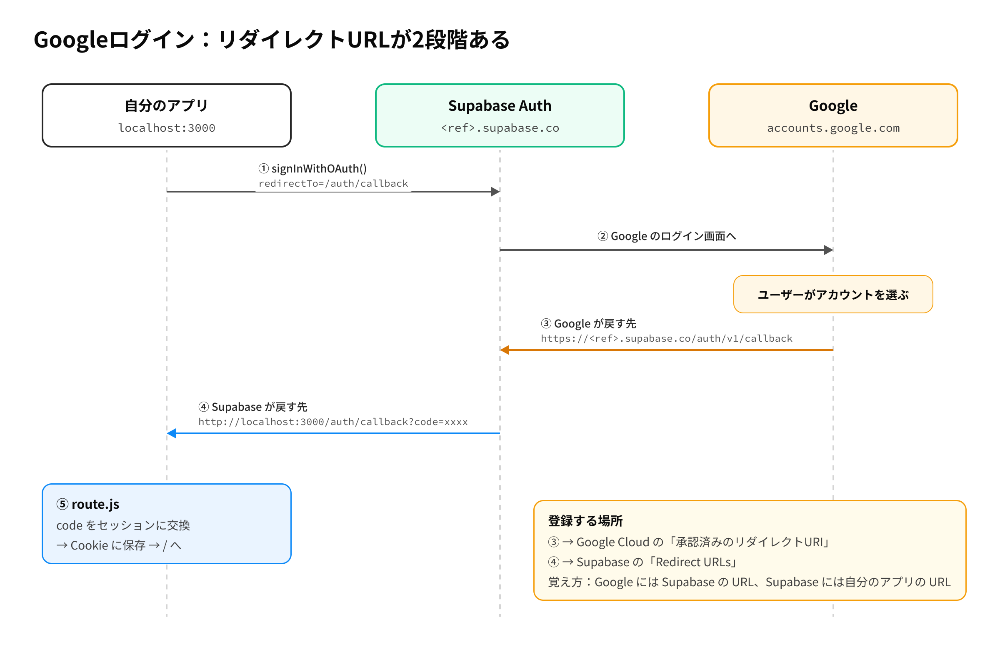
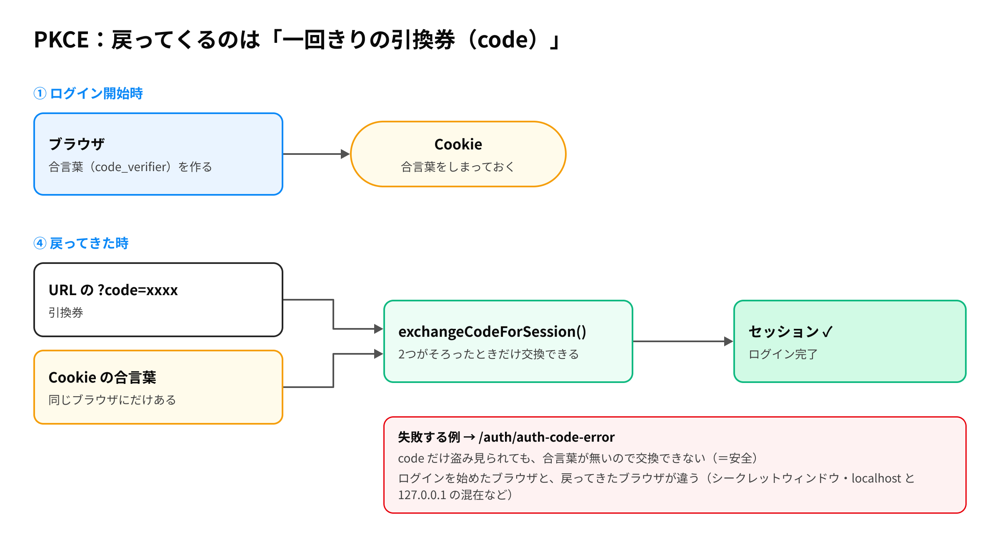

# 第5回 認証②：Googleログイン（OAuth・PKCE・callback ルート）

> 開始タグ：`lesson04-step4` → 到達タグ：`lesson05-step2`
> 前提：事前課題の Part 6・7（Google Cloud の設定と、Supabase への Google の登録）が終わっていること

## この回のゴール

- Google ログインで「どのURLからどのURLへ戻ってくるか」を図で説明できる
- PKCE（ピクシー）で、`code` を盗み見られても安全な理由がわかる
- `/auth/callback` の Route Handler を作り、Google ログインを完成させる

## 講義

### 1. リダイレクトURLが2段階ある（今日いちばん大事な図）



| 戻り先 | 誰が戻すか | どこに登録するか | 間違えたときの症状 |
|---|---|---|---|
| ③ `https://<ref>.supabase.co/auth/v1/callback` | Google | Google Cloud：承認済みのリダイレクトURI | Googleの画面で `redirect_uri_mismatch` |
| ④ `http://localhost:3000/auth/callback` | Supabase | Supabase：Redirect URLs | Site URL（`/`）に戻され、ログインが完了しない【推測】 |

> 💡 覚え方：**「Googleに登録するのはSupabaseのURL」「Supabaseに登録するのは自分のアプリのURL」**。

### 2. PKCE（ピクシー）を一言でいうと

④で戻ってくるのは、セッションそのものではなく **一回きりの引換券（`code`）** です。



- ログインを始めるとき、ブラウザの Cookie に「合言葉（code_verifier）」が保存される
- `/auth/callback` で `code` ＋合言葉をセットにして、初めてセッションに交換できる
- だから `code` を盗み見られても使えない。逆に、**ログインを始めたブラウザと戻ってきたブラウザが違うと失敗する**（→ `/auth/auth-code-error`）

### 3. ページごと移動する（リダイレクト方式）

- `signInWithOAuth()` を呼ぶと、ページごと Google に移動する。**その後の行は基本的に実行されない**
- ログイン完了の処理は、戻り先の `/auth/callback`（サーバー側の Route Handler）で行う
- 「Confirm email」を ON にしたときの **確認メールのリンク** も、同じ `/auth/callback` に戻ってくる

---

## Step 1：callback ルート（`/auth/callback`）を作る

- `app/auth/callback/route.js`：`?code=` を受け取り、`exchangeCodeForSession(code)` でセッションに交換して Cookie に保存する
  - 失敗したら `/auth/auth-code-error`（第2回で作った画面）へ
  - `?next=` は **`/` で始まるパスだけ** 受け付ける（外部サイトへ飛ばされる「オープンリダイレクト」を防ぐ）
- `stores/authStore.js`：新規登録の `emailRedirectTo` に、このルートを指定する

> 💡 proxy は `/auth` で始まるパスを「ログインしていなくても開けるページ」として通します（第4回 Step 3 で設定済み）。

#### 📄 `app/auth/callback/route.js`（新規）

```js
/**
 * OAuth（Google）とメール確認リンクの「戻り先」（app/auth/callback/route.js）
 *
 * 第5回の図の④：Supabase は ?code=xxxx を付けてここへ戻してくる。
 * この code を exchangeCodeForSession() でセッションに交換すると、
 * Cookie にセッションが保存され、ログイン完了になる（PKCEフロー）。
 *
 * Supabase公式ドキュメントの例をJavaScriptにしたもの。
 */
import { NextResponse } from 'next/server';
import { createClient } from '@/lib/supabase/server';

export async function GET(request) {
  const { searchParams, origin } = new URL(request.url);
  const code = searchParams.get('code');

  // ログイン後に戻したいページ（?next=/profile/xxx など）。
  // ★「/」で始まる相対パス以外は受け付けない。
  //   これを怠ると ?next=https://悪意のあるサイト で外部へ飛ばされる（オープンリダイレクト）。
  let next = searchParams.get('next') ?? '/';
  if (!next.startsWith('/') || next.startsWith('//')) next = '/';

  if (code) {
    const supabase = await createClient();
    const { error } = await supabase.auth.exchangeCodeForSession(code);
    if (!error) {
      // Vercel などロードバランサーの裏では、元のホスト名が x-forwarded-host に入る
      const forwardedHost = request.headers.get('x-forwarded-host');
      const isLocalEnv = process.env.NODE_ENV === 'development';
      if (isLocalEnv) return NextResponse.redirect(`${origin}${next}`);
      if (forwardedHost) return NextResponse.redirect(`https://${forwardedHost}${next}`);
      return NextResponse.redirect(`${origin}${next}`);
    }
  }

  // code が無い・交換に失敗した（期限切れ、別ブラウザで開いた など）
  return NextResponse.redirect(`${origin}/auth/auth-code-error`);
}
```

#### ✏️ `stores/authStore.js`（変更）

`+` の行を追加し、`-` の行を削除します。

```diff
@@ -1,5 +1,5 @@
 /**
- * ログイン状態のストア（stores/authStore.js）— 第4回：Supabase版
+ * ログイン状態のストア（stores/authStore.js）— Supabase版（第4回：メール、第5回：Google）
  *
  * ★第3回のモック版と「形」は同じ（user / loading / signOut …）。
  *   画面側は useAuthStore() を使うだけなので、ほとんど書き換えずに済む。
@@ -61,7 +61,11 @@ const useAuthStore = create((set) => ({
       password,
       // ここに入れた値は auth.users の raw_user_meta_data に保存され、
       // トリガー handle_new_user() が profiles.display_name にコピーする
-      options: { data: { full_name: displayName?.trim() || null } },
+      options: {
+        data: { full_name: displayName?.trim() || null },
+        // 「Confirm email」が ON のとき、確認リンクを開いた後の戻り先（第5回で作ったルート）
+        emailRedirectTo: `${location.origin}/auth/callback`,
+      },
     });
     if (error) {
       const msg = getAuthErrorMessage(error);
```


✅ **動作確認**

- <http://localhost:3000/auth/callback> を直接開く（`code` が無い） → `/auth/auth-code-error` が表示される
- <http://localhost:3000/auth/callback?code=dummy> → 同じくエラー画面（交換に失敗するため）

💾 **コミット**

```bash
git add -A
git commit -m "[第5回 Step1] Googleログイン・メール確認の戻り先（/auth/callback）を作る"
```

---

## Step 2：Google でログインできるようにする

- `stores/authStore.js`：`signInWithGoogle()` を追加
  - `redirectTo`：④の戻り先（`${location.origin}/auth/callback`）
  - `queryParams: { prompt: 'select_account' }`：毎回アカウント選択画面を出す（複数の Google アカウントを持つ人向け）
- `app/login/LoginClient.jsx`：「Googleでログイン」ボタンにつなぐ。押したらボタンを押せなくして二度押しを防ぐ

#### ✏️ `app/login/LoginClient.jsx`（変更）

`+` の行を追加し、`-` の行を削除します。

```diff
@@ -11,8 +11,8 @@ import { GoogleIcon } from '@/components/GoogleIcon';
 import useAuthStore from '@/stores/authStore';
 
 /**
- * ログイン画面（app/login/LoginClient.jsx）— 第4回：メール＋パスワードをつなぐ
- * Google ログインは第5回でつなぐ。
+ * ログイン画面（app/login/LoginClient.jsx）
+ * 第4回：メール＋パスワード、第5回：Google をつないだ。
  */
 export const LoginClient = () => {
   const router = useRouter();
@@ -20,7 +20,7 @@ export const LoginClient = () => {
   const [password, setPassword] = useState('');
   const [displayName, setDisplayName] = useState('');
   const [isLoading, setIsLoading] = useState(false);
-  const { error, notice, signIn, signUp } = useAuthStore();
+  const { error, notice, signIn, signUp, signInWithGoogle } = useAuthStore();
 
   // ログインできたらトップへ。router.refresh() で、サーバー側（proxy など）にも
   // 新しい Cookie で判定し直してもらう
@@ -42,6 +42,17 @@ export const LoginClient = () => {
     }
   };
 
+  const handleGoogleSignIn = async () => {
+    setIsLoading(true);
+    try {
+      await signInWithGoogle();
+      // 成功するとページごと Google へ移動する。戻ってくるのは /auth/callback → / なので
+      // ここで router.push は不要
+    } catch {
+      setIsLoading(false);
+    }
+  };
+
   const handleSignUp = async () => {
     setIsLoading(true);
     try {
@@ -63,10 +74,9 @@ export const LoginClient = () => {
         </CardHeader>
 
         <CardContent className="space-y-4">
-          {/* 第5回でつなぐ */}
-          <Button variant="outline" className="w-full" disabled>
+          <Button variant="outline" className="w-full" onClick={handleGoogleSignIn} disabled={isLoading}>
             <GoogleIcon />
-            Googleでログイン（第5回）
+            Googleでログイン
           </Button>
 
           <div className="relative">
```

#### ✏️ `stores/authStore.js`（変更）

`+` の行を追加し、`-` の行を削除します。

```diff
@@ -80,6 +80,26 @@ const useAuthStore = create((set) => ({
     return { needsConfirmation };
   },
 
+  // Googleでログイン
+  signInWithGoogle: async () => {
+    set({ error: null, notice: null });
+    const { error } = await supabase.auth.signInWithOAuth({
+      provider: 'google',
+      options: {
+        // ④ Supabase が最後に戻してくる先（＝自分のアプリの callback ルート）
+        redirectTo: `${location.origin}/auth/callback`,
+        // 毎回アカウント選択画面を出す（複数のGoogleアカウントを持つ人のため）
+        queryParams: { prompt: 'select_account' },
+      },
+    });
+    // 成功するとページごと Google へ移動するので、この先は基本的に実行されない
+    if (error) {
+      const msg = getAuthErrorMessage(error);
+      set({ error: msg });
+      throw new Error(msg);
+    }
+  },
+
   signOut: async () => {
     const { error } = await supabase.auth.signOut();
     if (error) {
```


✅ **動作確認**

| # | 操作 | 期待する結果 |
|---|---|---|
| 1 | 「Googleでログイン」 | Google のアカウント選択画面が出る |
| 2 | テストユーザーに登録したアカウントを選ぶ | 同意画面 → `/` に戻り、Google の名前とアイコンが表示される |
| 3 | 同意画面の表示 | アプリ名の近くに `<ref>.supabase.co` が出ている（独自ドメイン未設定のため）【確認済】 |
| 4 | Table Editor → `profiles` | `photo_url` に Google のアイコンURLが入っている（第4回のトリガーがそのまま動いた） |
| 5 | メールで登録したアカウントでもログインできる | 両方の方法が同じアプリで使える |

「どの方法で登録したか」は SQL で確認できます。

```sql
select u.email,
       u.raw_app_meta_data ->> 'provider' as provider,   -- email / google
       u.raw_app_meta_data -> 'providers' as providers,  -- 連携済みの一覧
       p.display_name, p.photo_url
from auth.users u
join public.profiles p on p.id = u.id;
```

💾 **コミット**

```bash
git add -A
git commit -m "[第5回 Step2] Googleでログインできるようにする"
```

---

## やってみよう：同じメールアドレスで両方使うと？

Supabase Auth は、**同じメールアドレスのアカウントを自動で1人のユーザーにまとめる**ことがあります（Identity Linking）【確認済】。

1. Google アカウントと **同じメールアドレス** で、メール＋パスワードの新規登録をする
2. ログアウトして、今度は Google でログインする
3. 上の SQL で、`auth.users` が何行か、`providers` に何が入っているかを確認する

> 【未確認】Confirm email が OFF（メールアドレスが未確認のまま）のときの結果。授業で試して記録してください。

| 実験 | auth.users の行数 | providers | 気づいたこと |
|---|---|---|---|
| | | | |

## 確認クイズ

1. Google Cloud の「承認済みのリダイレクトURI」に登録するのは、誰のURL？ → Supabase のURL（`…supabase.co/auth/v1/callback`）
2. `?code=` を盗み見られても大丈夫なのはなぜ？ → 交換には、ログインを始めたブラウザの Cookie にある合言葉も必要だから（PKCE）
3. callback ルートで `next` をチェックしないと何が起きる？ → 外部の悪いサイトへ転送される（オープンリダイレクト）

## よくあるつまずき

| 症状 | 原因 | 対処 |
|---|---|---|
| Google の画面で `Error 400: redirect_uri_mismatch` | Google Cloud のリダイレクトURIが Supabase の Callback URL と一字一句同じでない | Supabase の Google 設定画面からコピーし直す |
| 「アクセスをブロック」「このアプリは…テスト中」 | テストユーザーに登録していないアカウント【推測】 | Google Cloud → Audience → テストユーザーに追加 |
| 「この認証方法はSupabase側で有効になっていません」 | Supabase で Google が OFF | 事前課題 Part 7 |
| ログイン後 `/auth/callback` ではなく `/` に戻り、ログインできていない | Redirect URLs に `http://localhost:3000/**` が無い【推測】 | 事前課題 5-3 |
| `/auth/auth-code-error` に飛ぶ | 別ブラウザで戻った・時間が経ちすぎた・`localhost` と `127.0.0.1` が混ざった | 同じブラウザ・同じURLでやり直す |
| 3001番ポートで起動していた | 別のアプリが3000番を使っている | 3000番を空ける（Google と Supabase の設定が3000番のため） |

## 発展（本番公開の回で）

- Vercel に公開するときは、Google Cloud の **JavaScript生成元** に本番URLを、Supabase の **Site URL / Redirect URLs** に本番URLを追加する。Google Cloud のリダイレクトURI（Supabase の URL）は変更不要
- 同意画面に `supabase.co` を出さないためには、Supabase の独自ドメインの設定が必要（受託案件では必須級）【確認済】
