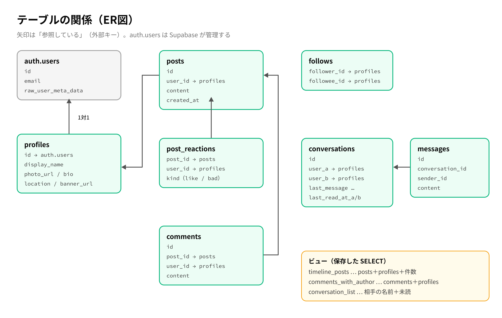

# 第6回 投稿をデータベースに保存する（posts と無限スクロール）

> 開始タグ：`lesson05-step2` → 到達タグ：`lesson06-step3`

## この回のゴール

- `posts` テーブルを作り、投稿の読み込み・作成・削除を Supabase に切り替える
- **ビュー**（保存しておいた SELECT 文）で「投稿＋書いた人の名前・アイコン」を1回で読める
- タイムラインを10件ずつ読み込む（無限スクロール）

## 講義

### 1. 名前やアイコンは投稿に保存しない



- `posts` が持つのは `user_id` だけ。名前・アイコンは `profiles` から **つなげて（JOIN して）** 表示する
- だからプロフィールの名前を変えると、**過去の投稿の表示も新しい名前になる**

### 2. ビュー `timeline_posts`

```sql
create view public.timeline_posts with (security_invoker = true) as
select p.id, p.content, …, pr.display_name as user_name, pr.photo_url as user_photo_url, …
from public.posts p join public.profiles pr on pr.id = p.user_id;
```

- アプリからはテーブルと同じように `supabase.from('timeline_posts').select('*')` で読める
- `security_invoker = true` を付けると、**読んだ人の権限で** 元のテーブルの RLS が効く。付け忘れると RLS をすり抜けるので必ず付ける
- いいね数・コメント数の列は、第7・8回まで `0` にしておき、そのときにビューを作り直す

### 3. `user_id` はアプリから送らない

- `user_id` の既定値を `auth.uid()`（ログイン中の人）にしておき、insert では `{ content }` だけ送る
- さらに RLS の `with check (user_id = auth.uid())` で、他人になりすました投稿を拒否する（二重の守り）

### 4. 280文字の制限は2か所で

| 場所 | 役割 |
|---|---|
| 画面（`maxLength={280}`） | 使いやすさ（入力中にわかる） |
| データベース（`check` 制約） | 本当の守り（画面を通らない書き込みも拒否する） |

---

## Step 1：posts テーブル・RLS・timeline_posts ビューの SQL

`supabase/migrations/0002_posts.sql` を作り、SQL Editor で実行します。

#### 📄 `supabase/migrations/0002_posts.sql`（新規）

```sql
-- =====================================================================
-- 0002_posts.sql（第6回）投稿
--
-- ① posts テーブル
-- ② RLS ＋ grant
-- ③ timeline_posts ビュー …… 投稿に「書いた人の名前・アイコン」をくっつけた表
-- =====================================================================

-- ① posts テーブル
--   user_id の default auth.uid() … insert のときに省略すると「ログイン中の人」が入る
--   名前やアイコンは保存しない。profiles とつなげて（JOIN して）表示する。
--   → プロフィールを変えると、過去の投稿の表示も新しい名前になる。
create table public.posts (
  id         uuid primary key default gen_random_uuid(),
  user_id    uuid not null default auth.uid() references public.profiles (id) on delete cascade,
  content    text not null,
  created_at timestamptz not null default now(),
  constraint content_length check (char_length(trim(content)) between 1 and 280)
);

-- 新しい順に並べる・人ごとに絞る、をよく行うので索引（インデックス）を作っておく
create index posts_created_at_idx on public.posts (created_at desc, id desc);
create index posts_user_id_idx on public.posts (user_id, created_at desc);

-- ② RLS ＋ grant
alter table public.posts enable row level security;

create policy "ログイン済みなら読める"
  on public.posts for select to authenticated
  using (true);

create policy "自分の投稿だけ追加できる"
  on public.posts for insert to authenticated
  with check (user_id = (select auth.uid()));

create policy "自分の投稿だけ削除できる"
  on public.posts for delete to authenticated
  using (user_id = (select auth.uid()));

-- 投稿の編集（update）は作らない機能なので、ポリシーも grant も無し
grant select, insert, delete on public.posts to authenticated;

-- ③ timeline_posts ビュー
--   ビュー ＝「保存しておいた SELECT 文」。アプリからはテーブルと同じように読める。
--   security_invoker = true … ビューを読んだ人の権限で、元のテーブルの RLS が効く（必ず付ける）
--
--   like_count など件数の列は、いいね（第7回）・コメント（第8回）を作るまで 0 にしておき、
--   そのときにこのビューを作り直す。
create view public.timeline_posts
with (security_invoker = true)
as
select
  p.id,
  p.user_id,
  p.content,
  p.created_at,
  pr.display_name as user_name,
  pr.photo_url    as user_photo_url,
  0::bigint       as like_count,
  0::bigint       as bad_count,
  0::bigint       as comment_count,
  false           as liked_by_me,
  false           as bad_by_me
from public.posts p
join public.profiles pr on pr.id = p.user_id;

grant select on public.timeline_posts to authenticated;
```


✅ **動作確認**（Supabase ダッシュボード）

- Table Editor に `posts`（鍵マーク付き）と、ビューの `timeline_posts` が出る
- SQL Editor で次を実行 → `content_length` の制約違反エラーになる（281文字は入らない）

```sql
insert into public.posts (user_id, content)
values ((select id from public.profiles limit 1), repeat('あ', 281));
```

💾 **コミット**

```bash
git add -A
git commit -m "[第6回 Step1] postsテーブル・RLS・timeline_postsビューのSQLを追加"
```

---

## Step 2：投稿の読み込み・作成・削除を Supabase に切り替える

- `stores/postStore.js`
  - `toPost(row)`：ビューの列名（`user_name`…）を、画面で使う名前（`userName`…）に詰め替える
  - `fetchTimeline`・`fetchPost`・`fetchUserPosts`：`timeline_posts` から読む
  - `createPost`：`posts` に insert → 名前付きの形で読み直して、一覧の先頭に足す
  - `deletePost`：`posts` から delete
  - いいね・コメントは **まだモック**（第7・8回）
- `PostRow.jsx`：削除の前に確認ダイアログ（`confirm`）を出し、失敗したらメッセージを出す
- `FloatingPostButton.jsx`・`CommentForm.jsx`：失敗したときにエラーを表示する

#### ✏️ `components/CommentForm.jsx`（変更）

`+` の行を追加し、`-` の行を削除します。

```diff
@@ -20,6 +20,8 @@ export const CommentForm = ({ user, onSubmit }) => {
     try {
       await onSubmit(text);
       setContent('');
+    } catch (error) {
+      window.alert(error.message);
     } finally {
       setIsSubmitting(false);
     }
```

#### ✏️ `components/FloatingPostButton.jsx`（変更）

`+` の行を追加し、`-` の行を削除します。

```diff
@@ -35,6 +35,9 @@ export const FloatingPostButton = ({ onSubmit }) => {
       await onSubmit?.(text);
       setContent('');
       setOpen(false);
+    } catch (error) {
+      // 失敗したら入力内容を残したまま知らせる
+      window.alert(error.message);
     } finally {
       setIsSubmitting(false);
     }
```

#### ✏️ `components/PostRow.jsx`（変更）

`+` の行を追加し、`-` の行を削除します。

```diff
@@ -28,9 +28,15 @@ export const PostRow = ({ post, onClick, onDelete, onToggleLike, onToggleBad })
     router.push(`/profile/${post.userId}`);
   };
 
-  const handleDelete = (e) => {
+  const handleDelete = async (e) => {
     e.stopPropagation();
-    onDelete?.(post.id);
+    // 消したら元に戻せないので、確認してから実行する
+    if (!window.confirm('この投稿を削除しますか？')) return;
+    try {
+      await onDelete?.(post.id);
+    } catch (error) {
+      window.alert(error.message);
+    }
   };
 
   return (
```

#### ✏️ `stores/postStore.js`（全体を書き換え）

```js
/**
 * 投稿・リアクション・コメントのストア（stores/postStore.js）
 *
 * 第6回：投稿（読み込み・作成・削除）を Supabase に切り替えた。
 *   読むときは timeline_posts ビュー（投稿＋書いた人の名前・アイコン）を使う。
 * いいね・Bad（第7回）とコメント（第8回）は、まだメモリ上のニセのデータベース。
 *
 * ★関数の名前と引数は第3回から変えていない → 画面のコードはほぼそのまま動く。
 */
import { create } from 'zustand';
import { createClient } from '@/lib/supabase/client';

const supabase = createClient();

// ビューの1行（snake_case）→ アプリで使う投稿の形（camelCase）
const toPost = (row) => ({
  id: row.id,
  userId: row.user_id,
  userName: row.user_name,
  userPhotoURL: row.user_photo_url,
  content: row.content,
  createdAt: row.created_at,
  likeCount: Number(row.like_count), // bigint は文字列で届くことがあるので数値にそろえる
  badCount: Number(row.bad_count),
  commentCount: Number(row.comment_count),
  likedByMe: row.liked_by_me,
  badByMe: row.bad_by_me,
});

// ---- いいね・コメントは第7・8回まで、メモリ上のニセのデータベース --------------
const mockDb = { reactions: [], comments: [] };
let nextId = 1000;
const withMockCounts = (post, myUid) => {
  const rs = mockDb.reactions.filter((r) => r.postId === post.id);
  const mine = (kind) => rs.some((r) => r.userId === myUid && r.kind === kind);
  return {
    ...post,
    likeCount: post.likeCount + rs.filter((r) => r.kind === 'like').length,
    badCount: post.badCount + rs.filter((r) => r.kind === 'bad').length,
    commentCount: post.commentCount + mockDb.comments.filter((c) => c.postId === post.id).length,
    likedByMe: post.likedByMe || mine('like'),
    badByMe: post.badByMe || mine('bad'),
  };
};

// ---- ストア ---------------------------------------------------------------
const usePostStore = create((set, get) => ({
  // --- State ---
  timeline: [],
  timelineLoading: false,
  currentPost: null, // 投稿詳細ページで表示中の投稿（見つからなければ null）
  userPosts: [], // プロフィールページで表示中の人の投稿
  comments: [], // 投稿詳細ページで表示中のコメント
  myUid: null,

  // --- 読み込み ---
  // mode: 'public'（全員）/ 'following'（userIds に含まれる人だけ）
  fetchTimeline: async ({ mode, myUid, userIds = [] }) => {
    set({ timelineLoading: true });
    let query = supabase
      .from('timeline_posts')
      .select('*')
      .order('created_at', { ascending: false })
      .limit(20);
    if (mode === 'following') query = query.in('user_id', userIds);
    const { data, error } = await query;
    if (error) console.error('fetchTimeline', error.message);
    set({
      timeline: (data ?? []).map(toPost).map((p) => withMockCounts(p, myUid)),
      timelineLoading: false,
      myUid,
    });
  },
  fetchPost: async (postId, myUid) => {
    const { data, error } = await supabase.from('timeline_posts').select('*').eq('id', postId).maybeSingle();
    if (error) console.error('fetchPost', error.message); // 例：id の形式が不正
    set({ currentPost: data ? withMockCounts(toPost(data), myUid) : null, myUid });
  },
  fetchUserPosts: async (uid, myUid) => {
    const { data, error } = await supabase
      .from('timeline_posts')
      .select('*')
      .eq('user_id', uid)
      .order('created_at', { ascending: false });
    if (error) console.error('fetchUserPosts', error.message);
    set({ userPosts: (data ?? []).map(toPost).map((p) => withMockCounts(p, myUid)), myUid });
  },
  fetchComments: async (postId) => {
    set({ comments: mockDb.comments.filter((c) => c.postId === postId) });
  },

  // --- 書き込み ---
  createPost: async ({ content }) => {
    // user_id は書かない（DB の default auth.uid() が入る。RLS でも自分以外は拒否される）
    const { data, error } = await supabase.from('posts').insert({ content }).select('id').single();
    if (error) throw new Error(`投稿に失敗しました：${error.message}`);
    // 名前・アイコン付きの形で読み直して、一覧の先頭に足す
    const { data: row } = await supabase.from('timeline_posts').select('*').eq('id', data.id).single();
    if (row) set({ timeline: [toPost(row), ...get().timeline] });
  },
  deletePost: async (postId) => {
    const { error } = await supabase.from('posts').delete().eq('id', postId);
    if (error) throw new Error(`削除に失敗しました：${error.message}`);
    set({
      timeline: get().timeline.filter((p) => p.id !== postId),
      userPosts: get().userPosts.filter((p) => p.id !== postId),
      currentPost: get().currentPost?.id === postId ? null : get().currentPost,
    });
  },
  // いいね・Bad（第7回で Supabase に切り替える）
  toggleReaction: async (post, kind, myUid) => {
    const mine = (r) => r.postId === post.id && r.userId === myUid && r.kind === kind;
    mockDb.reactions = mockDb.reactions.some(mine)
      ? mockDb.reactions.filter((r) => !mine(r))
      : [...mockDb.reactions, { postId: post.id, userId: myUid, kind }];
    get()._refreshPost(post, myUid);
  },
  // コメント（第8回で Supabase に切り替える）
  addComment: async ({ postId, content, user }) => {
    mockDb.comments.push({
      id: `c${nextId++}`,
      postId,
      userId: user.uid,
      userName: user.displayName,
      userPhotoURL: user.photoURL,
      content,
      createdAt: new Date().toISOString(),
    });
    await get().fetchComments(postId);
    if (get().currentPost) get()._refreshPost(get().currentPost, user.uid);
  },
  deleteComment: async (comment, myUid) => {
    mockDb.comments = mockDb.comments.filter((c) => c.id !== comment.id);
    await get().fetchComments(comment.postId);
    if (get().currentPost) get()._refreshPost(get().currentPost, myUid);
  },

  // 1件の投稿の件数表示を、表示中のすべての一覧で最新にする（ニセのDB用）
  _refreshPost: (post, myUid) => {
    const base = { ...post, likeCount: 0, badCount: 0, commentCount: 0, likedByMe: false, badByMe: false };
    const fresh = withMockCounts(base, myUid);
    const replace = (list) => list.map((p) => (p.id === post.id ? fresh : p));
    set({
      timeline: replace(get().timeline),
      userPosts: replace(get().userPosts),
      currentPost: get().currentPost?.id === post.id ? fresh : get().currentPost,
    });
  },
}));

export default usePostStore;
```


✅ **動作確認**

| # | 操作 | 期待する結果 |
|---|---|---|
| 1 | 投稿する → 再読み込み | **消えずに残る**（第3回との違い） |
| 2 | Table Editor → `posts` | 行が増え、`user_id` に自分の id が入っている |
| 3 | 別のアカウント（シークレットウィンドウ）でログイン | 1の投稿が見える。削除ボタンは出ない |
| 4 | 自分の投稿を削除 | 確認ダイアログ → 一覧から消え、`posts` からも消える |
| 5 | プロフィールの名前を変えてタイムラインに戻る | 過去の投稿の名前も変わっている |

💾 **コミット**

```bash
git add -A
git commit -m "[第6回 Step2] 投稿の読み込み・作成・削除を Supabase に切り替える"
```

---

## Step 3：タイムラインを10件ずつ読み込む（無限スクロール）

- `stores/postStore.js`
  - `PAGE_SIZE = 10`。最初は10件だけ読む
  - `loadMoreTimeline()`：今表示している **最後の投稿より古いもの** を10件読んで、後ろに足す（`created_at` が「より小さい」＝`.lt()`）
  - 10件ちょうど届いたら「まだ続きがあるかも」（`timelineHasMore`）
- `components/TopPageClient.jsx`：一覧の一番下に見えない目印を置き、**IntersectionObserver** で「目印が画面に入ったら続きを読む」
- `PostDetailClient.jsx`：読み込み中と「見つからない」を区別して表示する

```text
[ 投稿1〜10 ]  ← 最初の fetchTimeline
[ 目印 ]       ← 画面に入った！ → loadMoreTimeline()
[ 投稿11〜20 ] ← 投稿10 より古いものを10件
```

#### ✏️ `components/PostDetailClient.jsx`（変更）

`+` の行を追加し、`-` の行を削除します。

```diff
@@ -18,6 +18,8 @@ export const PostDetailClient = ({ postId }) => {
   const { user } = useAuthStore();
   const {
     currentPost: post,
+    currentPostLoading,
+    currentPostId,
     comments,
     fetchPost,
     fetchComments,
@@ -40,7 +42,9 @@ export const PostDetailClient = ({ postId }) => {
   return (
     <main className="mx-auto min-h-screen max-w-2xl border-x">
       <PageHeader title="投稿" />
-      {!post || post.id !== postId ? (
+      {currentPostLoading || currentPostId !== postId ? (
+        <p className="px-4 py-16 text-center text-muted-foreground">読み込み中...</p>
+      ) : !post ? (
         <p className="px-4 py-16 text-center text-muted-foreground">投稿が見つかりません</p>
       ) : (
         <>
```

#### ✏️ `components/TopPageClient.jsx`（変更）

`+` の行を追加し、`-` の行を削除します。

```diff
@@ -1,6 +1,6 @@
 'use client';
 
-import { useEffect, useState } from 'react';
+import { useEffect, useRef, useState } from 'react';
 import { useRouter } from 'next/navigation';
 import { FloatingPostButton } from '@/components/FloatingPostButton';
 import { PostRow } from '@/components/PostRow';
@@ -17,7 +17,17 @@ export const TopPageClient = () => {
   const router = useRouter();
   const [activeTab, setActiveTab] = useState('public');
   const { user, loading } = useAuthStore();
-  const { timeline, fetchTimeline, createPost, deletePost, toggleReaction } = usePostStore();
+  const {
+    timeline,
+    timelineLoading,
+    timelineHasMore,
+    fetchTimeline,
+    loadMoreTimeline,
+    createPost,
+    deletePost,
+    toggleReaction,
+  } = usePostStore();
+  const loadMoreRef = useRef(null);
 
   const { followingIds, fetchMyFollowing } = useProfileStore();
 
@@ -35,6 +45,20 @@ export const TopPageClient = () => {
     fetchTimeline({ mode: activeTab, myUid: user.uid, userIds: userIdsKey.split(',') });
   }, [activeTab, user, userIdsKey, fetchTimeline]);
 
+  // 無限スクロール：一覧の一番下（loadMoreRef）が画面に入ったら続きを読む
+  useEffect(() => {
+    const target = loadMoreRef.current;
+    if (!target || !timelineHasMore) return;
+    const observer = new IntersectionObserver(
+      (entries) => {
+        if (entries[0].isIntersecting) loadMoreTimeline();
+      },
+      { rootMargin: '200px' }, // 少し手前で読み始める
+    );
+    observer.observe(target);
+    return () => observer.disconnect(); // 購読したら必ず解除する
+  }, [timelineHasMore, loadMoreTimeline, timeline.length]);
+
   // ログイン状態の判定中は何も出さない（proxy があるので、未ログインならここへは来ない）
   if (loading || !user) {
     return (
@@ -47,7 +71,7 @@ export const TopPageClient = () => {
   return (
     <main className="mx-auto min-h-screen max-w-2xl border-x">
       <TimelineTabs value={activeTab} onChange={setActiveTab} />
-      {timeline.length === 0 && (
+      {timeline.length === 0 && !timelineLoading && (
         <p className="px-4 py-16 text-center text-muted-foreground">まだ投稿がありません</p>
       )}
       {timeline.map((post) => (
@@ -61,6 +85,9 @@ export const TopPageClient = () => {
           onToggleBad={(p) => toggleReaction(p, 'bad', user.uid)}
         />
       ))}
+      {/* この要素が見えたら続きを読む（見えない目印） */}
+      <div ref={loadMoreRef} className="h-10" />
+      {timelineLoading && <p className="pb-8 text-center text-sm text-muted-foreground">読み込み中...</p>}
       <FloatingPostButton onSubmit={(content) => createPost({ content, user })} />
     </main>
   );
```

#### ✏️ `stores/postStore.js`（変更）

`+` の行を追加し、`-` の行を削除します。

```diff
@@ -11,6 +11,7 @@ import { create } from 'zustand';
 import { createClient } from '@/lib/supabase/client';
 
 const supabase = createClient();
+const PAGE_SIZE = 10; // 1回に読み込む件数
 
 // ビューの1行（snake_case）→ アプリで使う投稿の形（camelCase）
 const toPost = (row) => ({
@@ -43,38 +44,67 @@ const withMockCounts = (post, myUid) => {
   };
 };
 
+// タイムラインの問い合わせを組み立てる。before を渡すと「その時刻より古いもの」だけにする
+const buildTimelineQuery = ({ mode, userIds }, before) => {
+  let query = supabase
+    .from('timeline_posts')
+    .select('*')
+    .order('created_at', { ascending: false })
+    .limit(PAGE_SIZE);
+  if (mode === 'following') query = query.in('user_id', userIds);
+  if (before) query = query.lt('created_at', before);
+  return query;
+};
+
 // ---- ストア ---------------------------------------------------------------
 const usePostStore = create((set, get) => ({
   // --- State ---
   timeline: [],
   timelineLoading: false,
+  timelineHasMore: false, // まだ続きがあるか（無限スクロール用）
+  timelineQuery: null, // 続きを読むときに同じ条件を使うため、最後の条件を覚えておく
   currentPost: null, // 投稿詳細ページで表示中の投稿（見つからなければ null）
+  currentPostLoading: false,
+  currentPostId: null, // どの投稿を読み込んだ（読み込み中）か
   userPosts: [], // プロフィールページで表示中の人の投稿
   comments: [], // 投稿詳細ページで表示中のコメント
   myUid: null,
 
   // --- 読み込み ---
   // mode: 'public'（全員）/ 'following'（userIds に含まれる人だけ）
+  //   最初の PAGE_SIZE 件だけ読み、続きは loadMoreTimeline() で読む
   fetchTimeline: async ({ mode, myUid, userIds = [] }) => {
-    set({ timelineLoading: true });
-    let query = supabase
-      .from('timeline_posts')
-      .select('*')
-      .order('created_at', { ascending: false })
-      .limit(20);
-    if (mode === 'following') query = query.in('user_id', userIds);
-    const { data, error } = await query;
+    const timelineQuery = { mode, userIds };
+    set({ timelineLoading: true, timelineQuery, myUid });
+    const { data, error } = await buildTimelineQuery(timelineQuery);
     if (error) console.error('fetchTimeline', error.message);
+    const rows = data ?? [];
+    set({
+      timeline: rows.map(toPost).map((p) => withMockCounts(p, myUid)),
+      timelineHasMore: rows.length === PAGE_SIZE, // ちょうど満タンなら続きがあるかもしれない
+      timelineLoading: false,
+    });
+  },
+  // 続きを読む：今表示している最後の投稿より「古い」ものを PAGE_SIZE 件
+  loadMoreTimeline: async () => {
+    const { timeline, timelineQuery, timelineLoading, timelineHasMore, myUid } = get();
+    if (timelineLoading || !timelineHasMore || !timelineQuery) return;
+    set({ timelineLoading: true });
+    const last = timeline[timeline.length - 1];
+    const { data, error } = await buildTimelineQuery(timelineQuery, last?.createdAt);
+    if (error) console.error('loadMoreTimeline', error.message);
+    const rows = data ?? [];
     set({
-      timeline: (data ?? []).map(toPost).map((p) => withMockCounts(p, myUid)),
+      timeline: [...timeline, ...rows.map(toPost).map((p) => withMockCounts(p, myUid))],
+      timelineHasMore: rows.length === PAGE_SIZE,
       timelineLoading: false,
-      myUid,
     });
   },
   fetchPost: async (postId, myUid) => {
+    set({ currentPostLoading: true, currentPostId: postId });
     const { data, error } = await supabase.from('timeline_posts').select('*').eq('id', postId).maybeSingle();
     if (error) console.error('fetchPost', error.message); // 例：id の形式が不正
-    set({ currentPost: data ? withMockCounts(toPost(data), myUid) : null, myUid });
+    set({ currentPost: data ? withMockCounts(toPost(data), myUid) : null, currentPostLoading: false, myUid });
   },
   fetchUserPosts: async (uid, myUid) => {
     const { data, error } = await supabase
```


✅ **動作確認**

- 投稿を11件以上用意する（SQL Editor で作ると早い）

```sql
insert into public.posts (user_id, content)
select (select id from public.profiles limit 1), 'テスト投稿 ' || g
from generate_series(1, 25) as g;
```

- トップを開き、下までスクロールすると続きが読み込まれる（開発者ツールの Network で、`timeline_posts` への通信が増えるのを確認）
- 最後まで読むと、それ以上は読み込まれない

💾 **コミット**

```bash
git add -A
git commit -m "[第6回 Step3] タイムラインを10件ずつ読み込む（無限スクロール）"
```

---

## 確認クイズ

1. `posts` に名前を保存しないのはなぜ？ → プロフィール変更が過去の投稿にも反映されるように（同じ情報を2か所に持たない）
2. ビューに `security_invoker = true` を付け忘れると？ → 作成者（管理者）の権限で読まれ、RLS が効かなくなる
3. 「続き」を読むときに `created_at` の比較を使うのはなぜ？ → 新しい投稿が増えても、続きの位置がずれないから

## よくあるつまずき

| 症状 | 原因 | 対処 |
|---|---|---|
| タイムラインが空（エラーなし） | RLS のポリシーが無い／ビューの grant が無い | 0002 の SQL を最後まで実行したか確認 |
| `new row violates row-level security policy` | insert で他人の `user_id` を送った | `user_id` は送らない（既定値に任せる） |
| 一番下で何度も同じ投稿が足される | `timelineHasMore` の判定漏れ・目印の監視を止めていない | 差分の `useEffect` のクリーンアップを確認 |
| いいね・コメントの数が、再読み込みすると 0 に戻る | 第7・8回まではモックなので正しい | ― |
