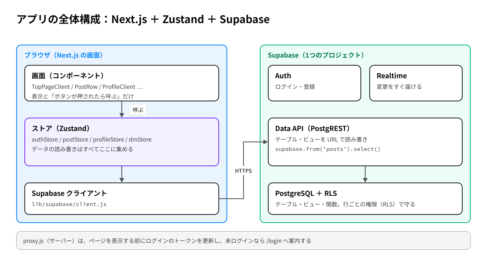

# 第10回 フォロー（follows）

> 開始タグ：`lesson09-step3` → 到達タグ：`lesson10-step2`

## この回のゴール

- 「たくさんの人が、たくさんの人をフォローする」関係（**多対多**）を、つなぐ表で表せる
- 件数だけを数える問い合わせ（`count: 'exact', head: true`）を使える
- 最後のモック（フォロー）を本物にし、**ダミーデータを削除** する

## 講義

### 1. 多対多は「つなぐ表」で

```text
follows
| follower_id（する人） | followee_id（される人） |
|-----------------------|-------------------------|
| 安堂                  | 佐藤                    |
| 安堂                  | 田中                    |
| 佐藤                  | 安堂                    |
```

| 知りたいこと | 問い合わせ |
|---|---|
| 安堂がフォローしている人 | `follower_id = 安堂` の `followee_id` |
| 安堂のフォロワーの数 | `followee_id = 安堂` の行数 |

- 主キー `(follower_id, followee_id)`：同じ人を2回フォローできない
- `check (follower_id <> followee_id)`：自分自身はフォローできない

### 2. 件数だけ数える

```js
supabase.from('follows').select('*', { count: 'exact', head: true }).eq('followee_id', uid);
// → { count: 3 }（行の中身は受け取らない）
```

---

## Step 1：follows テーブルと RLS の SQL

`supabase/migrations/0006_follows.sql` を作り、SQL Editor で実行します。

#### 📄 `supabase/migrations/0006_follows.sql`（新規）

```sql
-- =====================================================================
-- 0006_follows.sql（第10回）フォロー
--
-- follows テーブル：1行 ＝「follower（フォローする人）が followee（される人）をフォローしている」
-- 多対多（たくさんの人が、たくさんの人をフォローする）は、このように「つなぐ表」で表す。
-- =====================================================================
create table public.follows (
  follower_id uuid not null default auth.uid() references public.profiles (id) on delete cascade,
  followee_id uuid not null references public.profiles (id) on delete cascade,
  created_at  timestamptz not null default now(),
  primary key (follower_id, followee_id),        -- 同じ人を2回フォローできない
  constraint no_self_follow check (follower_id <> followee_id)  -- 自分はフォローできない
);

-- 「この人のフォロワー」を数えるときに使う索引
create index follows_followee_idx on public.follows (followee_id);

alter table public.follows enable row level security;

create policy "ログイン済みなら読める"
  on public.follows for select to authenticated
  using (true);

create policy "自分のフォローだけ追加できる"
  on public.follows for insert to authenticated
  with check (follower_id = (select auth.uid()));

create policy "自分のフォローだけ解除できる"
  on public.follows for delete to authenticated
  using (follower_id = (select auth.uid()));

grant select, insert, delete on public.follows to authenticated;
```


✅ **動作確認**（SQL Editor）

```sql
-- 自分で自分をフォロー → no_self_follow の制約違反エラーになる
insert into public.follows (follower_id, followee_id)
select id, id from public.profiles limit 1;
```

💾 **コミット**

```bash
git add -A
git commit -m "[第10回 Step1] followsテーブルとRLSのSQLを追加"
```

---

## Step 2：フォローを Supabase に切り替え、ダミーデータを削除する

- `stores/profileStore.js`
  - `fetchMyFollowing`：自分がフォローしている人の id 一覧
  - `fetchFollowCounts`：フォロー数・フォロワー数を `head: true` で数える（2つを `Promise.all` で同時に）
  - `follow`：`followee_id` だけ insert（`follower_id` は既定値の `auth.uid()`）。連打による重複（`23505`）は無視
  - `unfollow`：自分の行を delete
- `lib/dummyData.js`：**削除**。これでアプリのデータはすべて Supabase から来る
- `components/FollowButton.jsx`：失敗したらメッセージを出す

#### ✏️ `components/FollowButton.jsx`（変更）

`+` の行を追加し、`-` の行を削除します。

```diff
@@ -15,6 +15,8 @@ export const FollowButton = ({ isFollowing, onFollow, onUnfollow }) => {
     setBusy(true);
     try {
       await (isFollowing ? onUnfollow() : onFollow());
+    } catch (error) {
+      window.alert(error.message);
     } finally {
       setBusy(false);
     }
```

#### 🗑 `lib/dummyData.js`（削除）

このファイルは使わなくなったので削除します。

#### ✏️ `stores/profileStore.js`（変更）

`+` の行を追加し、`-` の行を削除します。

```diff
@@ -1,14 +1,13 @@
 /**
  * プロフィールとフォローのストア（stores/profileStore.js）
  *
- * 第4回：プロフィール（fetchProfile / updateProfile）を Supabase の profiles テーブルに切り替えた。
- * フォロー（follow / unfollow …）は、まだメモリ上のニセのデータベース。第10回で切り替える。
+ * 第4回 ：プロフィール（fetchProfile / updateProfile）を profiles テーブルに切り替えた。
+ * 第10回：フォロー（follow / unfollow …）を follows テーブルに切り替えた。
  *
  * profile の形：{ uid, displayName, photoURL, bio, location, bannerURL }
  */
 import { create } from 'zustand';
 import { createClient } from '@/lib/supabase/client';
-import { dummyFollows } from '@/lib/dummyData';
 
 const supabase = createClient();
 
@@ -25,9 +24,6 @@ export const toProfile = (row) =>
       }
     : null;
 
-// フォローは第10回まで、メモリ上のニセのデータベースのまま
-const mockDb = { follows: [...dummyFollows] };
-
 const useProfileStore = create((set, get) => ({
   // --- State ---
   profiles: {}, // { [uid]: profile } 一度読んだプロフィールを覚えておく（null は「見つからない」）
@@ -43,14 +39,19 @@ const useProfileStore = create((set, get) => ({
     set({ profiles: { ...get().profiles, [uid]: profile } });
     return profile;
   },
+  // 自分がフォローしている人の uid 一覧
   fetchMyFollowing: async (myUid) => {
-    set({ followingIds: mockDb.follows.filter((f) => f.followerId === myUid).map((f) => f.followeeId) });
+    const { data, error } = await supabase.from('follows').select('followee_id').eq('follower_id', myUid);
+    if (error) console.error('fetchMyFollowing', error.message);
+    set({ followingIds: (data ?? []).map((row) => row.followee_id) });
   },
+  // フォロー数・フォロワー数
+  //   { count: 'exact', head: true } … 行の中身は受け取らず、件数だけ数えてもらう
   fetchFollowCounts: async (uid) => {
-    const counts = {
-      following: mockDb.follows.filter((f) => f.followerId === uid).length,
-      followers: mockDb.follows.filter((f) => f.followeeId === uid).length,
-    };
+    const countBy = (column) =>
+      supabase.from('follows').select('*', { count: 'exact', head: true }).eq(column, uid);
+    const [following, followers] = await Promise.all([countBy('follower_id'), countBy('followee_id')]);
+    const counts = { following: following.count ?? 0, followers: followers.count ?? 0 };
     set({ followCounts: { ...get().followCounts, [uid]: counts } });
   },
 
@@ -71,13 +72,19 @@ const useProfileStore = create((set, get) => ({
     if (error) throw new Error(`プロフィールの更新に失敗しました：${error.message}`);
     set({ profiles: { ...get().profiles, [uid]: toProfile(row) } });
   },
+  // フォローする（follower_id は DB の default auth.uid() が入る）
   follow: async (myUid, targetUid) => {
-    if (myUid === targetUid) return;
-    mockDb.follows.push({ followerId: myUid, followeeId: targetUid });
+    if (myUid === targetUid) return; // DB の check 制約でも拒否されるが、送る前に止める
+    const { error } = await supabase.from('follows').insert({ followee_id: targetUid });
+    if (error && error.code !== '23505') throw new Error(`フォローに失敗しました：${error.message}`);
     await Promise.all([get().fetchMyFollowing(myUid), get().fetchFollowCounts(targetUid)]);
   },
   unfollow: async (myUid, targetUid) => {
-    mockDb.follows = mockDb.follows.filter((f) => !(f.followerId === myUid && f.followeeId === targetUid));
+    const { error } = await supabase
+      .from('follows')
+      .delete()
+      .match({ follower_id: myUid, followee_id: targetUid });
+    if (error) throw new Error(`フォロー解除に失敗しました：${error.message}`);
     await Promise.all([get().fetchMyFollowing(myUid), get().fetchFollowCounts(targetUid)]);
   },
 }));
```


✅ **動作確認**

| # | 操作 | 期待する結果 |
|---|---|---|
| 1 | 他人のプロフィールで「フォロー」 | 「フォロー中」になり、相手のフォロワー数が増える |
| 2 | トップの「フォロー中」タブ | 自分とフォローした人の投稿だけになる |
| 3 | 再読み込み | フォローが残っている |
| 4 | 「フォロー中」にマウスを乗せて押す | 解除され、数が減る |
| 5 | `grep -r dummyData .`（`node_modules` を除く） | どこからも使われていない |

```bash
grep -rn "dummyData" app components stores lib
```

💾 **コミット**

```bash
git add -A
git commit -m "[第10回 Step2] フォローを Supabase に切り替え、ダミーデータを削除する"
```

---

## ここまでで SNS の基本機能が完成



第3回で決めたストアの関数を、第4〜10回で1つずつ本物にしました。**画面のファイル（`components/`）には `supabase` という言葉が1つも出てきません。** データの取り方を知っているのはストアだけです。確かめてみましょう。

```bash
grep -rn "supabase" components   # 何も出ない
git diff --stat lesson03-step3 lesson10-step2 -- components   # 画面側の変更はエラー表示・購読などの追加が中心
```

## 確認クイズ

1. フォロー関係を `profiles` の列（例：`following_ids` の配列）で持たないのはなぜ？ → 「フォロワー」を探すのが難しく、同時に更新すると壊れやすいから。つなぐ表なら両方向を同じように数えられる
2. `head: true` を付けると何が嬉しい？ → 行の中身を受け取らないので、通信量が少ない

## よくあるつまずき

| 症状 | 原因 | 対処 |
|---|---|---|
| フォロー数が `null` | `count` オプションの付け忘れ | `{ count: 'exact', head: true }` |
| 「フォロー中」タブが空 | `followingIds` を読み込んでいない | `fetchMyFollowing` が呼ばれているか確認 |
| `Module not found: '@/lib/dummyData'` | 削除したファイルを読んでいる部品が残っている | 上の `grep` で探して、ストアから読むように直す |
