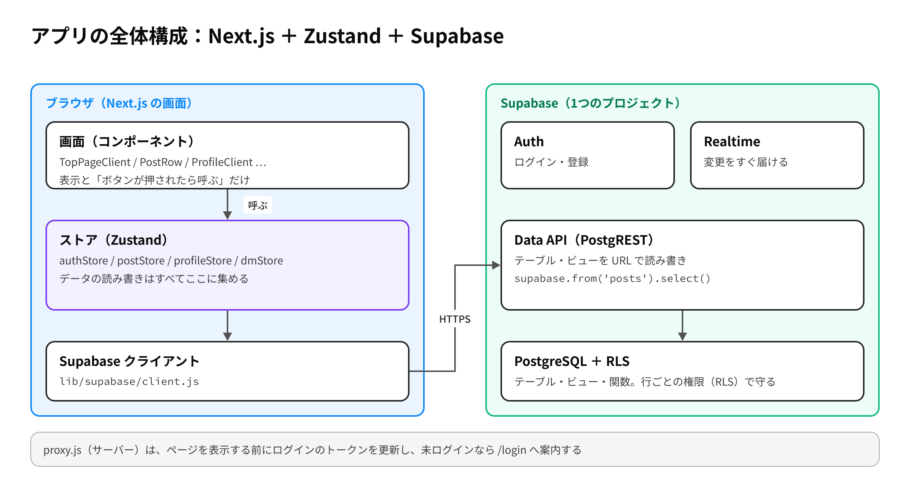
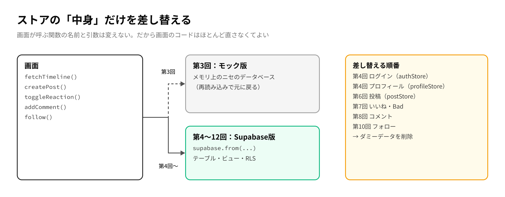
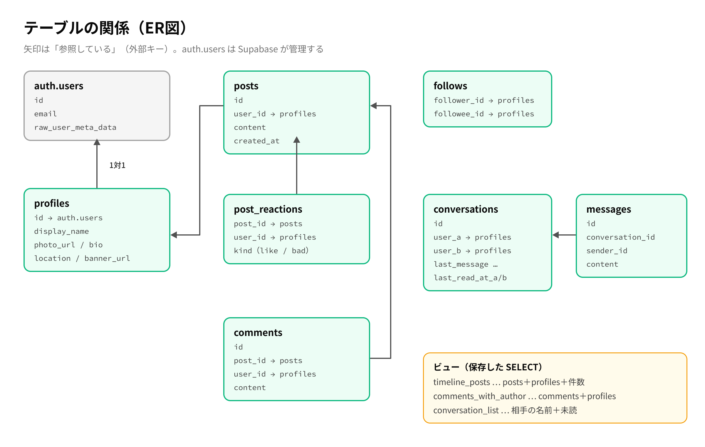

# my-sns-app（Supabase版）ハンズオン講義 手順書

Next.js 16 ＋ Supabase で、X（旧Twitter）風の SNS を **ゼロから** 作る全12回＋準備回の手順書です。
教材の種別：**教育コンテンツ**（初学者向け。わかりやすさを優先し、本番運用で必要になる一部の対策は「発展」として紹介にとどめます）



## この講座の進め方

1. **第0〜2回：見た目を作る（プロトタイプ）**
   Next.js と shadcn/ui で、Figma のデザインカンプどおりの画面を **ダミーデータ** で作ります。データベースはまだ使いません。
2. **第3回：画面と「データの係」を分ける**
   Zustand のストアを作り、画面はストアの関数（`createPost()` など）だけを呼ぶ形にします。ストアの中身はまだニセモノ（モック）です。
3. **第4〜12回：ストアの中身を Supabase に差し替える**
   認証 → プロフィール → 投稿 → いいね → コメント → リアルタイム → フォロー → DM の順に、1つずつ本物にしていきます。**画面のコードはほとんど変わりません。**



## 目次

| 回 | 内容 | 手順書 | 到達タグ |
|---|---|---|---|
| 第0回 | 開発環境・プロジェクト作成・shadcn/ui | [00_開発環境とプロジェクト作成.md](00_開発環境とプロジェクト作成.md) | `lesson00-step2` |
| 第1回 | タイムライン画面（ダミーデータ） | [01_タイムライン画面を作る.md](01_タイムライン画面を作る.md) | `lesson01-step3` |
| 第2回 | 投稿詳細・プロフィール・ログイン画面 | [02_投稿詳細とプロフィールとログイン画面.md](02_投稿詳細とプロフィールとログイン画面.md) | `lesson02-step3` |
| 第3回 | Zustand でストアを作る（モック） | [03_Zustandでデータの係を作る.md](03_Zustandでデータの係を作る.md) | `lesson03-step3` |
| 事前課題 | Supabase と Google Cloud の準備 | [04-0_事前課題_SupabaseとGoogleの準備.md](04-0_事前課題_SupabaseとGoogleの準備.md) | （コードなし） |
| 第4回 | 認証①：メール＋パスワード、profiles | [04_認証1_メールとパスワード.md](04_認証1_メールとパスワード.md) | `lesson04-step4` |
| 第5回 | 認証②：Googleログイン | [05_認証2_Googleログイン.md](05_認証2_Googleログイン.md) | `lesson05-step2` |
| 第6回 | 投稿（posts）と無限スクロール | [06_投稿をデータベースに保存する.md](06_投稿をデータベースに保存する.md) | `lesson06-step3` |
| 第7回 | いいね・Bad（post_reactions） | [07_いいねとBad.md](07_いいねとBad.md) | `lesson07-step2` |
| 第8回 | コメント（comments） | [08_コメント.md](08_コメント.md) | `lesson08-step2` |
| 第9回 | リアルタイム更新（Realtime） | [09_リアルタイム更新.md](09_リアルタイム更新.md) | `lesson09-step3` |
| 第10回 | フォロー（follows） | [10_フォロー.md](10_フォロー.md) | `lesson10-step2` |
| 第11回 | ダイレクトメッセージ（DM） | [11_ダイレクトメッセージ.md](11_ダイレクトメッセージ.md) | `lesson11-step2` |
| 第12回 | DM のリアルタイム・既読・未読バッジ | [12_DMのリアルタイムと未読バッジ.md](12_DMのリアルタイムと未読バッジ.md) | `lesson12-step3` |
| 付録 | 認証方式の選定（Supabase Auth と Clerk） | [付録_認証方式の選定.md](付録_認証方式の選定.md) | ― |

## コミットとタグのルール

- 手順書の **Step 1つ ＝ コミット1つ** です。各 Step の最後に「💾 コミット」の欄があります
- このリポジトリでは、各コミットに `lesson回-stepN` の **タグ** を付けています（例：`lesson06-step2`）
- **どのタグを取り出しても `npm run build` と `npm run lint` が通る** ことを確認しています（下の「検証状況」）
- 各 Step のコードは、そのコミットの差分から自動で手順書に貼り込んでいます。手順書とタグのコードは一致します

> 💡 タグが見つからない（`git tag` が空）ときは、リポジトリの直下で `bash scripts/tag-lessons.sh` を実行すると、コミットメッセージ「[第N回 StepM]」からタグを付け直せます。

### 自分で作りながら「答え合わせ」をする

自分のプロジェクトにこのリポジトリを「answer」という名前で登録しておくと、任意の Step と見比べられます。

```bash
# 最初に1回だけ
git remote add answer https://github.com/kjandy/my-sns-app-supabase.git
git fetch answer --tags

# 自分のコードと、第6回 Step2 の完成形の違いを見る
git diff lesson06-step2 -- . ':(exclude)package-lock.json'

# 特定のファイルだけ、完成形で上書きする（遅れたときの救済）
git checkout lesson06-step2 -- stores/postStore.js
```

### 完成形の途中から始める・動かして確かめる

```bash
git clone https://github.com/kjandy/my-sns-app-supabase.git
cd my-sns-app-supabase
git switch --detach lesson03-step3   # 第3回の完成時点にする
npm install
npm run dev
```

> ⚠ 第4回以降のタグを動かすには `.env.local`（Supabase の URL とキー）と、そのタグまでの SQL（`supabase/migrations/`）を自分の Supabase プロジェクトで実行しておく必要があります。

## 使うもの（バージョン）

| 名前 | バージョン | 役割 |
|---|---|---|
| Next.js | 16.4.6（App Router） | 画面とサーバー |
| React | 19.3.0 | UI |
| Tailwind CSS | 4.3.3 | スタイル |
| shadcn/ui（radix-nova） | ― | ボタンやダイアログなどの部品 |
| Zustand | 5.x | 画面とデータの橋渡し（ストア） |
| @supabase/supabase-js | 2.119.x | Supabase を呼ぶ |
| @supabase/ssr | 0.12.x | Next.js で Cookie を使ってログイン状態を共有する |
| 言語 | JavaScript（TypeScript は使わない） | |

## データベースの全体像



## デザインカンプ（Figma）

- ファイル：<https://www.figma.com/design/Zvl8sFgOt5bEd4fro4Mmo7>
- ページ構成：Foundations（色・文字・部品）／Desktop（D1〜D7）／Mobile（M1〜M4）／Figures（手順書の図版）

## 検証状況（凡例：【確認済】【推測】【未確認】）

| 項目 | 状況 |
|---|---|
| 全34コミット（＋手順書のコミット）を1つずつ取り出して `next build` と `eslint` が通る | 【確認済】※ `lesson00-step1`（create-next-app の雛形そのもの）だけは、雛形が Google Fonts をダウンロードするため、外部に接続できない検証環境ではビルドできなかった。インターネットにつながるパソコンでは通る【推測】。`lesson00-step2` で Google Fonts の読み込みをやめている |
| 第0〜3回の各画面が `next start` で表示される | 【確認済】 |
| SQL（`supabase/migrations/0001〜0008`）を順に実行でき、RLS が意図どおり働く（他人の行を更新できない、DM の部外者は読めない等） | 【確認済】※ローカルの PostgreSQL に Supabase の `auth` スキーマ相当を用意して検証 |
| 実際の Supabase プロジェクトでのログイン・Googleログイン・Realtime の動作 | 【未確認】作成環境から Supabase に接続できなかったため。授業前に講師が通しで確認すること |
| ダッシュボードのボタン名・メニュー名 | 【推測】サービス側の更新で変わることがある |
