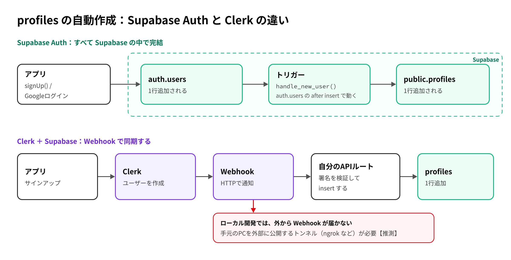

# 認証方式の選定：Supabase Auth と Clerk の比較（講師用）

> 位置づけ：**教育コンテンツ**（初学者向けハンズオン、1コマ90分）
> 要件：**メール＋パスワード認証** と **Google認証** の併用
> 作成日：2026-11-25

凡例：【確認済】=公式ドキュメントで確認した事実／【推測】=見立て／【未確認】=要検証

---

## 結論：Supabase Auth を採用する

この講座の中心は「`firestore.rules` を **RLS** に置き換えること」です。
RLSは「今リクエストしてきたのは誰か」をもとに行を絞る仕組みなので、**認証とデータベースが同じサービスにある方が、初学者にとって圧倒的に見通しがよい**、というのが最大の理由です。

Clerk には「Googleログインの設定がほぼ不要」という大きな利点がありますが、それと引き換えに、サービスが1つ増え、RLS・profiles作成・外部キーの書き方がすべて“Clerk用の特別な書き方”になります。

---

## 比較表

| 観点 | Supabase Auth | Clerk ＋ Supabase |
|---|---|---|
| 使うサービス | Supabase だけ | Clerk と Supabase の2つ。Supabase側に「Third-Party Auth」として Clerk を登録する【確認済】 |
| RLSでの本人判定 | `auth.uid()`（uuid型） | `auth.jwt()->>'sub'`（text型、`user_2s2X…` 形式のID）【確認済】 |
| `user_id` 列の型 | `uuid references auth.users(id)` | `text`。`auth.users` にはユーザーがいないので外部キーを張れない【推測】 |
| profiles の自動作成 | `auth.users` への登録トリガー（講義資料3-2がそのまま使える） | Clerkの連携はユーザー情報を同期しない。DBへ送るには **Webhook** が必要【確認済】 |
| ↑のローカル開発 | 追加作業なし | Webhookを受けるには、手元のPCを外部に公開するトンネル（ngrok等）が必要になる【推測】 |
| Googleの設定（開発時） | Google Cloud でクライアントを作り、Supabaseに登録する（受講者ごとに30〜45分の見込み）【推測】 | **開発インスタンスでは共有の認証情報が用意され、追加設定なし**【確認済】 |
| Googleの設定（本番） | 同上 | 自前の認証情報が必要（結局 Google Cloud の設定が要る）【確認済】 |
| ログイン画面 | 自作（第2回で作った `LoginClient.jsx` にそのままつなげる） | `<SignIn />` などの完成部品がある。速いが中身が見えない |
| サーバー側の判定 | `@supabase/ssr` ＋ `proxy.js` ＋ `getClaims()` | `clerkMiddleware()` ＋ `auth()` |
| 第3回のストア設計との連続性 | `authStore` の形（user / loading / signIn …）を保てる | `ClerkProvider` とClerkのフックに置き換わり、Zustandの `authStore` の出番がほぼ無くなる【推測】 |
| 無料枠 | 授業規模なら無料枠に収まる見込み【推測】 | Hobbyプランは 50,000 MRU（月間“継続”ユーザー）まで無料【確認済：2026-02-05 改定】 |

---

## 判断の理由（授業で受講者に説明するときの要点）

### 1. RLSの1行が、そのまま教材になる
```sql
-- Supabase Auth
using (user_id = (select auth.uid()))

-- Clerk の場合
using (user_id = (select auth.jwt()->>'sub'))
```
Clerk版も1行ですが、「JWTとは何か」「subとは何か」「なぜtext型なのか」を先に教える必要があります。Supabase Auth なら `auth.uid()` ＝「ログイン中の人のID」と一言で説明できます。

### 2. profiles の自動作成がDBの中で完結する

初学者にとって「Webhookの受け口を作り、署名を検証し、ローカルを外部公開する」は、それだけで1コマかかる内容です【推測】。

### 3. 「Googleの設定が大変」は事前課題で吸収できる
Clerkの最大の利点はここですが、
- 本番公開時には結局 Google Cloud の設定が必要【確認済】
- 「リダイレクトURLが2段階ある」ことはOAuthの基本で、教える価値がある

ため、**スクリーンショット付きのチェックリストを事前課題にして吸収する**方針にします（`01_事前課題チェックリスト.md`）。

---

## Clerk の方が向いているケース（記録）
- 受託案件で、ログイン画面・プロフィール管理画面・多要素認証などを短期間で用意したいとき
- 組織（チーム）単位の権限管理が必要なとき
- 認証基盤を特定のDBに縛りたくないとき

→ 講座の最終回か発展課題で「認証サービスの選び方」として触れる価値はあります。

---

## 授業運営上の注意（Supabase Auth を選んだことで生じるもの）

### 標準のメール送信には強い制限がある【確認済】
- 独自のSMTPを設定していないプロジェクトでは、**プロジェクトのチーム（Organizationのメンバー）以外のアドレスにはメールが送られない**（エラー `Email address not authorized`）
- 送信数の上限も小さい（公式の例では1時間あたり2通）

→ 授業では **「Confirm email」をOFF** にして、登録したらすぐログインできる状態で進めます。
受講者が自分のプロジェクトで自分のアドレスに確認メールを送る体験は可能なので、メール確認は「解説＋任意の体験」に留めます。

### 同じメールアドレスでの「メール登録」と「Googleログイン」
- 同じメールアドレスのアカウントは、自動的に1人のユーザーにまとめられる（Identity Linking）【確認済】
- メール未確認の状態でGoogleログインした場合の扱い【未確認】→ 第5回の「やってみよう」で実際に確認し、結果を資料に追記する

---

## 参考
- Supabase：Setting up Server-Side Auth for Next.js — https://supabase.com/docs/guides/auth/server-side/nextjs
- Supabase：Login with Google — https://supabase.com/docs/guides/auth/social-sign-in/auth-google
- Supabase：Password-based Auth — https://supabase.com/docs/guides/auth/passwords
- Supabase：Custom SMTP — https://supabase.com/docs/guides/auth/auth-smtp
- Supabase：Identity Linking — https://supabase.com/docs/guides/auth/auth-identity-linking
- Supabase：Clerk third-party auth — https://supabase.com/docs/guides/auth/third-party/clerk
- Clerk：Integrate Supabase with Clerk — https://clerk.com/docs/guides/development/integrations/databases/supabase
- Clerk：Add Google as a social connection — https://clerk.com/docs/guides/configure/auth-strategies/social-connections/google
- Clerk：New plans (2026-02-05) — https://clerk.com/changelog/2026-02-05-new-plans-more-value
